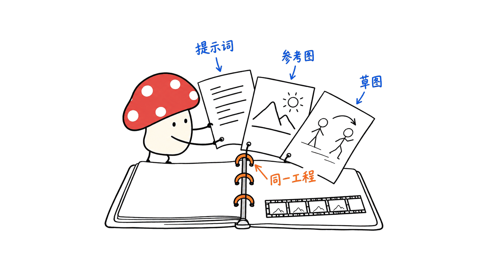

Valtz 是一款把 AI 生成、素材管理和画面编排放进同一个工程的原生 Mac 应用。它由 Vpipe 提供执行引擎，界面与工程层采用 MPL 2.0 开源；我们核对的实际仓库是 `tgo-app-dev/valtz`，对应你提供的“vpipe/valtz”。它值得关注的地方，是生成之后还保留素材版本、输入关系和时间线，方便继续修改。

我们在 M4、16GB 内存、macOS 26.6.2 上编译了无 Vpipe 引擎的核心与 CLI，完成创建项目、导入图片和重开读取；上游测试有一项失败。**这次没有下载生成模型，也没有运行完整 SwiftUI 应用或验证视频生成速度。** 封面裁切自作者公开的生成预览，属于作者演示，不是本机成果。

官方仓库：https://github.com/tgo-app-dev/valtz

固定源码：`cc02e25140571a18fad103f9cd6cf0190c5e97c1`；核验日期：2026 年 10 月 16 日。

## Valtz 和 Vpipe 分别做什么？

把它们想成创作台与执行机器，会比“又一个模型”更准确。

| 层次 | 负责什么 | 本次核验范围 |
| --- | --- | --- |
| Valtz SwiftUI 界面与桥接层 | 显示预览、编辑文档、与核心通信 | 读源码与官方演示，未构建或启动 GUI |
| Valtz C++20 核心 | 项目、素材、配方、任务、媒体与助手编排 | 本机构建、测试和 CLI 操作 |
| Vpipe 执行引擎 | 加载模型、运行推理与生成任务 | 本次未链接、未运行 |
| 模型权重 | 决定具体生成或理解能力 | 不随应用源码附带，本次未下载 |

Vpipe 自己还有 Pipeline Manager、Web UI 和可保存的计算图；Valtz 则把操作组织为创作工程、素材和合成文档。界面变原生，不代表换了一个更强的基础模型，也不能把 Vpipe 某条工作流的速度直接当成 Valtz 在所有机器上的性能。

我们此前介绍过 Vpipe 的原生推理与音视频管线：
https://blog.mushroom.cv/blog/vpipe-minimax-h3-apple-silicon-video-audio-local-metal-cpp-pipeline/

## 作者演示的三条创作路径

第一条是视频：写提示词、让助手按模型格式增强、生成预览，再从片尾 2—5 秒继续生成，把续段放到时间线上。官方示例包含 MiniMax H3 场景与声音描述。演示呈现了创作路径，但接缝是否自然、角色是否稳定，还得看具体输入和模型，不能把功能入口理解成每次都无缝。

第二条是先画后生成：用涂画层放置人物、给草图加时间上的运动，再把计划作为提示词的参考输入。它试图把“人物站哪里、什么时候相遇”从一句含糊的文字，变成可编辑的视觉约束。草图是指导信号，不是严格保证每一帧都满足布局的约束求解器。

第三条是助手做文档：让 Agent 制作四季主题的四页内容，逐步调用编辑器工具生成图片、放置元素，并查看页面。这里的“Agent”操作的是 Valtz 暴露的编辑器工具，不能据此说它能接管整个 macOS 桌面。



## 为什么素材关系比多一个生成按钮更重要？

源码把文本、图片、音视频、遮罩乃至派生数据统一建模为 Asset，但不是只给文件套个文件夹。

Asset 代表逻辑上的素材，比如“角色参考图”；AssetVersion 保存某次不可变的产物；Recipe 记录产生它的操作、模型、参数与输入。生成版本还保留执行时的输入内容哈希、具体配方、引擎构建和执行主机等信息。输入可以跟随素材当前版本，也可以固定在某个旧版本。

这解决一个实际问题：如果参考图换了，哪些后续结果还是基于旧图做的？Valtz 按内容与配方判断派生结果是否过期，而不是只看修改时间。你能保留旧结果，也能知道它与当前输入的关系。

我的判断是，这种结构比“输出图片并保存 prompt.txt”更适合反复迭代。它让生成内容接近一个有依赖的工程。不过，保留 seed、参数和引擎版本只是提供复查线索，不保证换一台机器、换一个内核后还能逐像素复现，更不代表参考图更新后会免费、自动重算全部后续内容。


相关源码：
https://github.com/tgo-app-dev/valtz/blob/cc02e25140571a18fad103f9cd6cf0190c5e97c1/core/include/valtz/project/records.h

## 保存的工程是什么：LMDB 还是文件包？

这里容易读错。LMDB 用于活动工作副本，而当前保存格式是 `.valtz` 文件包：里面有 `project.cbor` 和按内容寻址的 `blobs/` 媒体目录。应用在工作副本里编辑，保存时写回工程文件；源码还包含未保存工作副本的恢复逻辑。

因此，不能把“用 LMDB”简单翻译成“视频全塞进数据库”。也不能默认所有工程都能随手复制到另一台机器：以链接方式导入的外部素材仍依赖原文件。要交接工程，应先检查是否保留了外部链接，以及模型、扩展和相关许可是否可在目标机器使用。

这部分判断来自当前文件格式与工作副本代码，不是仅根据旧注释里的版本号推断：
https://github.com/tgo-app-dev/valtz/blob/cc02e25140571a18fad103f9cd6cf0190c5e97c1/core/include/valtz/project/project-file.h
https://github.com/tgo-app-dev/valtz/blob/cc02e25140571a18fad103f9cd6cf0190c5e97c1/core/include/valtz/project/workspace.h

## 本地助手、局域网和云端：任务到底在哪里跑？

Agent 接口支持三种后端：本机 Vpipe 助手、Fleet 中另一台 Mac 的助手，以及 Anthropic Messages 或 OpenAI Chat Completions 兼容服务。启用审阅时，非只读工具操作会进入逐步审阅；也有允许后续连续执行的路径。不能把官方“每步等待运行”的一张截图说成系统永远只有手动模式。

Fleet 的代码描述的是把完整任务交给有能力且空闲的成员，按内容哈希交换缺失输入，任务完成后返回输出。它不是把两台 Mac 的统一内存透明拼成一台超大显存设备。这次测试涉及相关协议和替身逻辑，不是我们真的用两台 Mac 跑了一次远程生成。

对本地创作用户，最需要确认的是每个任务实际走哪个后端。选择云端助手后，对话及所需输入可能发给服务方；“应用能本地运行”不等于每个配置都不联网。


Agent 与 Fleet 定义：
https://github.com/tgo-app-dev/valtz/blob/cc02e25140571a18fad103f9cd6cf0190c5e97c1/core/include/valtz/agent/agent.h
https://github.com/tgo-app-dev/valtz/blob/cc02e25140571a18fad103f9cd6cf0190c5e97c1/core/include/valtz/fleet/fleet.h

## 怎么安装，什么机器能跑？

截至核验日，最新 Release 为 `v0.1.0.10`，发布于 10 月 15 日，提供 `Valtz-0.1.0.10-with-ffmpeg.dmg`，约 47.4MB。这个体积是安装包，绝不是所有模型的下载体积或内存占用。

下载入口：https://github.com/tgo-app-dev/valtz/releases/tag/v0.1.0.10

硬件平台是 Apple Silicon。README 概括写 macOS 26+，但该 Release 注明 26.2+，CMake 默认部署目标也为 26.2；按更具体的 **macOS 26.2+** 准备。作者在 Vpipe 介绍里展示的部分 16GB 工作流，不是“所有 Valtz 模型都能在 16GB 满速运行”的保证。先看具体模型、权重精度、流式加载、分辨率、帧数与额外模型占用。

从源码构建完整应用，需要 Swift 6 工具链、CMake 3.29+、Ninja、LMDB 子模块及已安装的 Vpipe。README 的 dev preset 默认使用 `~/dump/` 下的目录；下面是同一逻辑的概括步骤，Vpipe 本身的前置依赖仍要先满足：

```bash
git clone https://github.com/tgo-app-dev/valtz.git
cd valtz
git submodule update --init
# 先构建并安装 Vpipe 到自己的前缀目录
cmake --preset dev -DVALTZ_VPIPE_PREFIX=/path/to/vpipe-install
cmake --build --preset dev
```

只想研究工程存储与核心层，可关闭引擎和 GUI，避免把“缺 Vpipe”误当成项目无法研究：

```bash
cmake -S . -B build-core -G Ninja   -DVALTZ_WITH_VPIPE=OFF -DVALTZ_BUILD_APP=OFF
cmake --build build-core -j 4
./build-core/tests/valtz_test
```

注意：这个无引擎构建不能生成 AI 图片或视频。可选 Sparkle 负责应用更新；未带它的源码构建不会因此自动拥有更新功能。

## 我们本机究竟验证了什么？

在 M4 / 16GB / macOS 26.6.2 上，使用 AppleClang 21 编译器、临时 Python 环境提供的 CMake 与 Ninja，编译出 C++ 核心、`valtzctl` 和测试二进制，未修改上游源码。CLI 成功创建临时 `.valtz` 工程、复制导入原创 64×64 PNG，再重开读取，得到一个 v1 图片素材；文件包中可见 `project.cbor` 与媒体目录。

完整上游测试结果是：210 项运行，192 通过、1 失败、17 跳过。失败发生在 `controller.upscalers_run_as_settings_have_them`，两处断言检查 `i8_gemm` 设置；单独重跑该项仍失败。不能把它写成“测试全过”。源码把该选项可用性与硬件能力联系起来，但本次没有进一步判断是测试预期、能力过滤还是其他实现细节导致，也没有据此推断发行版一定存在同样问题。

跳过项包括需要真实模型、媒体或显式环境开关的检查；无 Vpipe 构建也没有纳入依赖真实引擎链接的测试文件。通过的替身、存储与协议测试，不等于完成端到端生成验收。本次未构建或启动 SwiftUI 应用、未下载模型、未运行付费云调用，也未测图像质量、视频接缝、生成速度或多 Mac 实际协作。

这让我们的结论比较具体：工程核心能够在这台机器上构建，基本素材保存路径跑通；完整创作体验与目标模型仍需独立验证。一个已复现的测试失败也值得后续跟踪。

## 许可证与成熟度要怎么看？

Valtz 主体是 MPL 2.0，Vpipe 为 Apache 2.0，不能给整套应用只贴一个 Apache 标签。NOTICE 说扩展 SDK 将另行以 Apache 2.0 发布，示例扩展已经采用该许可；“计划发布 SDK”与“已有稳定、完整的扩展生态”是两件事。

模型权重另由发布者提供并适用各自许可。项目自身排除了某些仅限非商业使用的组件，但用户主动下载这些模型时仍需面对对应条款。这里描述的是仓库分工，不是替所有模型作商业使用许可结论。

我的选型建议是：如果你关注 Mac 本地生成，而且生成之后还需要反复调整素材、布局和时间线，Valtz 值得研究。若需求只是运行一条已知模型管线，Vpipe 自身可能已足够；若要把现有专业剪辑工程完全迁入，仍应逐项验证所需导入、导出和编辑能力，不能仅凭几张演示截图判定替代完成。

## 常见问题

### 只下载约47MB安装包就能离线生成吗？

不能这样理解。应用、执行引擎与模型是不同部分，权重需要另外准备；完整离线能力还取决于选用的助手和工作流。

### 它会在本机自动生成一整部电影吗？

官方展示了生成、续写与编排的工作流，本次没有验证长片、持续角色一致性或无人值守整片制作。

### 我该把这篇当成性能评测吗？

这是源码、架构与有限本机验证的介绍。本文给出了失败和跳过项，不提供生成速度排行榜或模型效果对比。

---

> © 2026 Author: Mycelium Protocol. 本文采用 [CC BY 4.0](https://creativecommons.org/licenses/by/4.0/deed.zh) 授权——欢迎转载和引用，须注明作者姓名及原文链接，不得去除署名后以原创发布。

<!--EN-->

Valtz is a native Mac application that keeps AI generation, assets and composition in one project. Its execution engine is Vpipe; the application and project layer are MPL 2.0. The verified repository is `tgo-app-dev/valtz`, matching the supplied shorthand “vpipe/valtz”. Its interesting contribution is retaining versions, input dependencies and a timeline after generation.

On an M4 with 16GB RAM and macOS 26.6.2, we built the no-engine core and CLI, created a project, imported an original image and reopened it. One upstream test failed. **We did not download generation models, build or launch the SwiftUI app, or measure video generation.** The cover is cropped from the author's public generation preview, not our output.

Repository: https://github.com/tgo-app-dev/valtz

Pinned source: `cc02e25140571a18fad103f9cd6cf0190c5e97c1`. Review date: October 16, 2026.

## What does Valtz add to Vpipe?

| Layer | Responsibility | What we checked |
| --- | --- | --- |
| SwiftUI and bridge | Preview and document editing, communication with the core | Source and official examples; no GUI build or launch |
| C++20 core | Projects, assets, recipes, media, tasks and assistant orchestration | Local build, tests and CLI operations |
| Vpipe | Model loading and inference/generation execution | Not linked or run here |
| Model weights | Specific understanding and generation capabilities | Separate from source; not downloaded |

Vpipe also has its own Pipeline Manager, Web UI and reproducible graphs. Valtz presents a creative project, asset and composition interface over the engine. A native interface is not a new foundation model, and Vpipe's performance on one workflow is not a universal Valtz benchmark.

Our earlier Vpipe overview: https://blog.mushroom.cv/blog/vpipe-minimax-h3-apple-silicon-video-audio-local-metal-cpp-pipeline/

## Three workflows in the author's examples

The video example moves from a prompt to model-specific enhancement, generation preview and continuation using the final two to five seconds of a clip. Continuations can then be placed on a timeline. The MiniMax H3 example includes sound direction, but seamless transitions and consistent characters remain model- and input-dependent.

The visual-planning example uses markup figures and motion over time as references for generation. This makes spatial intent editable, without establishing a strict per-frame guarantee. The document example asks an agent to make four seasonal pages, generate illustrations, position elements and inspect the result. Those are exposed editor tools, not proof of general macOS desktop control.


## Why retain assets and recipes?

The source treats text, images, audiovisual material, masks and derived data as assets. An Asset identifies a logical item; an immutable AssetVersion records a particular output. A Recipe identifies its operation, model, parameters and inputs. Executed versions retain input content hashes, the materialized recipe, engine build and execution host. Inputs may follow an asset's head version or remain pinned.

This lets the application recognize when a derived result no longer matches its current recipe or inputs. Staleness follows content, not just timestamps. Our interpretation is that this is a more useful basis for iterative creation than an image plus a prompt text file. The records provide provenance; they do not guarantee pixel-identical regeneration across machines and kernels, or automatically recompute every downstream asset for free.


Records: https://github.com/tgo-app-dev/valtz/blob/cc02e25140571a18fad103f9cd6cf0190c5e97c1/core/include/valtz/project/records.h

## Is the project an LMDB database?

LMDB stores the active working copy. The current saved `.valtz` package contains `project.cbor` and content-addressed media under `blobs/`. Changes happen in the working copy and are written back on save, with recovery logic for unsaved state. This does not mean all video bytes live inside the database.

Linked source media can still depend on external files. Before transferring a project, check those links and the required models and extensions. File-format claims here follow the current declarations and implementation rather than an outdated version number in a comment.

Saved format: https://github.com/tgo-app-dev/valtz/blob/cc02e25140571a18fad103f9cd6cf0190c5e97c1/core/include/valtz/project/project-file.h

Working copy: https://github.com/tgo-app-dev/valtz/blob/cc02e25140571a18fad103f9cd6cf0190c5e97c1/core/include/valtz/project/workspace.h

## Where does the agent run?

The backend interface supports a local Vpipe helper, another Mac's Fleet helper, and cloud services using Anthropic Messages or OpenAI Chat Completions-compatible APIs. With review enabled, non-read tool calls wait for review; an approve-all path can permit continued execution. A screenshot of manual steps does not establish that manual review is the only mode.

Fleet dispatches complete jobs to capable available members and exchanges missing inputs by content hash, then returns outputs. It does not transparently combine several Macs' unified memory into one larger GPU allocation. Protocol and substitute-backed tests are not our own two-Mac generation deployment.

The practical question is the backend chosen for each task. Cloud helpers may receive conversation and required inputs; a locally runnable application does not make every configuration offline.


Agent: https://github.com/tgo-app-dev/valtz/blob/cc02e25140571a18fad103f9cd6cf0190c5e97c1/core/include/valtz/agent/agent.h

Fleet: https://github.com/tgo-app-dev/valtz/blob/cc02e25140571a18fad103f9cd6cf0190c5e97c1/core/include/valtz/fleet/fleet.h

## Installation and build requirements

The latest release at review time is `v0.1.0.10`, published October 15. Its `Valtz-0.1.0.10-with-ffmpeg.dmg` is about 47.4MB. This is installer size, not model download size or runtime memory.

Release: https://github.com/tgo-app-dev/valtz/releases/tag/v0.1.0.10

Apple Silicon is required. The README says macOS 26+, but both the release and default CMake deployment target specify 26.2, so plan for macOS 26.2+. Some Vpipe workflows demonstrated on 16GB machines do not establish universal 16GB support or speed for every Valtz model. Resolution, frames, precision, weight streaming and additional models matter.

A full source build needs Swift 6, CMake 3.29+, Ninja, the LMDB submodule and an installed Vpipe. The dev preset uses directories under `~/dump/`; point it to your own installed engine prefix:

```bash
git clone https://github.com/tgo-app-dev/valtz.git
cd valtz
git submodule update --init
# Build and install Vpipe and its prerequisites first.
cmake --preset dev -DVALTZ_VPIPE_PREFIX=/path/to/vpipe-install
cmake --build --preset dev
```

For core/store investigation without inference or GUI:

```bash
cmake -S . -B build-core -G Ninja   -DVALTZ_WITH_VPIPE=OFF -DVALTZ_BUILD_APP=OFF
cmake --build build-core -j 4
./build-core/tests/valtz_test
```

A no-engine build cannot perform AI generation. Sparkle auto-updates are optional; a build without Sparkle does not automatically acquire an update mechanism.

## What did our machine actually prove?

We compiled unmodified upstream C++ core, CLI and tests on an M4/16GB/macOS 26.6.2 using AppleClang 21 and temporary-environment CMake/Ninja. The CLI created a temporary project, copied in an original 64×64 PNG and reopened it as one v1 image asset. The saved package contained `project.cbor` and media storage.

The full upstream run reported 210 tests: 192 passed, one failed and 17 skipped. `controller.upscalers_run_as_settings_have_them` failed two assertions about `i8_gemm`; rerunning that test alone reproduced the failure. Availability is connected to hardware capabilities in the source, but we did not establish whether the cause is the test expectation, capability filtering or another implementation detail. We also did not establish the same behavior in the packaged release.

Skipped cases require real models, media or explicit environment switches. This no-Vpipe build also excludes engine-linked test files. Store, protocol and substitute-engine tests are not full inference acceptance tests. We did not build or launch SwiftUI, download models, make paid cloud calls, measure generation quality or speed, or test real multi-Mac collaboration.

The supported conclusion is narrow: the core builds on this machine and the basic project import/save path works. The generation experience still needs separate validation, and the reproduced test failure remains open.

## Licenses and maturity

Valtz is MPL 2.0; Vpipe is Apache 2.0. NOTICE says the Extension SDK will be published separately under Apache 2.0; example extensions already use it. A planned SDK is not evidence of an established stable ecosystem. Model weights remain separate, with publisher-specific terms; downloading an optional non-commercial component does not remove those terms.

Our recommendation is to investigate Valtz if local Mac generation must feed repeated asset, layout and timeline edits. For a known model pipeline, Vpipe itself may already meet the need. Replacing an existing professional editing workflow requires checking its actual import, export and editing requirements rather than assuming equivalence from screenshots.

## Frequently asked questions

### Is the roughly 47MB installer enough for offline generation?

No. Application, execution engine and model weights are separate. Offline behavior also depends on the chosen assistant and workflow.

### Does this automatically generate an entire film locally?

The official material demonstrates generation, continuation and composition. We have not verified long films, persistent character consistency or unattended production.

### Is this a performance benchmark?

No. This is an architecture and source review with limited local validation, including a failure and skips. It provides no generation-speed ranking or model-quality comparison.

---

> © 2026 Author: Mycelium Protocol. Licensed under [CC BY 4.0](https://creativecommons.org/licenses/by/4.0/) — free to share and adapt with attribution. You must credit the author and link to the original; removing attribution and republishing as original is not permitted.
