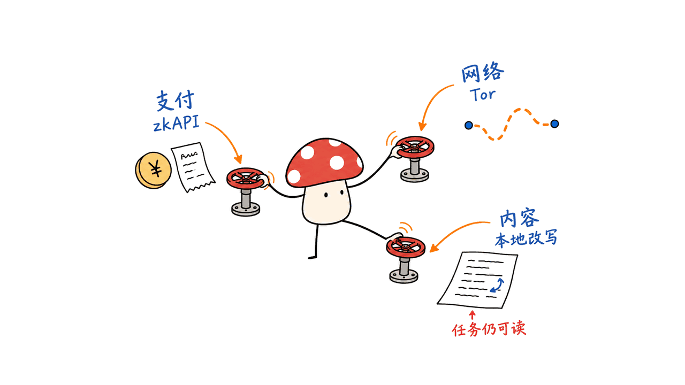
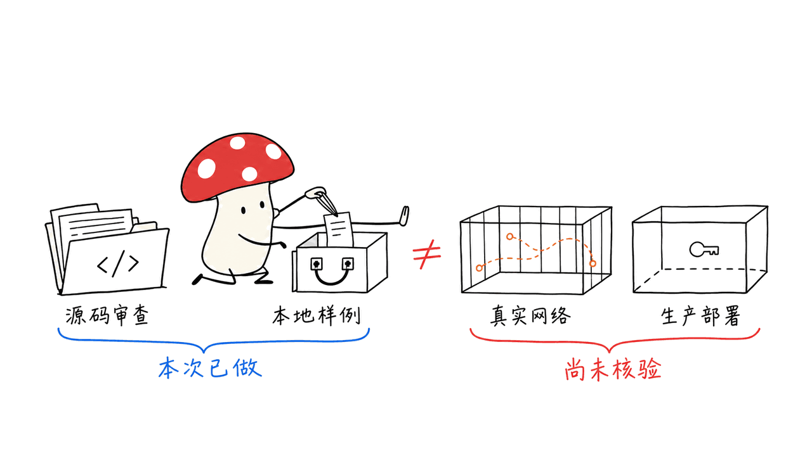

Vitalik 的“偏执模式”是一层放在 AI 客户端与远程模型之间的隐私代理：把付款凭证、网络来源和提示词表达分开处理，尽量减少不同对话被关联的机会。它不是新大模型，也不让远程模型看不到任务内容。截至 2026 年 10 月 22 日，我们找到的开发分支还明确写着生产部署与证明密钥未就绪，因此更适合研究和受控验证，不能照着旧安装器就当成完整可用的匿名钱包。

原帖发布于 2026 年 10 月 16 日，包含操作演示视频；未找到需要另行观看的独立 vlog。原帖直连抓取返回 403，我们通过公开嵌入核对文字、日期和状态地址，并实际解析其短链接，定位到 Vitalik 本人的代码分支，而非名称相似的项目。

原帖：https://x.com/VitalikButerin/status/2111046730959433793

代码分支：https://github.com/vbuterin/zkapi/tree/feat/client-concession-local

本次源码快照：`0fb263b0da04986cfe5c63b12340c1581018ae9b`。下面的配置和边界以这个版本为准，不能反推它们全部已经存在于 10 月 16 日的演示。

## Vitalik 到底开源了什么？

zkAPI 是 Open Anonymity 与 Ethereum Foundation 合作开发的支付协议。它用零知识证明，让服务端核验调用者有支付能力，同时尽量不把调用绑定到具体链上存款。`zkapi-clientd` 是跑在用户电脑上的守护进程，把这套支付机制接到本地 OpenAI-compatible API。

当前分支的客户端还整合了按对话隔离的 Tor 路由、提示词重构、独立的目标端历史，以及有上限的背景掩护流量。客户端目录中的 LICENSE 为 MIT；这不是对整个仓库及全部依赖作统一的许可证判断。

客户端入口：https://github.com/vbuterin/zkapi/blob/0fb263b0da04986cfe5c63b12340c1581018ae9b/zkapi-clientd/README.md

协议文档：https://zkapi.openanonymity.ai/

原帖中的 Agent harness 是 pi。这里的“OpenAI 兼容”指接口形状，不表示与 OpenAI 官方合作，也不表示支付协议自动支持任意模型供应商。该实现通过 zkAPI 获取短期 OpenRouter 凭证，再把推理请求交给目标服务。



## 为什么只开 Tor 或只用零知识支付还不够？

同一个人可以从多条线索被认出来。把 IP 隐藏以后，固定账号、银行卡或稳定 API key 仍能关联活动；换成私密支付，提示词里的公司名称、家庭住址或个人习惯仍可能暴露身份。

| 层次 | 这套方案尝试处理什么 | 没有因此消失的风险 |
| --- | --- | --- |
| zkAPI 支付 | 存款与 API 授权之间的直接绑定 | 链上金额、存取款地址与时间仍可见；协议仍属实验性 |
| Tor 路由 | 对端直接看到用户源 IP，以及不同对话的连接关联 | 时序、流量大小、合谋观察；不同隔离身份不保证不同出口 |
| 背景掩护流量 | 给真实请求之外增加随机网络活动 | 小 GET 与流式推理可能容易区分；不是恒定速率填充 |
| 本地提示词重构 | 减少无关个人措辞、口头习惯和表达风格 | 必要身份事实、代码、引用、附件；语义漂移 |
| Agent 沙箱 | 限制工具访问宿主资源的范围 | 不等于网络匿名，也不保证所有子进程都正确走代理 |

这也是我们对它的主要判断：价值在于把泄漏面拆开，并能逐层检查；不能把几个隐私组件相加，得到“完全匿名”的结论。远程推理服务仍能读取收到的任务文本，模型输出也没有因为 zkAPI 而变成零知识计算。

## “每段对话一条 Tor 线路”在源码里怎么落实？

客户端使用显式 `tor://` 模式，为对话分配随机 SOCKS 认证身份；Tor 的 SOCKS 监听端必须开启 `IsolateSOCKSAuth`。普通 `socks5://` 配置不等价于这项对话隔离功能。

对话识别依靠原始消息历史的摘要和前缀关系：符合延续条件的历史可继续使用隔离身份；不相关、编辑或交错的历史会保守地轮换，同时清掉可复用的供应商凭证。相同历史无法凭空分辨成两个人，这也不是多用户安全隔离机制。

这里要区分“分配不同 SOCKS 身份”和“证明生成不同物理线路”。客户端不能通过 SOCKS 检查 Tor 配置是否正确，更不能保证出口 IP 一定变化。Tor 可以自行替换线路，多个隔离身份也可能碰到相同出口。

同一会话内没有必要每条消息重新买一张凭证、重建一条线路。当前默认凭证复用窗口最多 60 秒，并受到期时间、预算和连续历史约束；不是永久保留，也不是所有聊天都能共用。服务商能关联使用同一凭证的请求。

隐私边界：https://github.com/vbuterin/zkapi/blob/0fb263b0da04986cfe5c63b12340c1581018ae9b/zkapi-clientd/docs/PRIVACY.md

## 本地模型改写，究竟改了什么？

“所有提示词都被匿名化”容易让读者高估覆盖范围。当前实现重点处理 `user` 消息里的文本部分，保存独立的目标端历史，避免后续重发历史时把未经处理的旧用户文本夹带出去。普通续聊只需改写新增用户轮次；缓存丢失、历史修改或进程重启后，未知用户轮次需要重新处理。

但 system/developer 指令、assistant 消息、工具返回、schema 和图片、音频、文件附件，并没有被这一步全面脱敏。用户文本被其他组件复制进这些字段时，也可能绕过文本改写的保护范围。

改写策略要求保留代码、URL、数字、否定、条件和必要上下文。保留内容越多，任务越准确，但也可能保留识别身份的线索；删得越狠，越可能改变任务。这是需要实测的取舍，不是通过一段 system prompt 就能证明的安全性质。

还有一个很实际的坑：改写器连接**直接访问配置的端点，不经过 Tor/Wisp**。把它填成云端服务，原始提示词就先交给那个云端了。真正希望原文不离开设备，必须确保改写模型与它的上游都在本地，且不另行上传日志。

Vitalik 原帖及分支示例写的是 `qwen3.8-flash-next`。本文按原样记录这个模型标识，没有独立确认它对应的公开权重与硬件需求，不能把它当成本文验证过的模型推荐。

上游还公开了一份 10 月 16 日的小型改写评估：先比较 12 个案例，再迭代为 16 个，曾发现丢掉简短要求、把“预算以内”改成严格小于预算等问题；最终检查通过仍保留语义不确定性。这是开发者自己的定性测试，我们没有复跑，不能当成匿名性或普遍语义保真的基准。

评估记录：https://github.com/vbuterin/zkapi/blob/0fb263b0da04986cfe5c63b12340c1581018ae9b/zkapi-clientd/docs/REWRITER_EVALUATION.md

改写文档：https://github.com/vbuterin/zkapi/blob/0fb263b0da04986cfe5c63b12340c1581018ae9b/zkapi-clientd/docs/REWRITER.md


## 随机掩护流量为什么还挡不住主动时序攻击？

当前原生实现默认关闭，开启后向用户控制或获准轮询的小型 HTTPS 资源发送背景 GET。它不花推理余额，也不把提示词塞进这些请求。配置限制为每秒平均 0.01–5 次尝试、并发最多 8；默认并发 4。每个响应读取上限 64 KiB，采用随机到达调度，繁忙时跳过，不随推理请求加速。

这些限制很重要：它避免无限制造流量，也意味着不能把它说成已经构建好的专业混合网络。在上限持续成功读取满响应的粗略条件下，仅响应负载就可超过每小时 1 GiB，还不包括协议开销。这是配置上限推算，不是本次网络实测。

真实推理可能是长时间流式连接，掩护请求却是小 GET；两者目的地、长度和 TLS 特征可能不同。原生文档明确承认它不提供恒定速率传输，不填充推理流，也不保证掩护流量与真实请求在同一出口混合。

Vitalik 特别指出：服务商若与 Tor 入口节点合谋，主动改变响应时序，就可能在入口端寻找同样的变化模式。随机背景噪声对这种攻击的能力有限；更专门的 mixnet 可以选择更高带宽与延迟成本来交换更强的混淆，但本分支没有因此自动获得那些保障。

掩护流量边界：https://github.com/vbuterin/zkapi/blob/0fb263b0da04986cfe5c63b12340c1581018ae9b/zkapi-clientd/docs/COVER_TRAFFIC.md

Tor 官方保护范围：https://support.torproject.org/about-tor/introduction/protections/

## 现在能直接安装跑起来吗？

先看版本，不要先转账。当前根 README 和开发说明同时标记：concession 网络 manifest 未部署，生产证明密钥缺失；旧 `clientd-v0.1.6` 安装包不含本分支隐私特性。选择 legacy 也不是自动解决方案：它依赖与原有钱包匹配的历史引擎、companion 和证明资源，文档没有据此确认旧协议当前能接受新存款。

原帖“更便宜的存取款 Gas 即将上主网”是当时的路线图描述。我们没有获得足以确认该开发分支已完成主网生产部署的证据，不能用本地测试或公开合约代码替代部署证明。

开发构建指南还存在细节差异：文字写 Go 1.26，当前 `go.mod` 声明 `go 1.25.0`。实际构建应以固定提交、依赖和工具链验证结果为准，而不是只抄其中一行。

开发说明：https://github.com/vbuterin/zkapi/blob/0fb263b0da04986cfe5c63b12340c1581018ae9b/zkapi-clientd/docs/DEVELOPMENT.md

下面是阅读配置的最小示例，假设已经得到与固定源码匹配的二进制，并使用独立研究配置目录。它不是一键安装、不会搭好本地模型，也没有跳过部署检查。

```sh
CLIENT="$PWD/zkapi-clientd/bin/zkapi-clientd-concession-tor"
PROFILE="$PWD/research-profile"

# Tor 的 torrc 另需配置：SocksPort 127.0.0.1:9050 IsolateSOCKSAuth
"$CLIENT" --config-dir "$PROFILE" config --relay-url tor://127.0.0.1:9050
"$CLIENT" --config-dir "$PROFILE" config   --rewriter-url http://localhost:8012   --rewriter-model YOUR_LOCAL_MODEL_ID
"$CLIENT" --config-dir "$PROFILE" config
```

刻意没有把 `serve` 写成下一条必须执行的命令：文档说明它在相应条件下会触发自动资金配置流程，不能当作无副作用的健康检查。只想研究路由与改写时，先使用上游的本地 fixture 测试。

接入阶段，本地 API 基址是 `http://127.0.0.1:8787/v1`，pi 对应 `openai-completions` 适配器。兼容仍需检查工具调用、SSE 中途错误与历史压缩行为；不能只看首次 HTTP 200，因为改写预览可能已经先发出，后续付款或推理仍可能失败。

原帖提到 `bwrap`、`torsocks` 和实验中的 MicroVM。这些是其 Agent 环境的包装选择，不能据此认为 clone 此分支便安装了完整沙箱。尤其浏览器、工具子进程、外部登录态和附件上传，应该作为独立出口逐项核验。

## 工程团队应该怎样验证，而不是只相信演示？

我们下载固定提交，阅读了路由、改写、掩护流量及部署限制，并运行了客户端的本地回归测试。测试范围与结果在文末明确列出；没有给钱包充值，没有访问付费推理，没有启动真实 Tor 网络或做去匿名攻击实验。

下面是建议的下一阶段验收计划，不代表本文已经完成：

| 验收面 | 用什么场景检查 | 记录什么 |
| --- | --- | --- |
| 内容路径 | 两轮聊天、编辑历史、重启、工具返回、带附件 | 远端收到哪些字段；旧原文是否重现 |
| 语义保真 | 数字、否定、金额上限、条件、路径和代码 | 关键约束保留率与任务成功率 |
| 网络隔离 | 同聊续接、不同聊天、代理故障、DNS 故障 | SOCKS 身份轮换、DNS 出口、直连泄漏 |
| Agent 工具 | 浏览器、搜索、下载、代码子进程 | 是否存在绕过代理或带账号请求 |
| 性能与成本 | 冷启动、热续聊、长历史恢复 | 首 token 的 p50/p95、本地改写耗时、结算等待、带宽与费用 |

延迟要拆分测量：本地改写与 Tor 预连接可以并行，但冷线路、凭证申请、结算和远端生成仍会增加等待。我们没有足够数据给出“慢几倍”或具体秒数，也没有验证更强匿名性。

对多数企业，第一步可以更小：先明确哪些数据不能发，约束工具返回与附件，用自有本地模型做必要的内容处理，再决定是否真的需要私密链上支付与 Tor。要抵抗强时序关联，应从完整威胁模型设计网络，而非不断叠加代理。



## 常见问题

### 开了这个模式，模型服务商就看不到问题了吗？

仍然看得到发送给它的任务、必要上下文及保留的附件。它尝试降低身份关联，不是加密推理，也不保证删除所有个人信息。

### 这是已经完成审计的生产隐私产品吗？

不是。所读分支明确标记开发状态，部署与生产证明资源仍有阻碍。本地回归通过不能替代密码学审计、真实 Tor 验证和主网部署确认。

### 需要一定用 Vitalik 提到的 Qwen 模型吗？

不需要绑定这个名称。改写器接受配置的模型接口；选择本地模型时，要验证它的语义保真、真正本地运行，以及数据与日志路径，而非只比较参数量。

## 本次核验范围与来源

实际执行：`go test -json ./internal/relay ./internal/rewriter ./internal/cover`。3 个包全部通过，记录到 32 个测试及子测试通过事件、6 个跳过事件，无失败；子测试计数不是独立安全属性数量。需要显式开启的本地模型实测被跳过，不算模型验证。这些是本地 SOCKS/TLS 与模拟传输检查，不是真实 Tor 匿名性测试。

所有检查均针对 2026 年 10 月 22 日固定源码。没有测量匿名性提升、实时网络延迟或 Gas 节省，也没有完成生产钱包生命周期。后续更新要重新核验 manifest、证明密钥、部署地址与协议版本，不能直接沿用本篇状态。

相关文章：我们讨论过 Agent 的本地服务与执行边界，参见 https://blog.mushroom.cv/blog/praisonai-five-layer-agent-stack-managed-agents/ 。本篇以源码和可核验文档为界，不把 Agent 自主执行能力当成隐私保证。

---

> © 2026 Author: Mycelium Protocol. 本文采用 [CC BY 4.0](https://creativecommons.org/licenses/by/4.0/deed.zh) 授权——欢迎转载和引用，须注明作者姓名及原文链接，不得去除署名后以原创发布。

<!--EN-->

Vitalik’s “paranoid mode” is a privacy proxy between an AI client and remote inference. It separates payment credentials, network origin and prompt wording to reduce opportunities to link activity. It is not a new model or encrypted inference. The development branch inspected on October 22, 2026 explicitly lacks deployed concession manifests and production proving keys, so it should be approached as research source rather than an install-and-fund production wallet.

The October 16 post includes an operation demo. We found no separate original vlog. Direct retrieval of X returned 403; we checked public embeds and resolved the post’s short link to Vitalik’s actual branch. Current source must not be projected backwards as an exact description of every feature in the original video.

Original: https://x.com/VitalikButerin/status/2111046730959433793

Branch: https://github.com/vbuterin/zkapi/tree/feat/client-concession-local

Inspected commit: `0fb263b0da04986cfe5c63b12340c1581018ae9b`.

## What does the stack actually contain?

Open Anonymity developed zkAPI with the Ethereum Foundation. Its proofs let an API service verify spending authorization without directly identifying the corresponding on-chain deposit. The local `zkapi-clientd` daemon exposes an OpenAI-compatible endpoint and obtains short-lived OpenRouter credentials through the protocol.

The branch adds conversation-aware Tor routing, canonical user-text reconstruction, a separate target transcript and bounded background cover traffic. The client directory has an MIT license; this is not a blanket licensing statement about the entire repository and dependencies. API compatibility does not imply an OpenAI partnership or universal provider support. The post’s agent harness is pi.

Client README: https://github.com/vbuterin/zkapi/blob/0fb263b0da04986cfe5c63b12340c1581018ae9b/zkapi-clientd/README.md

Protocol: https://zkapi.openanonymity.ai/


## Why are payment, networking and content separate problems?

Hiding an IP address does not hide a stable account or billing identity. Separating payment authorization from a deposit does not remove a company name embedded in a task. Each control addresses a different source of correlation.

| Control | Intended contribution | Remaining exposure |
| --- | --- | --- |
| zkAPI | Separate API authorization from a particular deposit | Public funding and withdrawal metadata; experimental protocol assumptions |
| Tor | Hide direct source IP and isolate eligible conversations | Timing, volume, colluding observers and potentially shared exits |
| Cover traffic | Add activity beyond real inference requests | Distinguishable GETs; no constant-rate padding |
| Local rewriting | Reduce irrelevant personal framing and writing style | Necessary identifying facts, exact text and attachments; semantic drift |
| Agent sandbox | Restrict host resource access | Separate network configuration and tool behavior still matter |

The architectural value is making these surfaces independently inspectable. Adding controls does not establish complete anonymity. The inference provider still reads the task it receives; zkAPI is not zero-knowledge execution of the language model.

## Does every message get a new Tor circuit?

No. Explicit `tor://` mode assigns randomized SOCKS authentication identities to conversations. The Tor listener must enable `IsolateSOCKSAuth`. A generic SOCKS proxy setting is not equivalent to this mode.

The daemon compares message digests and prefix continuity. Eligible continuations retain an isolation identity; unrelated, edited or interleaved histories rotate conservatively and discard reusable provider credentials. Identical histories cannot be distinguished as separate users. This is not a multi-user security boundary.

A different SOCKS identity is not proof of a different exit IP or a particular physical circuit. The daemon cannot inspect the required Tor option through SOCKS, and Tor can replace circuits itself. The default provider-key reuse window is up to 60 seconds, bounded by expiry, budget and conversation eligibility. Requests sharing a key remain linkable to the provider.

Privacy boundaries: https://github.com/vbuterin/zkapi/blob/0fb263b0da04986cfe5c63b12340c1581018ae9b/zkapi-clientd/docs/PRIVACY.md

## Does local rewriting anonymize every field?

The implementation reconstructs text in user messages and keeps a separate target-side transcript. Ordinary continuations rewrite newly added user turns; cached rewrites replace old user text when the client resends history. After a restart, history edit or cache loss, unknown user turns must be processed again rather than silently forwarded raw.

System/developer instructions, assistant messages, tool results, schemas and known image, audio or file attachments are not comprehensively anonymized. Moving user prose into one of those fields can put it outside this processing boundary.

The reconstruction instruction preserves code, quotations, URLs, numbers, conditions, negation and meaningful context. That protects task fidelity but can also preserve identifying details. Conversely, aggressive deletion can break the task. Semantic fidelity and reduced stylometric identifiability are goals to evaluate, not properties established by the instruction alone.

Upstream also records a small October 16 editor evaluation: 12 initial cases expanded to 16 after iteration. Earlier candidates dropped brevity requirements or changed an inclusive budget into a strict limit. The final checks still leave semantic uncertainty. This is the developer’s qualitative evaluation, not a benchmark proving anonymity or general fidelity, and we did not rerun it.

Evaluation: https://github.com/vbuterin/zkapi/blob/0fb263b0da04986cfe5c63b12340c1581018ae9b/zkapi-clientd/docs/REWRITER_EVALUATION.md

The rewriter connection is direct and outside Tor/Wisp. Configuring a hosted editor sends original text to that service first. A local privacy design requires a genuinely local model and an understanding of its upstream requests and logs.

The post and branch examples use the identifier `qwen3.8-flash-next`. We retain that exact spelling without claiming to have independently identified its public weights or hardware requirements.

Rewriter design: https://github.com/vbuterin/zkapi/blob/0fb263b0da04986cfe5c63b12340c1581018ae9b/zkapi-clientd/docs/REWRITER.md


## Why is cover traffic weaker against active timing attacks?

Native cover traffic is disabled by default. When configured, it sends background HTTPS GETs to small resources the user controls or has permission to poll. It carries neither prompt text nor paid inference credentials.

Configuration permits a mean of 0.01–5 attempted arrivals per second, at most eight in-flight requests, and a default concurrency of four. Responses are bounded at 64 KiB. Random scheduling skips work when busy rather than accelerating around inference. At the maximum rate with full successful responses, response payload alone can exceed 1 GiB per hour; that is a configuration-based estimate, not measured traffic.

Small GETs can differ visibly from long streaming inference in destination, volume and connection characteristics. The implementation does not pad inference, create constant-rate traffic or guarantee that dummy and real requests mix at the same exit.

Vitalik explicitly warns about a provider colluding with a guard and actively manipulating timing. Background noise is much less convincing against that adversary. A specialized mixnet could trade more bandwidth and delay for different protection, but that capability is not automatically present in this branch.

Cover limits: https://github.com/vbuterin/zkapi/blob/0fb263b0da04986cfe5c63b12340c1581018ae9b/zkapi-clientd/docs/COVER_TRAFFIC.md

Tor protections: https://support.torproject.org/about-tor/introduction/protections/

## What can an engineer deploy today?

First distinguish a source branch from a production release. Both READMEs state that concession network manifests are undeployed and production proving keys are unavailable. Published `clientd-v0.1.6` packages do not contain this branch’s privacy features. Legacy selection requires compatible historical engines, companions and proving assets; documentation does not establish current live deposit availability merely by offering that selector.

The promise of cheaper mainnet deposits and withdrawals is a roadmap statement from the post. We did not obtain evidence sufficient to declare this branch production-deployed on mainnet. Contract source and local tests do not establish that status.

There is also a documentation mismatch: the development guide says Go 1.26 while the inspected `go.mod` declares `go 1.25.0`. Reproducible builds should record the commit, actual toolchain and dependency results rather than silently choosing one line.

Build guide: https://github.com/vbuterin/zkapi/blob/0fb263b0da04986cfe5c63b12340c1581018ae9b/zkapi-clientd/docs/DEVELOPMENT.md

These commands illustrate configuration only. They assume a binary built from the pinned source, a separate research profile and an independently running local model. They do not bypass deployment checks.

```sh
CLIENT="$PWD/zkapi-clientd/bin/zkapi-clientd-concession-tor"
PROFILE="$PWD/research-profile"
# Separate torrc prerequisite:
# SocksPort 127.0.0.1:9050 IsolateSOCKSAuth
"$CLIENT" --config-dir "$PROFILE" config --relay-url tor://127.0.0.1:9050
"$CLIENT" --config-dir "$PROFILE" config   --rewriter-url http://localhost:8012   --rewriter-model YOUR_LOCAL_MODEL_ID
"$CLIENT" --config-dir "$PROFILE" config
```

We deliberately do not present `serve` as a harmless health check: its documented autofunding behavior can matter when a usable funded profile exists. Use local fixtures first when researching routing and rewriting alone.

The inference base URL is `http://127.0.0.1:8787/v1`; pi uses its `openai-completions` adapter. Test tool calls, history compaction and streamed failures. An early HTTP 200 may contain a rewrite preview even if payment or target inference subsequently fails.

The original post mentions bwrap, torsocks and MicroVM experiments. Cloning this branch does not establish that the complete demonstrated sandbox has been installed. Browsers, subprocesses, logged-in sessions and attachment uploads need separate egress verification.

## What should a realistic acceptance plan measure?

We inspected the pinned source and ran local client regression tests, with scope reported below. We did not fund a wallet, call paid inference, run actual Tor circuits or execute a deanonymization experiment.

A next-stage plan should check five surfaces: target transcripts after continuation/edit/restart; preservation of numbers, negation and code; SOCKS identity and DNS behavior under failure; browser and tool subprocess egress; and latency, bandwidth and spending across cold and warm conversations. Record first-token p50/p95, local rewrite time, settlement waits and task success separately.

Some rewrite work can overlap Tor connection preparation. Cold routing, credential acquisition, settlement and remote generation still add latency. We have no measurement supporting a specific slowdown factor or anonymity improvement.

For a typical team, start by defining prohibited data, controlling attachments and tool results, and evaluating a truly local editor. Add private payment and Tor only where the threat model calls for them. Strong traffic-correlation resistance requires a network design appropriate to the adversary.


## Frequently asked questions

### Can the provider still read the question?

Yes. It receives the rewritten task, necessary context and preserved attachments. This stack targets identity correlation; it is not encrypted inference or guaranteed personal-data removal.

### Is this an audited production privacy product?

The inspected branch explicitly remains development source with deployment and proving-resource blockers. Local regression tests cannot substitute for cryptographic review, live network validation or mainnet deployment evidence.

### Must the editor use the Qwen identifier from the post?

No. The editor uses a configurable model endpoint. Evaluate fidelity, actual local execution and data paths rather than assuming a particular model name establishes privacy.

## Verification scope

Command: `go test -json ./internal/relay ./internal/rewriter ./internal/cover`. All 3 packages passed; 32 test/subtest pass events and 6 skips were recorded, with no failures. Counts include nested subtests and do not represent independent security properties. Skipped opt-in live rewriter tests are not live model validation. These are local SOCKS/TLS/mock fixtures, not a Tor anonymity demonstration.

All observations refer to the October 22 source snapshot. We did not measure anonymity, live network latency or gas savings, and did not complete a production wallet lifecycle. Future updates must recheck manifests, proving keys, deployed addresses and protocol compatibility.

Related agent infrastructure discussion: https://blog.mushroom.cv/blog/praisonai-five-layer-agent-stack-managed-agents/ . Autonomous execution is not itself a privacy guarantee.

---

> © 2026 Author: Mycelium Protocol. Licensed under [CC BY 4.0](https://creativecommons.org/licenses/by/4.0/) — free to share and adapt with attribution. You must credit the author and link to the original; removing attribution and republishing as original is not permitted.
