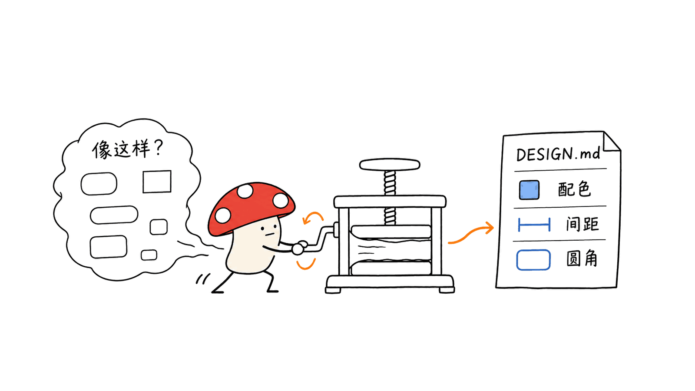
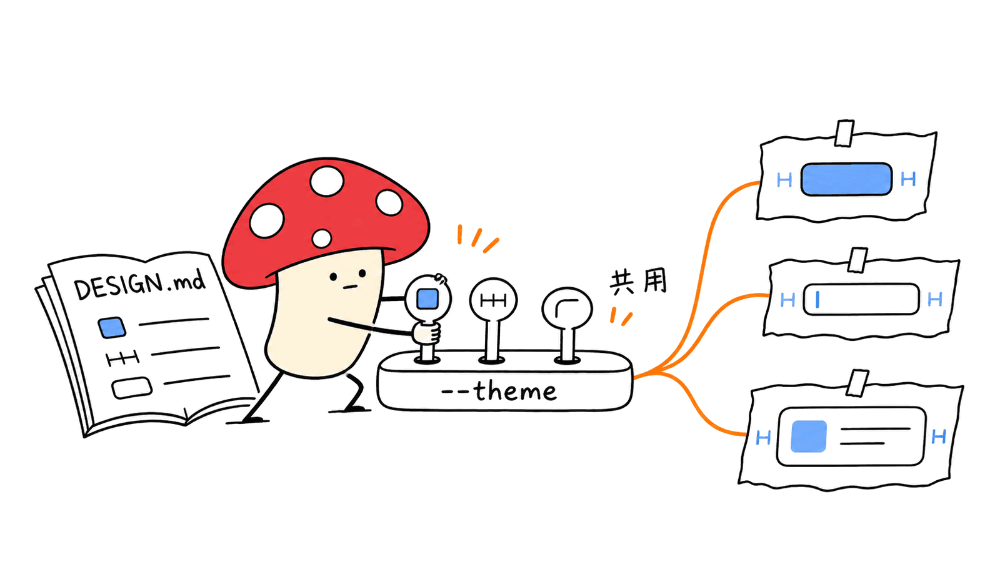

VoltAgent 的这个设计仓库，把网站的视觉规则写成 AI 能读的文档，帮助编码智能体减少界面风格漂移。对应项目是 `VoltAgent/awesome-design-md`，采用 MIT 许可；它与同组织的 TypeScript Agent 框架是不同仓库。

一手仓库：https://github.com/VoltAgent/awesome-design-md

我们在 2026 年 11 月 12 日检查了提交 `fcc70284932276d085f01ef9f83edde90b1258cb`：实际有 **84 份 DESIGN.md**。数量是这次检出的快照，不是长期承诺。下面重点讲怎么使用，以及怎样避免把一份视觉参考误当成完整产品设计。

## 它到底提供什么？

常见的提示词“做得像 Linear 一点”，把大量判断留给了模型：黑色应该多黑，哪一层面板该抬高，紫色能不能铺满卡片，按钮到底是圆角矩形还是胶囊形？

DESIGN.md 把这些选择提前展开。以仓库中的 Linear 分析为例，文件包含颜色角色、字号层级、间距、圆角、组件状态、布局原则、响应式行为，以及已知缺口。主色是 `#5e6ad2`，背景是 `#010102`，按钮默认圆角为 8px。正文还说明强调色应克制使用，层次主要靠面板色与细边框形成。

这些数值来自社区对公开网站的分析，并非品牌官方签发的设计规范。文件标为 `alpha`，也承认表单错误状态没有在检查的页面中观察到。读到这种缺口，比只复制颜色更有价值：工程师知道哪里还需要补设计。



## 文档库和组件库有什么区别？

| 你需要的东西 | 这个仓库提供的支持 | 项目仍需完成的工作 |
|---|---|---|
| 视觉方向 | 颜色、排版、布局和组件外观分析 | 按目标用户调整信息密度 |
| 可运行页面 | 交给编码智能体作为上下文 | 编写组件、路由与业务逻辑 |
| 一致性 | 共同参考和禁止事项 | 建立实际 token 与组件约束 |
| 键盘和读屏体验 | 部分交互描述 | 检查语义、焦点、错误提示与对比度 |
| 品牌素材 | 对公开视觉的描述 | 确认字体、图片、图标的使用条件 |

另一个实际发现是：README 列出 `preview.html` 和 `preview-dark.html`，但我们检查的这次提交中，`design-md/` 下这两类 HTML 文件数量为 **0**。各品牌 README 将预览入口引向 `getdesign.md`。因此，不能照着总 README 假设克隆后就有整套离线预览。

在线目录：https://getdesign.md/

## 工程上怎样接入？

第一步，选一个与业务相符的参考。内容站优先阅读节奏，数据后台优先密度和状态表达，不能因为某个品牌出名就把营销页结构搬进管理系统。

第二步，固定来源，再将单个文档带进你的项目。下面在临时目录检出，最后的目标文件应在你自己的项目根目录；已有同名文件时先比较内容。

```bash
git clone https://github.com/VoltAgent/awesome-design-md.git /tmp/design-reference
git -C /tmp/design-reference checkout fcc70284932276d085f01ef9f83edde90b1258cb
cp /tmp/design-reference/design-md/linear.app/DESIGN.md ./DESIGN.reference.md
```

第三步，明确要求智能体读取该文件。Markdown 文件不会自动变成所有工具的强制策略；实际是否加载，要看工具和项目的上下文配置。可以在项目的 AGENTS.md 中写清读取入口，也可以在任务提示里显式指定。

一个可复用的提示：

```text
先读取 DESIGN.reference.md 和项目现有组件。
为任务管理页面提炼本项目的 DESIGN.md，保留来源提交。
使用参考中的表面层级和间距节奏，改用我们的品牌色与可授权字体。
沿用已有技术栈，不引入第二套组件库。
实现列表、空状态、加载、错误和键盘焦点。
交付时列出采用的规则、主动偏离之处和待人工确认项。
```

第四步，把文字约束落到真实代码。`{colors.primary}` 这种引用只是文档里的记法，不会自行成为 CSS 变量。下面是我们按该参考写的映射示例，属于项目实现建议：

```css
:root {
  --color-canvas: #010102;
  --color-panel: #0f1011;
  --color-text: #f7f8f8;
  --color-action: #5e6ad2;
  --radius-control: 8px;
  --space-unit: 4px;
}
```

在你已有的主题系统中维护这些值，让按钮、输入框和卡片消费同一组变量。不要同时维护一份会持续变化的 Markdown 和另一套没人同步的硬编码颜色。



## 我们实际验证到了哪一步？

这次做了仓库文件清点、Linear 文档阅读与颜色算术检查。没有运行编码模型生成页面，没有测量生成速度，也没有证明生成结果比另一种提示词更好看。

我们用文档里的 sRGB 数值计算两组对比度：`#5e6ad2` 与白色约为 **4.70:1**；`#62666d` 与 `#010102` 约为 **3.62:1**。计算脚本随研究材料保存，可以复算。后一组对应文档中的较弱文本颜色，提醒我们把参考移植到页面时，要按照实际文本用途检查可读性。

这两个数值只描述两个纯色之间的关系。真实页面还会受到字号、字重、透明度、背景叠加和状态变化影响，不能据此宣布整个设计系统通过可访问性审核。

实用的验收顺序是：先看任务能否完成，再检查小屏布局和长文本；用键盘走完主要操作，检查禁用、错误、选中、加载状态；最后才判断视觉是否接近参考。只看一张漂亮的首屏截图，很容易遗漏这些问题。


## 适合谁，怎样开始？

适合已经能让智能体写页面、却总在颜色与排版上反复纠正的开发者，也适合需要给团队建立共同视觉语言的小项目。可以先拿一个页面，限定一份参考和一套现有组件，做一次完整验收，再决定是否扩展。

仓库价值在于让设计决策变得可检查、可提交、可讨论。它不能替代用户研究、组件实现或最终验收。MIT 许可下复用文档时保留许可声明；仓库也明确不主张拥有相关品牌的视觉身份，品牌字体和素材应另行确认来源与使用条件。

相关阅读：https://blog.mushroom.cv/blog/meta-astryx-react-design-system-ai-agent-mcp-cli/

## 常见问题

### 需要安装 VoltAgent 框架吗？

不需要。这里使用的是单独的设计文档仓库，可以把单份 Markdown 交给你现有的编码智能体。

### 克隆后可以离线看全部预览吗？

这次检查的提交没有包含 README 所列的预览 HTML。文档本身可离线读取，在线预览入口在各品牌 README 指向的网站。

### 能直接把品牌网站原样用于自己的产品吗？

更实用的做法是借鉴层级、节奏和组件规则，再换成自己的品牌与内容。文档许可不能代替对独立字体、图片和品牌素材的核对。

来源与检查范围：仓库 README、LICENSE、CONTRIBUTING.md、`design-md/linear.app/DESIGN.md` 及同目录 README；固定版本见上文。Mycelium Protocol 的独立工作是文件清点、对比度计算与上述工程接入建议。

---

> © 2026 Author: Mycelium Protocol. 本文采用 [CC BY 4.0](https://creativecommons.org/licenses/by/4.0/deed.zh) 授权——欢迎转载和引用，须注明作者姓名及原文链接，不得去除署名后以原创发布。

<!--EN-->

VoltAgent's design reference repository turns website styling decisions into documents that coding agents can read. The relevant project is `VoltAgent/awesome-design-md`, licensed under MIT, separate from the organization's TypeScript agent framework.

Repository: https://github.com/VoltAgent/awesome-design-md

We inspected revision `fcc70284932276d085f01ef9f83edde90b1258cb` on November 12, 2026 and counted **84 DESIGN.md files**. This is a checkout snapshot, not a permanent collection size. The useful question is how to turn those references into maintainable UI constraints.

## What does the library contain?

A request such as “make it feel like Linear” leaves decisions about surfaces, accent use, spacing and component shapes to the model. A design document makes those choices explicit.

The Linear analysis includes semantic colors, typography, spacing, radii, component states, layout guidance, responsive behavior and known gaps. Its primary color is `#5e6ad2`, its canvas is `#010102`, and its default button radius is 8px. The prose favors restrained accents and separates panels with surface colors and thin borders.

These are community analyses of public websites, not specifications approved by the brands. The Linear document is marked `alpha`; it acknowledges that form validation styles were not visible on the inspected pages. Such disclosures tell an engineer where additional product design is required.


## Is this a component library?

It supplies visual context rather than a complete application runtime. You still implement components, routes, data flows, keyboard behavior, loading states and error messages. A shared document helps a team agree on intent, but consistency ultimately depends on the tokens and components that ship.

There is also a documentation gap worth checking before planning an offline workflow. The README lists `preview.html` and `preview-dark.html`; our checkout contained **zero preview HTML files** under `design-md/`. Individual brand READMEs direct visitors to online previews on https://getdesign.md/ instead. The design documents themselves remain readable offline.

## How should engineers use it?

Choose a reference that fits the product. Reading rhythm matters for a publication; density and state visibility matter for an operations dashboard. A well-known marketing site is not automatically a good application layout.

Pin the source, then copy one reference into your own project. Compare with an existing destination file before replacing it:

```bash
git clone https://github.com/VoltAgent/awesome-design-md.git /tmp/design-reference
git -C /tmp/design-reference checkout fcc70284932276d085f01ef9f83edde90b1258cb
cp /tmp/design-reference/design-md/linear.app/DESIGN.md ./DESIGN.reference.md
```

Explicitly instruct the agent to read the file. A Markdown filename alone does not force every coding tool to load or enforce it. Document the entry point in your project instructions or name it in the task prompt.

A practical prompt is:

```text
Read DESIGN.reference.md and the existing components first.
Create a project-specific DESIGN.md and retain the source revision.
Adopt its surface hierarchy and spacing rhythm, but use our own
brand colors and fonts we can use in this project.
Keep the current stack and component library.
Build the list, empty, loading, error and keyboard-focus states.
Report adopted rules, intentional deviations and unresolved decisions.
```

Translate the agreed rules into real theme variables. References such as `{colors.primary}` in the document do not automatically become CSS. For example, a project implementation might map them as follows:

```css
:root {
  --color-canvas: #010102;
  --color-panel: #0f1011;
  --color-text: #f7f8f8;
  --color-action: #5e6ad2;
  --radius-control: 8px;
  --space-unit: 4px;
}
```

Feed those variables into the existing components. Avoid maintaining an evolving Markdown document beside a separate set of hardcoded colors with no clear owner.


## What did we actually verify?

We inspected the checkout, read the Linear analysis and computed two contrast ratios from its documented sRGB values. We did not run an AI page-generation experiment, measure generation latency or establish that this method produces better-looking pages than another prompt.

The primary color `#5e6ad2` against white gives approximately **4.70:1**. The weaker text color `#62666d` against canvas `#010102` gives approximately **3.62:1**. The calculation script is retained with the research artifacts for reproduction. The latter pairing is a reason to review how that text token is used when adapting the reference.

These results describe two solid-color pairs. Font size, weight, opacity, layered backgrounds and interactive states affect a real interface. They do not establish accessibility conformance for a page or for the library as a whole.

Validate task completion first, then narrow layouts and long content. Walk through important actions using a keyboard, and inspect disabled, error, selected and loading states before judging visual resemblance. A polished hero screenshot does not cover these requirements.


## Who should try it?

It is useful for developers who can already generate a page but repeatedly correct its typography and colors, and for small teams that need a shared visual reference. Start with one page, one reference and the current component library. Complete the review before expanding the approach.

The value is making design decisions inspectable and versionable. User research, component implementation and acceptance review remain engineering work. Keep the MIT notice when reusing the documents. The repository disclaims ownership of the brands' visual identities; independently check the source and usage conditions of fonts, imagery and other brand assets.

Related reading: https://blog.mushroom.cv/blog/meta-astryx-react-design-system-ai-agent-mcp-cli/

## FAQ

### Does this require the VoltAgent framework?

No. This is a separate repository of design documents. You can provide one Markdown file to your existing coding agent.

### Are all previews included for offline use?

Not in the inspected revision. The documents are local, while individual brand READMEs link to online previews.

### Should I copy a brand's website exactly?

Use its hierarchy, rhythm and component rules as references, then adapt them to your own product. The document license does not replace checking independent font, image and brand assets.

Sources: the pinned repository's README, LICENSE, CONTRIBUTING.md, Linear DESIGN.md and its local README. Mycelium Protocol contributed the checkout inventory, reproducible contrast calculations and engineering recommendations above.

---

> © 2026 Author: Mycelium Protocol. Licensed under [CC BY 4.0](https://creativecommons.org/licenses/by/4.0/) — free to share and adapt with attribution. You must credit the author and link to the original; removing attribution and republishing as original is not permitted.
