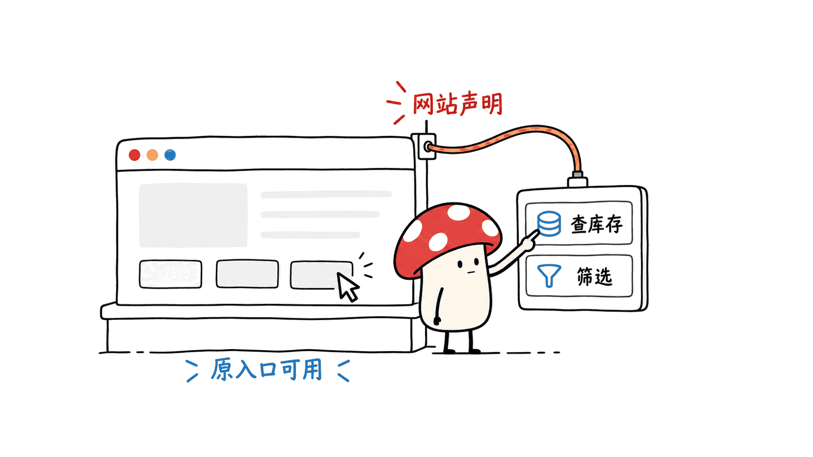
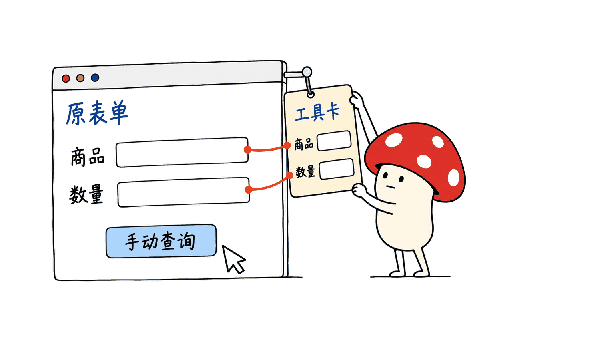
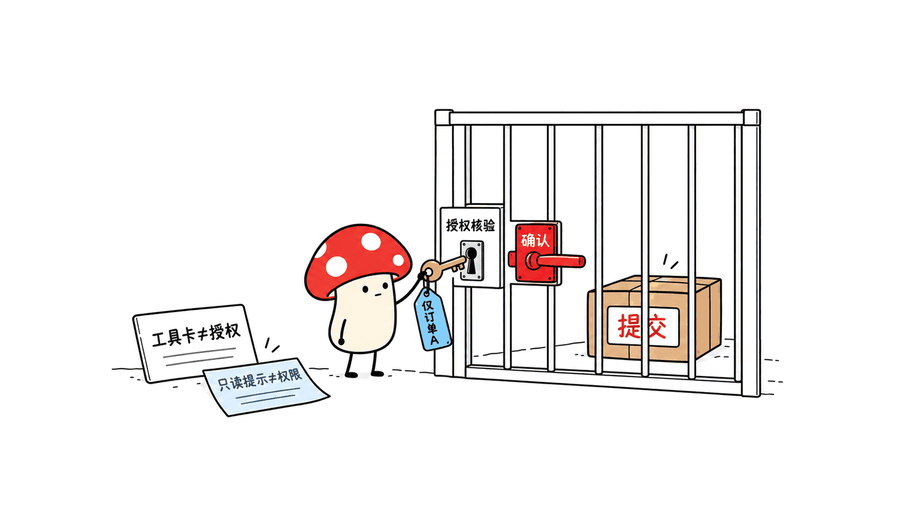

WebMCP 的核心变化，是让网站主动把“查询库存”“筛选结果”等能力声明为工具，供兼容的 Agent 用结构化参数调用。它能减少猜测按钮含义和拼接交互步骤的负担，但不意味着所有网站自动可用，也不是网页自动化第一次摆脱截图。

截至 2026-10-29，它仍处于实验推进阶段。Chrome 官方提供 Origin Trial 和本地测试入口；规范是 Web Machine Learning Community Group 的草案，明确不是 W3C 标准。本文同时核对了官方文档与 10 月 27 日版本的规范，并做了一个原生浏览器只读示例。

Chrome 文档：https://developer.chrome.com/docs/ai/webmcp

规范仓库：https://github.com/webmachinelearning/webmcp

草案：https://webmachinelearning.github.io/webmcp/

## 变化究竟发生在哪一层？

先把“以前都靠截图”这个印象拆开。传统网页自动化早已可以通过 DOM、可访问性树、选择器、浏览器调试接口或业务 API 工作，不是所有方案都要反复识图找坐标。

WebMCP 增加的是网站主动提供的语义接口：开发者选择哪些能力可以调用，说明参数和用途，再把它接到已有应用逻辑。Agent 不必先从一组按钮、菜单和输入框里推断完整业务流程。

| 路径 | Agent 面对什么 | 仍需处理什么 |
|---|---|---|
| 截图与视觉操作 | 像素、布局、坐标 | 识别、定位、页面变化与状态确认 |
| DOM 等浏览器操作 | 元素、属性、可访问名称 | 选择器稳定性与业务含义 |
| WebMCP 工具 | 网站声明的能力、参数结构与返回结果 | 工具选择、参数正确性、权限和执行结果 |

例如，订座流程可以提供“查询可用时段”，而不是让 Agent 依次猜日历、人数菜单和下一步按钮。工具内部仍可能更新页面、调用服务器或等待网络；少掉交互步骤，不等于整个任务没有延迟。



## 它和服务端 MCP 是同一回事吗？

WebMCP 是浏览器页面里的 JavaScript 接口。工具注册和执行与当前文档、页面状态相连；它不是要求每个网站新增一个通过 stdio 或 HTTP 接入的后端 MCP 服务器。

这不妨碍工具回调继续调用正常业务 API。区别是，Agent 调用的入口由页面声明，页面可以复用当前用户界面与应用上下文。服务端身份校验、数据权限和请求约束仍然存在。

它也不会把整个 JavaScript 环境中的函数自动公开。开发者必须选择、包装并注册能力；Agent 与浏览器客户端也需要支持相应发现和调用方式。安装了 Chrome，不代表任意网站都已经完成这一步。

## Chrome 当前开放到了哪一步？

Chrome 官方在 2026 年 6 月 9 日发布的文章介绍了从 Chrome 149 开始的 Origin Trial；当前文档也保留本地 `chrome://flags/#enable-webmcp-testing` 测试入口。Origin Trial 是实验机制，不能当成已经面向所有网站默认稳定开放。

规范由包括 Google 和 Microsoft 在内的贡献者推进，不能简单等同于 Chrome 的私有服务。本文固定核对仓库提交 `6838130ef3e930c8e1a9f98375c13d9133d61aba`，对应 10 月 27 日草案；API 仍可能变化。

当前文档与本机验证使用 `document.modelContext`。旧教程常见的 `navigator.modelContext` 不应直接照抄；检测当前环境支持情况，比只看 Chrome 大版本号可靠。

Origin Trial 说明：https://developer.chrome.com/blog/ai-webmcp-origin-trial

固定版本规范：https://github.com/webmachinelearning/webmcp/blob/6838130ef3e930c8e1a9f98375c13d9133d61aba/index.bs

## 网站怎样声明一个工具？

命令式方式由 JavaScript 注册带名称、描述和输入结构的回调。下面是只读库存示例的简化模块代码，库存全部是虚构本地数据：

```js
const inventory = { "demo-a": 8, "demo-b": 3 };
const lifecycle = new AbortController();

if (document.modelContext) {
  await document.modelContext.registerTool({
    name: "lookup_demo_stock",
    description: "Look up fictional stock without creating an order.",
    inputSchema: {
      type: "object",
      properties: {
        sku: {
          type: "string",
          enum: Object.keys(inventory),
          description: "The demo product identifier."
        }
      },
      required: ["sku"],
      additionalProperties: false
    },
    execute: async args => {
      if (!args || Object.keys(args).length !== 1 ||
          typeof args.sku !== "string" ||
          !Object.hasOwn(inventory, args.sku)) {
        throw new TypeError("Choose a known demo product.");
      }
      return { sku: args.sku, stock: inventory[args.sku] };
    },
    annotations: { readOnlyHint: true }
  }, { signal: lifecycle.signal });
}

// 页面模块释放时，撤销这次工具注册：
// lifecycle.abort();
```

完整可运行示例：https://blog.mushroom.cv/demos/webmcp-readonly/

这里有两个容易忽略的点：输入结构能帮助 Agent 理解参数，但回调仍要校验业务约束；`readOnlyHint` 是行为提示，不是强制权限系统。示例确实只读库存，不能给有写入副作用的工具随便贴一个只读标签。

`AbortSignal` 用于管理注册生命周期。撤销注册表示工具不再可发现，不意味着自动撤销此前已经完成的操作。单页应用在切换页面或卸载组件时，需要处理这些关系。

## 普通 HTML 表单也能接入吗？

声明式方式在标准表单上添加 `toolname`、`tooldescription` 等属性，让浏览器根据控件生成工具参数结构。示例页面同时保留了一个普通选择框表单：

```html
<form toolname="lookup_demo_stock_form"
      tooldescription="Look up fictional stock using the normal form.">
  <label for="sku">Demo product</label>
  <select id="sku" name="sku" required>
    <option value="demo-a">Notebook</option>
    <option value="demo-b">Adapter</option>
  </select>
  <button type="submit">Look up manually</button>
</form>
```

它没有添加 `toolautosubmit`。本文测试了声明式工具发现和参数结构，没有测试真实 Agent 的表单提交或确认流程，不能把“浏览器识别了工具”写成“Agent 已自主完成业务”。

对已有系统，这提供了一条渐进接入路线：先让原有表单继续工作，再为合适的操作添加结构化能力。不支持 WebMCP 的环境也应保留可用入口。

声明式提案：https://github.com/webmachinelearning/webmcp/blob/6838130ef3e930c8e1a9f98375c13d9133d61aba/declarative-api-explainer.md



## 本次在真实 Chrome 中验证了什么？

测试使用 Google Chrome `156.0.8078.49`，两个全新的隔离配置目录，以及只监听回环地址的本地页面。没有操作日常浏览器配置、安装扩展或连接实际业务系统。

| 检查 | 实际结果 |
|---|---|
| 默认配置 | `document.modelContext` 和旧 navigator 入口均不存在，普通表单仍可查询 |
| 显式实验配置 | 原生 document 接口存在，navigator 入口仍不存在 |
| 工具发现 | 发现命令式工具与声明式表单，包含生成的参数结构 |
| 只读调用 | `demo-b` 返回虚构库存 `3` |
| 未知 SKU | 回调拒绝，当前构建返回 `UnknownError` |
| 同名重复注册 | 拒绝，返回 `InvalidStateError` |
| 撤销与恢复 | Abort 后命令式工具消失，表单工具保留；重新注册成功 |

测试启动参数同时显式开启了 `WebMCP` 与 `WebMCPTesting` 的 feature 和 Blink 实验开关，不据此判断其中某一个开关单独是否足够。普通试用可按官方本地测试指引操作；本文没有为公开示例申请 Origin Trial token。

测试中的工具调用使用页面端 `getTools()` 与 `executeTool()`，而非让大模型规划任务。浏览器内置 Agent 可能通过内部机制发现工具。这次验证不涵盖模型选择工具的准确率、第三方客户端支持情况、跨源 iframe 或表单自动提交。

也没有进行截图方案对照、延迟分布、Token 消耗或费用测量。因此“减少猜测与步骤”有机制依据，“极快极准”“降低多少成本”仍需要按实际任务测量。

## 安全、登录和确认是否就不需要了？

工具名字更明确，不能代替服务端授权。读某张订单、改客户资料或提交操作，仍需使用当前身份验证资源范围、校验参数，并处理重复请求和过期状态。

工具描述与返回内容也可能包含不可信文本。草案专门讨论了工具污染、输出注入、意图误表述等问题。注释和提示可以辅助 Agent 决策，但不应被当成不可绕过的安全控制。

对于有现实后果的写入，应保留清晰的预览和确认，区分“准备提交”与“最终提交”。同样需要注意文档生命周期、跨源权限策略和数据最小化；当前页面可以发现自己的工具，不代表可以自由调用其他站点的工具。



## 小团队先接哪一类功能最划算？

建议从一个只读、高频、步骤清楚的能力开始，例如查询产品状态、筛选文档或读取当前配置。工具名称应对应具体业务动作，返回结果应便于核对，不要把万能脚本执行器包装成一个“方便的工具”。

验收时分别检查：页面能力能否被发现；参数与返回值是否稳定；授权及确认是否正确；不支持 WebMCP 时原流程是否可用。再用同一组任务对比原自动化方案，记录工具调用与人工介入次数、成功率及端到端耗时。

如果前端需要对话面板，可另看 [OpenTiny 与 TinyRobot](https://blog.mushroom.cv/blog/opentiny-tinyrobot-agent-ui/) 的组件分工。聊天 UI、WebMCP 工具、Agent 调度和服务端业务权限属于不同层次，安装其中一个包不等于整条链路都已完成。接入第三方 SDK 时，另行核对它使用的传输与原生 API 版本。

## 常见问题

### 所有网页现在都能直接调用函数了吗？

不能。网站要声明合适的工具，浏览器与 Agent 也要支持；未接入网站仍可能需要 DOM、视觉或其他接口。

### WebMCP 是一个已经定稿的 W3C 标准吗？

当前核对的文档是社区草案，明确不属于 W3C 标准，也不在其标准轨道上。浏览器实验与草案成熟度要分开判断。

### 函数调用是不是必然更快、更便宜？

不必然。它可能减少交互步骤和界面推断，但还取决于模型、工具实现、网络、确认与错误恢复；本文没有跑性能或费用横评。

> © 2026 Author: Mycelium Protocol. 本文采用 [CC BY 4.0](https://creativecommons.org/licenses/by/4.0/deed.zh) 授权——欢迎转载和引用，须注明作者姓名及原文链接，不得去除署名后以原创发布。

<!--EN-->

WebMCP lets websites expose selected application capabilities as structured tools. Compatible agents can call actions such as stock lookup or filtering without inferring every step from interface elements. This reduces a particular kind of ambiguity; it does not make every website callable or guarantee perfect task completion.

This review was checked on October 29, 2026 against the October 27 community draft and repository commit `6838130ef3e930c8e1a9f98375c13d9133d61aba`. It is not a W3C Standard or on the W3C Standards Track. Google and Microsoft contributors are among those developing it.

Chrome documentation: https://developer.chrome.com/docs/ai/webmcp

Specification repository: https://github.com/webmachinelearning/webmcp

## What actually changes?

Browser automation already had DOM selectors, accessibility information, debugging interfaces and business APIs. It did not universally depend on screenshots. WebMCP adds a site-authored semantic tool surface: developers select capabilities, describe inputs and connect callbacks to application behavior.

A tool can reduce a sequence of menu and field interactions, but its implementation can still perform UI updates, backend requests and network waits. It complements existing browser interaction rather than removing every need for it.


## Is it a backend MCP server?

No. Registration and execution occur in the browser document's JavaScript context. The page can reuse its current application state and call ordinary backend APIs as necessary; WebMCP does not itself require a separate stdio/HTTP MCP service.

It also does not publish arbitrary private JavaScript functions automatically. The site must register selected tools, and the agent/browser client must support discovery and invocation. Ordinary authorization remains the application's responsibility.

## What is Chrome's current status?

Chrome's June 9, 2026 announcement introduced an origin trial starting with Chrome 149. Current documentation also provides the local `chrome://flags/#enable-webmcp-testing` entry. These are experimental deployment paths, not evidence of universal default availability.

Current guidance and the tested build use `document.modelContext`. Older `navigator.modelContext` examples should be rechecked against the actual browser. Browser version alone does not establish feature availability.

Announcement: https://developer.chrome.com/blog/ai-webmcp-origin-trial

Pinned draft: https://github.com/webmachinelearning/webmcp/blob/6838130ef3e930c8e1a9f98375c13d9133d61aba/index.bs

## How can a website expose a tool?

The imperative API registers a name, description, JSON input schema, execution callback and optional annotations. The complete read-only example is available here:

https://blog.mushroom.cv/demos/webmcp-readonly/

Its `lookup_demo_stock` callback explicitly validates one known SKU and returns fictional inventory data. It registers using `await document.modelContext.registerTool(tool, {signal})`, with an AbortController managing availability. `readOnlyHint: true` describes the callback; it is not an authorization mechanism. Aborting registration removes the tool but does not undo completed side effects.

The declarative route annotates a regular HTML form using `toolname` and `tooldescription`. The demo's select control becomes a structured parameter. It deliberately omits `toolautosubmit`, and remains a usable manual form when the preview API is unavailable.


Declarative proposal: https://github.com/webmachinelearning/webmcp/blob/6838130ef3e930c8e1a9f98375c13d9133d61aba/declarative-api-explainer.md

## What did the native browser test establish?

Google Chrome **156.0.8078.49** ran with two fresh isolated profiles and a loopback-only fixture server. The ordinary profile exposed neither the document nor the old navigator API, while the normal form returned fictional data successfully.

A second profile explicitly enabled both `WebMCP` and `WebMCPTesting` through feature and Blink switches. The native document API appeared; navigator's entry remained absent. Discovery returned both imperative and declarative tools and their schemas. A lookup for `demo-b` returned stock **3**. The callback rejected an unknown SKU with `UnknownError` in this build; duplicate registration rejected with `InvalidStateError`. Abort removed the imperative registration while preserving the form tool, and re-registration succeeded. No runtime exception was observed.

The test does not determine which single switch would suffice. It uses page-side `getTools()` and `executeTool()`, not an LLM planning tasks; browser-integrated agents can use different internal discovery mechanisms. Declarative discovery was checked, but autonomous form submission and cross-origin iframe behavior were not.

No extensions, real accounts, production services or daily browser profile settings were changed. No screenshot baseline, timing, token-cost or model-accuracy comparison was performed. The public example has no origin-trial token, so preview support still needs an appropriate environment.

## Do authentication and confirmation disappear?

No. Backend access checks, input constraints, duplicate handling and stale-state recovery remain necessary. Tool descriptions and outputs can contain untrusted information; the draft discusses tool poisoning, output injection and misleading intent.

For consequential writes, make preparation and final commitment distinct and preserve an appropriate confirmation path. Read-only annotations and descriptive names do not enforce these boundaries. Same-origin and permissions-policy rules also remain relevant.


## Where should a small team begin?

Start with one bounded, read-only capability such as status lookup or document filtering. Verify discovery, stable parameters/results, access control and the manual fallback independently. Then compare complete tasks using tool-call counts, human interventions, success rate and end-to-end time.

For a front-end conversation panel, see the separate [OpenTiny/TinyRobot review](https://blog.mushroom.cv/blog/opentiny-tinyrobot-agent-ui/). Chat components, WebMCP, agent orchestration and server permissions solve different parts of the system. For a third-party SDK, check its transport and native API version independently.

## FAQ

### Does every website now expose callable functions?

No. The site, browser and agent need compatible integration. Other sites can still require DOM, visual or existing API interaction.

### Is this a finalized W3C standard?

No. The verified document is a community draft, expressly outside the W3C Standards Track.

### Are tool calls necessarily faster and cheaper?

No universal result follows. They can reduce interaction steps, but model work, tool implementation, networking, confirmation and recovery still affect outcomes. This review contains no performance or cost benchmark.

> © 2026 Author: Mycelium Protocol. Licensed under [CC BY 4.0](https://creativecommons.org/licenses/by/4.0/) — free to share and adapt with attribution. You must credit the author and link to the original; removing attribution and republishing as original is not permitted.
