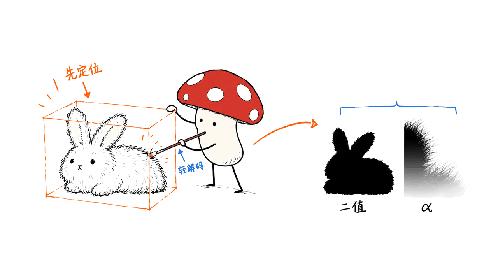

WeVisOne-VL把检测、定位、计数、打点、OCR、分割和抠图放进同一个视觉模型与推理接口。七类任务和开源代码可以核实；流传的“RTX 4090上48毫秒、显存6GB”对比，我们尚未找到可核验的一手依据。

项目来自腾讯微信视觉团队，2B与4B模型卡及仓库标注Apache-2.0。论文 arXiv:2610.31329 于2026年10月22日提交；本文在10月26日固定仓库提交`9a6bcd85404505df0d05cfb5d97512ccacf35dee`核查。模型仓库的创建时间不能独立证明“隔天才公开全部资源”，因此不把这一传播时间线写成结论。

本文原文：https://blog.mushroom.cv/blog/wevisone-vl-unified-vision/

源码：https://github.com/Tencent/WeVisOne-VL

2B权重：https://huggingface.co/tencent/WeVisOne-VL-2B

4B权重：https://huggingface.co/tencent/WeVisOne-VL-4B

论文：https://arxiv.org/abs/2610.31329

项目主页：https://tencent.github.io/WeVisOne-VL/

封面采用官方README中的兔子alpha抠图示例局部，来源为腾讯微信视觉团队；它是官方定性展示，不是我们运行模型得到的结果。

## 七种能力是否一次调用就全部输出？

不是。统一的是模型、任务表达和调用入口，使用时仍要指定任务、查询对象和生成参数。SDK的`predict(image, task=..., query=...)`会构造相应提示，生成结构化输出；像素任务还需要解码掩码或alpha图。

| 任务家族 | SDK入口示例 | 工程上拿到什么 |
| --- | --- | --- |
| 目标检测 | `detection` | 按类别查询目标框 |
| 指代定位 | `referring` | 依照自然语言描述定位，目标不存在时可输出`None` |
| 计数 | `count_box` / `count_point` | 通过框或点表达实例；按任务协议统计数量 |
| 打点 | `point` | 指向目标的位置 |
| OCR | `ocr` / `ocr_grounding` | 文字与位置，或定位指定文字 |
| 指代分割 | `segmentation` | 目标框和实例掩码；应看具体分割测试口径 |
| 提示式抠图 | `matting` | 目标框和连续透明度alpha图 |

“一个模型干七类活”不等于一遍前向就同时完成七份业务输出，也不等于无需图片缩放、坐标还原或结果校验。不同任务的输出长度和像素解码开销可能不同。


## 从目标框到发丝边缘，模型如何工作？

WeVisOne-VL基于Qwen3-VL，用结构化next-token预测表达对象名称与空间位置。坐标使用`<0>`到`<1000>`这组归一化token，像素任务在预测框之后生成特殊的`<OBJ>`实例token。

约9.6M参数的轻量像素解码器，结合实例token隐藏状态、预测框与多层视觉特征，产生掩码或alpha matte。因此，分割与抠图路径不需要额外接入SAM；它仍然包含视觉主干、语言模型和像素解码等不同计算环节。

二值掩码回答“这个像素属不属于目标”；alpha图表达连续透明度，用于毛发、绒毛和半透明边界。把alpha图阈值化为黑白结果，会丢掉抠图本来要保留的信息。



“无需SAM”属于模型设计与推理路径的事实，不能继续推导成“所有SAM、YOLO、PaddleOCR应用都可以直接替换”。专业检测流水线、文档OCR和交互分割有不同协议、精度目标与延迟要求。

## 官方评测能支持哪些判断？

下面是官方README与论文给出的4B结果，均为作者报告，不是Mycelium Protocol独立复测。各行对照模型不同，不能把它们当成同一个“三模型串联系统”。

| 任务与测试 | WeVisOne-VL-4B | 指标解释 |
| --- | --- | --- |
| LVIS检测 | 55.3 | F1 Mean，越高越好 |
| Dense200密集检测 | 71.3 | F1 Mean，越高越好 |
| PixMo-Count test计数 | 89.6 | Accuracy，越高越好 |
| TotalText文字检测/定位评测 | 52.0 | F1 Mean，不能直接当成完整文档OCR字符准确率 |
| ReasonSeg val指代分割 | 71.2 | gIoU，越高越好 |
| P3M-500-NP框提示抠图 | 7.3 | MAD，越低越好 |

检测、指代与OCR的F1 Mean按IoU阈值0.5至0.95平均，不能直接和COCO AP或单个IoU阈值下的F1交换使用。框抠图MAD与计数Accuracy同样不可合并成一个综合分。

官方还报告WeRef-Bench不存在目标的拒绝率为96.4%。这是特定测试上的拒绝指标，并不证明模型不会幻觉，也不能单独说明“拒绝的都是该拒绝的”。业务验收应同时测试存在目标时的召回和不存在目标时的误报。

论文第8节列出能力取舍：一般能力可能相对基座受影响；训练侧重直接输出结构化结果，没有CoT推理；现实中含糊的用户意图也会增加定位难度。因此，它更像面向精细感知的专用VLM，不宜仅凭几个视觉指标称为通用视觉理解的全面升级。

## 152→48毫秒、10.8→6GB的说法核实了吗？

没有。我们检查了固定版本README、模型卡和论文全文，没有找到支撑这组RTX 4090串联对比的硬件配置、脚本或测试表。当前证据只能支持“尚未核实”，不能将它写成官方已证明的68%延迟下降和44%显存下降。

若要复现这类说法，至少需要明确：2B还是4B、权重精度、输入尺寸、任务、输出目标数量、后端、预热与同步方式、计时是否包含预处理和像素解码。对照也要给出YOLO、SAM、PaddleOCR的版本与实际组合任务；不是所有应用都需要三者串行运行。

源码的`predict()`确实返回`latency_s`，计时覆盖文本生成和按需掩码解码。但存在计时字段不等于发布了某个4090测量结果，更不能保证不同后端、设备与任务的计时口径一致。


## 我们在Mac上实际验证了什么？

本次在M4、16GB统一内存机器上完成了轻量格式测试，未下载模型权重做完整推理。我们直接加载固定版本的官方评测解析器，运行上游两个解析测试，并检查`None`输出的解析行为。

验证通过的内容包括：归一化框坐标缩放、退化框过滤、多点与截断输出解析，以及打点模式下的裸标签处理。例如1000×500图片上的`<100><200><300><400>`被还原为`[100,100,300,200]`。

这些测试证明的是输出格式后处理在所测样例上的行为，不是识别准确率、拒绝能力、像素解码质量、4090延迟或显存结果。统一坐标协议仍需要后处理，而不是彻底消除坐标问题。

我们还只读取了Hugging Face safetensors文件头，没有下载整份权重：

| 发布文件 | 文件头记录 | 工程含义 |
| --- | --- | --- |
| 2B主权重 | 约24.42亿张量元素，F16，文件约4.88GB | 下载大小不等于完整推理内存 |
| 4B主权重 | 约48.31亿张量元素，F32，文件约19.32GB | 存储精度与推理加载精度要区分 |

4B这些张量若全部以BF16保存，单纯元素载荷约9.66GB；这只是容量算术，不是运行显存实测。像素解码器另有`mask_decoder.pt`资源，运行还需要激活、KV缓存和视觉特征等。未说明模型与精度时，不能用“6GB”作为统一硬件门槛。

SDK的`device="auto"`依次选择CUDA、NPU，最后CPU，没有自动选择Apple MPS。CPU分支会使用FP32；虽然构造器接受显式设备字符串，但我们没有验证MPS完整路径，因此不提供“Mac开箱即用”的承诺。

## 想试用，怎样开始更稳妥？

先用官方托管Demo看输出形式，再在独立环境按仓库固定依赖部署。Demo入口由README链接提供，托管页面可用性及容量不在本次测试范围内：

- 2B：https://huggingface.co/spaces/hugging-apps/wevisone-vl-2b
- 4B：https://huggingface.co/spaces/hugging-apps/wevisone-vl-4b

官方安装路径是Python 3.10环境、仓库requirements与可编辑安装。注意vLLM属于可选依赖；选择该后端时需按同版本依赖说明准备，不能把`backend="vllm"`当成自动安装完成。

```bash
git clone https://github.com/Tencent/WeVisOne-VL.git
cd WeVisOne-VL
git checkout 9a6bcd85404505df0d05cfb5d97512ccacf35dee
conda create -n wevisone-vl python=3.10 -y
conda activate wevisone-vl
pip install -r requirements.txt
pip install -v -e .
```

模型推理入口如下，这是对照官方API写的使用示例，未在本机运行模型：

```python
from PIL import Image
from wevisone_vl import WeVisOneVL
from wevisone_vl.visualization import save_result

model = WeVisOneVL("tencent/WeVisOne-VL-2B", backend="transformers")
image = Image.open("your-image.jpg").convert("RGB")
result = model.predict(image, task="detection", query=["cup", "bottle"])
save_result("outputs/detection", image, result)
```

部署时保留像素解码器资源；评测流水线还需要对应数据集与任务协议。当前README把推理、Cookbooks、评测代码、模型权重与Mask2Alpha标为已发布，微调代码仍在待办列表，不能把“推理可用”等同于完整训练复现。

我们的建议是拿同一批业务图片比较现有方案与2B/4B，分别统计准确率、空目标误报、P50/P95端到端延迟和峰值显存，再决定替换哪一段。对于文档处理，还可以对照本博客的OCR与视觉模型分析；替换选择应由任务质量和工程成本共同决定。

相关交互层阅读：https://blog.mushroom.cv/blog/realtime-venus-fulldup-interactive-dual-loop-local-deploy/

## 常见问题

### 一个调用会同时返回七类结果吗？

不会自动如此。SDK按`task`构造提示，输出取决于所选任务；像素结果另有解码过程。

### 能断言它全面替代YOLO、SAM和PaddleOCR吗？

不能。统一接口有整合价值，但专业任务的协议、吞吐、精度和输出要求仍需逐项验证。

### 48毫秒和6GB是否已被本文证实？

没有找到可核验的一手测试依据，也没有进行4090实测。本文不把这组数字当成选型承诺。

### 16GB Mac可以直接顺畅运行吗？

本次没有模型推理验证。SDK自动设备选择不含MPS，CPU分支会改用FP32；文件大小也不能直接作为内存门槛。

---

> © 2026 Author: Mycelium Protocol. 本文采用 [CC BY 4.0](https://creativecommons.org/licenses/by/4.0/deed.zh) 授权——欢迎转载和引用，须注明作者姓名及原文链接，不得去除署名后以原创发布。

<!--EN-->

WeVisOne-VL brings detection, referring localization, counting, pointing, OCR, segmentation and matting into one model and inference interface. The seven task families and released code are verifiable. We have not found primary-source evidence for the circulated claim of 48ms and 6GB on an RTX 4090.

Tencent's WeChat Vision team released 2B and 4B model cards under Apache-2.0, matching the repository license. The report, arXiv:2610.31329, was submitted on October 22, 2026. This October 26 review pins source commit `9a6bcd85404505df0d05cfb5d97512ccacf35dee`. Repository creation timestamps alone do not establish the exact public-release sequence.

Original article: https://blog.mushroom.cv/blog/wevisone-vl-unified-vision/

Sources:

- Code: https://github.com/Tencent/WeVisOne-VL
- 2B: https://huggingface.co/tencent/WeVisOne-VL-2B
- 4B: https://huggingface.co/tencent/WeVisOne-VL-4B
- Paper: https://arxiv.org/abs/2610.31329
- Project: https://tencent.github.io/WeVisOne-VL/

The cover crops the rabbit alpha-matting example from the official Tencent WeChat Vision README teaser. It is an upstream qualitative example, not our inference output.

## Does one request produce all seven outputs?

No. `predict(image, task=..., query=...)` selects a task prompt. The model generates structured answers, with additional pixel decoding when appropriate. Unified capabilities do not imply seven simultaneous outputs in one pass.

| Task family | SDK example | Output |
| --- | --- | --- |
| Detection | `detection` | Queried-category boxes |
| Referring localization | `referring` | Boxes or `None` for an absent target |
| Counting | `count_box` / `count_point` | Box/point instances interpreted under the counting protocol |
| Pointing | `point` | Target locations |
| OCR | `ocr` / `ocr_grounding` | Text and locations, or localization of requested text |
| Referring segmentation | `segmentation` | Boxes and instance masks |
| Promptable matting | `matting` | Boxes and continuous alpha mattes |

Output length and pixel-decoding work vary across tasks. Image resizing, coordinate conversion and result validation remain application responsibilities.


## How does it move from boxes to fine boundaries?

The Qwen3-VL-based model predicts structured labels and normalized coordinate tokens from `<0>` through `<1000>`. Pixel tasks emit an `<OBJ>` instance token after a box.

A roughly 9.6M-parameter pixel decoder combines instance hidden states, boxes and multi-level visual features to produce masks or alpha mattes. This inference path needs no additional SAM model, while still containing distinct backbone, language-generation and decoding stages.

Binary masks express membership. Alpha mattes preserve fractional opacity at hair, fur and translucent boundaries. Thresholding the latter destroys information needed for compositing.


A SAM-free architecture is not proof of universal replacement for detection, document OCR or interactive segmentation systems. Their protocols and operating requirements differ.

## What do the reported benchmarks show?

These 4B figures come from the upstream README and paper; Mycelium Protocol did not reproduce them. Each benchmark's comparison set differs and is not a single combined three-model pipeline.

| Benchmark | Reported result | Metric |
| --- | --- | --- |
| LVIS detection | 55.3 | F1 Mean, higher is better |
| Dense200 | 71.3 | F1 Mean, higher is better |
| PixMo-Count test | 89.6 | Accuracy |
| TotalText | 52.0 | F1 Mean, not end-to-end document character accuracy |
| ReasonSeg val | 71.2 | gIoU |
| P3M-500-NP box matting | 7.3 | MAD, lower is better |

Detection, referring and OCR F1 Mean average over IoU thresholds 0.5–0.95. They are not interchangeable with COCO AP or single-threshold F1. Matting error and counting accuracy cannot be combined into a meaningful overall score.

Upstream reports 96.4% rejection on absent-target WeRef-Bench queries. This is a scoped rejection metric, not a hallucination-free guarantee. Validate present-target recall alongside absent-target false positives.

The paper's limitations include possible degradation of general capabilities, direct structured output without CoT, and difficulty interpreting ambiguous real-world requests. Treat this as a specialized fine-grained perception model rather than a universal visual upgrade.

## Are 152→48ms and 10.8→6GB verified?

No. The reviewed README, model cards and report did not provide a hardware configuration, script or table establishing this RTX 4090 comparison. We therefore do not report the circulated latency and VRAM reductions as demonstrated results.

A reproduction needs the model size, precision, input resolution, task, output count, backend, warm-up and synchronization method. It must specify preprocessing and pixel-decoding boundaries, plus exact baseline models. Many applications do not run YOLO, SAM and PaddleOCR sequentially.

The SDK returns `latency_s` around text generation and conditional mask decoding. A timer field is not a published benchmark and does not establish comparable timing across devices or backends.


## What did we actually test on a Mac?

On an M4 with 16GB unified memory, we loaded the pinned upstream evaluation parser, ran its two parser tests, and checked that `None` parses to an empty result. No model weights were loaded.

The checks cover coordinate scaling, degenerate-box filtering, multiple points, truncated output and bare pointing tags. On a 1000×500 image, bins `<100><200><300><400>` decode to `[100,100,300,200]`.

This is a format/postprocessing smoke test, not a recognition, rejection-quality, pixel-decoder, latency or VRAM evaluation. A common coordinate protocol still needs correct conversion.

We also read only the safetensors HTTP headers:

| Checkpoint file | Header contents | Meaning |
| --- | --- | --- |
| 2B | About 2.442B tensor elements, F16; approximately 4.88GB | Storage size is not total inference memory |
| 4B | About 4.831B tensor elements, F32; approximately 19.32GB | Storage and loading precision differ |

Those 4B tensors alone would occupy approximately 9.66GB as BF16 payload. This is arithmetic, not measured VRAM. The separate `mask_decoder.pt`, activations, KV cache and visual features add requirements. An unspecified 6GB figure is not a general hardware threshold.

Automatic device selection tries CUDA, NPU, then CPU; it does not select Apple MPS. The CPU path forces FP32. Accepting an explicit device string is not proof of a working MPS pipeline, which we did not validate.

## How should you try it?

Inspect the output formats using the hosted demos linked by upstream. Their live availability and capacity were not tested here:

- https://huggingface.co/spaces/hugging-apps/wevisone-vl-2b
- https://huggingface.co/spaces/hugging-apps/wevisone-vl-4b

For local deployment, use an isolated Python 3.10 environment and the pinned requirements. The Chinese section gives the exact checkout/install commands. vLLM is optional and requires its own matching dependency setup.

A documentation-checked API example, not executed model inference:

```python
from PIL import Image
from wevisone_vl import WeVisOneVL
from wevisone_vl.visualization import save_result

model = WeVisOneVL("tencent/WeVisOne-VL-2B", backend="transformers")
image = Image.open("your-image.jpg").convert("RGB")
result = model.predict(image, task="detection", query=["cup", "bottle"])
save_result("outputs/detection", image, result)
```

Keep the pixel-decoder resources and follow each evaluation dataset's protocol. Upstream marks inference, Cookbooks, evaluation code, model weights and Mask2Alpha released; fine-tuning code remains on its TODO list. Inference availability is not complete training reproducibility.

Evaluate the same business images with your existing pipeline and both checkpoints. Track quality, absent-target false positives, P50/P95 end-to-end latency and peak memory before deciding which component to replace.

Related interaction-layer analysis: https://blog.mushroom.cv/blog/realtime-venus-fulldup-interactive-dual-loop-local-deploy/

## Frequently asked questions

### Does one call return every task output?

No. The selected task determines the prompt and response; pixel output needs additional decoding.

### Does this replace every YOLO, SAM or PaddleOCR application?

No. Unified integration is useful, but specialized quality, throughput and output requirements need individual validation.

### Has this review confirmed 48ms and 6GB?

No primary-source benchmark supporting that comparison was found, and we did not measure an RTX 4090.

### Is a 16GB Mac guaranteed to run it smoothly?

No model inference was tested. Automatic selection omits MPS, CPU uses FP32, and checkpoint size is not a runtime-memory guarantee.

---

> © 2026 Author: Mycelium Protocol. Licensed under [CC BY 4.0](https://creativecommons.org/licenses/by/4.0/) — free to share and adapt with attribution. You must credit the author and link to the original; removing attribution and republishing as original is not permitted.
