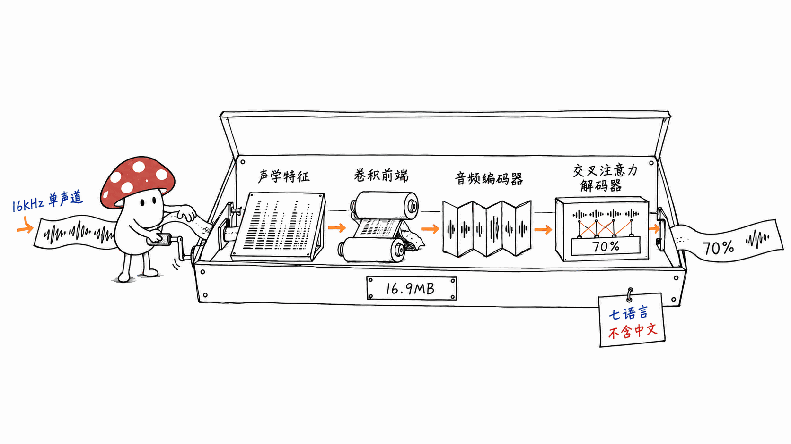
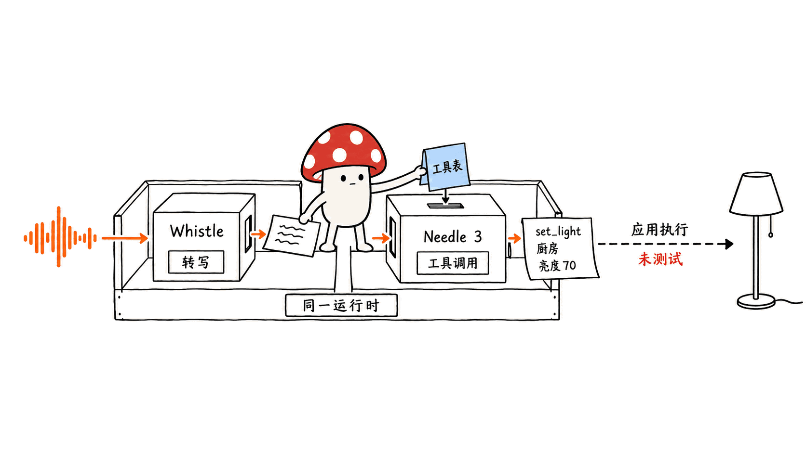
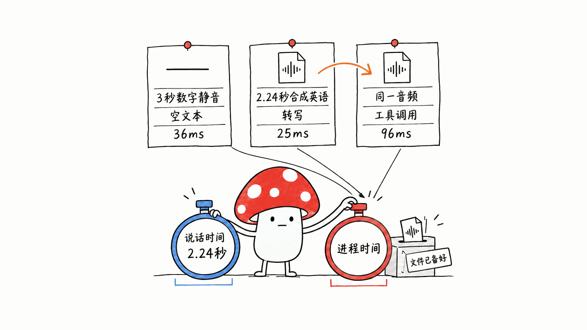
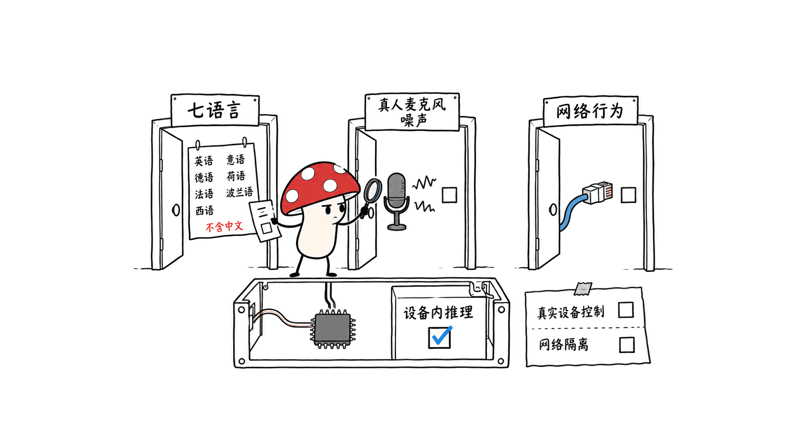

**BLUF**：Cactus Compute 的 Whistle 是一个只有 16.9MB 的 CPU 语音识别模型，支持英语等 7 种语言，不含中文。

我们在 Apple M4、16GB 内存的 Mac mini 上跑了三次最小验证：3 秒数字静音返回空文本；一段 2.24 秒的合成英语命令被正确转写，进程耗时 25ms；同一段音频再配合 Needle 3，生成了正确的调灯函数和参数，进程耗时 96ms。Whistle 与 Needle 3 两份模型合计 52.3MB，运行时另计。

我的判断是，它值得作为英文设备控制、短口令和窄范围业务操作的候选，不能凭这几个样本认定它适合中文会议、嘈杂现场或任意语音助手。

> 一手资料：
> Whistle 模型卡：https://huggingface.co/Cactus-Compute/whistle
> 共享引擎与文本模型：https://huggingface.co/Cactus-Compute/needle3
> 官方源代码：https://github.com/cactus-compute/needle
> 核查及实测日期：2026-10-11。模型卡标注 Apache-2.0，源码仓库也标注 Apache-2.0。

## 为什么关注一个 16.9MB 的语音模型？

做本地语音产品，很容易从「找一个识别率最高的 ASR」开始。可如果产品只需要处理「把厨房灯调到七成」「选下一首」「记录一个数量」，转写全文不是最终目的，识别出哪个动作、把参数填对才是。

这会改变模型选择的标准。要关注的包括模型下载量、运行时是否重复、启动开销、业务词能否识别，以及无法理解时是否会误触发动作。Whistle 有意思的地方在于：它可以单独做转写，也能和 Cactus 的文本工具调用模型 Needle 3 共用一个 C++ 引擎，把音频变成函数调用。

本站此前写过 Audio8-ASR 和 Qwen3-ASR 的本地部署，关注的是端侧识别与中英业务语音：

- Audio8-ASR：https://blog.mushroom.cv/blog/audio8-asr-01b-on-device-speech-recognition/
- Qwen3-ASR：https://blog.mushroom.cv/blog/qwen3-asr-small-business-bilingual-voice-ai-local-deploy/

Whistle 的切入点更窄：用很小的包，把设备听到的一句话接进本地动作接口。这篇文章检查这条路径是否真的能跑通，以及它的边界在哪里。

## 16.9MB 指的是哪一部分？

我们下载官方文件后，核对了实际字节数。以下使用十进制 MB，1MB 等于 1,000,000 字节：

| 文件 | 实际字节数 | 约合体积 | 用途 |
|---|---:|---:|---|
| `whistle.cact` | 16,919,407 | 16.9MB | 语音识别 |
| `needle3.cact` | 35,335,380 | 35.3MB | 文本工具调用 |
| `macos-arm64/needle` | 1,106,424 | 1.1MB | 此次使用的 CPU 可执行引擎 |
| 两份模型合计 | 52,254,787 | 52.3MB | 语音 → 工具调用，不含引擎 |

所以「16.9MB 就能做语音工具调用」是不完整的表述。只转写要 Whistle；要把转写结果变成动作，还要文本模型。我们的两份模型与这一个可执行文件加起来约 53.4MB；它也不是内存需求，运行时还有缓存和中间结果。

官方 `config.json` 没有提供 Whistle 的总参数量。这篇文章不从量化文件体积倒推出一个参数数，因为量化、容器元数据和不同张量的存储精度都会影响这个估算。

模型卡列出的语言是英语、德语、法语、西班牙语、意大利语、荷兰语和波兰语。「多语言」在这里是一个明确的七语言清单，不包括中文。

## 它怎样把声音变成文字？



按官方模型卡，Whistle 的内部路径是：

1. 16kHz 单声道音频先变成 log-mel 声学特征；
2. 卷积前端把特征送入音频编码器；
3. 类似 Needle 的解码器在每一层通过门控交叉注意力读取音频信息，生成文字。

这不是把音频上传到另一个服务的包装器。它复用 Needle 的 `.cact` 容器、Cactus Quants 量化、SIMD 内核和 KV cache，官方提供直接运行在 CPU 上的引擎。

解码器也采用「梯子」设计：从 2 层起，不同深度可以作为可部署的子模型，用 `--audio-depth` 在加载时选择。我们没有测试不同深度的准确率和速度，所以不能承诺减少层数仍能保留完整模型的识别质量。

几个接口细节会影响应用设计：

| 能力 | 官方说明 | 对产品的意义 |
|---|---|---|
| 输入 | 16kHz、单声道 | 其他格式需要先转码或重采样 |
| 单次窗口 | 最长 30 秒，超过后分窗 | 支持长音频不代表能一直看到完整上下文 |
| 词级时间戳 | 从解码器注意力对齐，带起止和概率 | 可做逐词高亮、定位和剪辑 |
| 关键词偏置 | 在搜索时倾向指定名字、地点、产品词 | 业务专名可注入，但不能保证不会识别错 |
| 音频嵌入 | 每 80ms 一帧的编码器输出 | 可用于音频匹配、检索，无需先转写 |
| 流式 | 提交连续两次识别一致的词 | 实际提交延迟还要现场测 |

以上是官方能力描述。本次实测覆盖了文件转写与词级时间戳，没有覆盖流式、嵌入、关键词偏置和长音频分窗。

## 最有价值的路径：音频 → 动作参数



Whistle 和 Needle 3 同时加载后，同一引擎先转写，再根据工具 schema 选择函数、填写参数，返回一个 JSON。语音相关字段加 `audio_` 前缀。两步在引擎内部衔接，应用不必启动两个独立推理服务。

这并不意味着 Whistle 自己会理解工具。Whistle 负责听清，Needle 3 负责把文字映射成动作。即使两者共享运行时，仍然有两个模型和两种可能出错的环节。

我们给引擎的工具表包含 `get_weather(city)` 和 `set_light(room, brightness)`。输入只表达调灯，因此预期是一个 `set_light` 调用，不应出现天气查询。

官方命令形式如下，`tools.json` 是应用自己定义的函数列表，`clip.wav` 是已经准备好的 16kHz 单声道文件：

```bash
# 单独转写，返回词级时间戳
./needle --model whistle.cact --audio clip.wav --audio-word-timestamps

# 同一引擎加载两份模型，生成动作参数
./needle --model needle3.cact --model whistle.cact \
  --tools tools.json --audio clip.wav --audio-word-timestamps
```

返回函数名和参数以后，应用仍需把它们交给实际的设备或业务接口。本次没有控制任何真实灯具，也没有接天气服务。我们验证的是生成调用的这一段。

## M4 实测：25ms 和 96ms 到底测了什么？



环境是 Mac mini、Apple M4、16GB 内存、macOS 26.6.2，运行官方 `macos-arm64` CPU 引擎。模型文件已预先下载。每一项都是一次最小冒烟测试，没有重复采样，也没有统计平均值或尾延迟。

我们没有拿网上的演示视频当输入，而是准备了两种可控音频：一段 3 秒数字静音，以及用 macOS `say` 的 Samantha 声音合成的英语句子：

> Set the kitchen light to seventy percent.

合成语音转成 16kHz 单声道后，时长为 2.243625 秒。这种输入发音清晰、没有麦克风和环境噪声，难度明显低于实际使用现场。

| 测试 | 输出 | 本次进程耗时 |
|---|---|---:|
| 3 秒数字静音 → Whistle | `text` 为空，语言字段也为空 | 36ms |
| 合成英语 → Whistle，含词级时间戳 | `set the kitchen light to 70%.`，语言 `en` | 25ms |
| 同一音频 → Whistle + Needle 3 | `set_light`，`room=kitchen`，`brightness=70` | 96ms |

第三项的关键结果如下，省略了时间戳和其他日志字段：

```json
{
  "function_calls": [
    {
      "name": "set_light",
      "arguments": {"room": "kitchen", "brightness": 70}
    }
  ],
  "audio_text": "set the kitchen light to 70%.",
  "audio_language": "en",
  "confidence": 0.9366,
  "peak_ram_mb": 136.5
}
```

`peak_ram_mb=136.5` 是引擎自行报告的字段，不是操作系统独立测量的峰值。`confidence=0.9366` 也不能读成「在我们的业务中有 93.66% 的成功率」；一个样本无法验证置信度校准。

单独转写时，引擎还报告首 token 耗时 3.8ms、解码速度 1281.4 tokens/s。这些口径和 25ms 不同：25ms 是我们计时的进程墙钟时间；3.8ms 是引擎内部的 TTFT；解码速度只描述后续解码阶段。

25ms 和 96ms 都不包含人说完这 2.24 秒音频的时间，不包含采集等待、联网下载和真实设备执行，也不是实时语音交互的端到端延迟。我们还没有验证真人口音、背景噪声、说到一半改口、否定句、七语言切换和麦克风流式输入。

数字静音返回空文本，是一个好信号，但只能支持「这段数字静音没有幻觉」这个结论，不能证明各种噪声都会被正确拒绝。

## 官方跑分应该怎样读？

Whistle 模型卡把它与 Whisper base 和 Moonshine tiny v2 放在一起比较。我们解析了官方 SVG 中的文字，下面只列 Whistle 自己标注的 WER（词错误率，越低越好），不把图上的其他柱子目测成精确值：

| 测试集 | 官方 Whistle WER |
|---|---:|
| LibriSpeech test-clean | 4.31% |
| LibriSpeech test-other | 10.49% |
| SPGISpeech | 7.65% |
| Earnings-22 | 19.01% |
| AMI | 26.07% |
| AMI cleaned | 22.87% |
| TED-LIUM | 7.61% |
| FLEURS | 21.4% |
| MLS | 24.9% |

来源：https://huggingface.co/Cactus-Compute/whistle/resolve/main/assets/whistle-benchmarks.svg

官方说 Whistle 共评估了 86,174 条语音，用 Whisper normalizers 评分；Whisper 和 Moonshine 的 WER 来自各自作者已发布的结果，不是把三个模型在同一套当前环境里重新跑一遍。AMI、TED-LIUM 和多语言平均还有单独的计分说明，不能忽略。

速度图使用 Apple M4 Pro、10 秒音频，报告 TTFT：Whistle 11.1ms、Whisper base 73.2ms、Moonshine tiny v2 22.8ms。不过三者运行时和精度不同：Whistle 是 2–4 bit C++ 引擎，Whisper 是 CPU 内存中的 fp32 与官方 Python 运行时，Moonshine 是 int8。

所以，这张图能支持「官方这套部署组合表现很快」，不能单独推出「Whistle 的架构在相同精度、相同优化水平下一定更快」。我们的 M4、2.24 秒合成音频结果也不能和官方 M4 Pro、10 秒音频直接拼成加速排名。

## 本地运行和不出网，要分开核查



模型卡强调端侧推理。权重下载到本机、CPU 能完成识别，我们已经验证了。但「能本地推理」和「运行过程中没有任何网络行为」是两件需要分别检查的事。

这里有一处值得留意的文档差异：Whistle 的 Hugging Face 模型卡说引擎不读取环境变量；共享源码仓库的 README 又明确写着 binary 默认开启 telemetry，可用下面两个环境变量关闭：

```bash
export NEEDLE_TELEMETRY=0
export DO_NOT_TRACK=1
```

出处：https://github.com/cactus-compute/needle

我们还读了源码中的 `needle/_telemetry.py`：Python 层默认启用匿名使用事件，载荷包含事件名、版本、操作系统、架构和随机安装标识；代码注释说明不发送提示词、输出或路径。上述两个变量在这份 Python 代码中确实是退出条件。这项源码核查不等于独立验证了下载的 C++ binary 的 telemetry 行为，不能直接把二者混为一谈。

我会按更保守的那份说明先关闭 telemetry，但本文没有抓包、没有做断网隔离验证，也没有证明关闭后所有路径都不访问网络。如果产品承诺音频绝不出设备，要把版本固定、首次下载和日常运行分开，再独立检查运行时网络行为，不能只引用模型卡上的「on-device」。

另一个边界是设备。官方把手机、穿戴设备、机器人甚至微控制器列为目标，也提供多平台引擎；我们只验证了 M4 Mac。这证明 Apple Silicon CPU 路径可用，不证明任意微控制器都能装下模型、获得相同速度或满足实时内存预算。

## 我的判断：先从受限英文动作做起

对一个小团队，Whistle 最有吸引力的地方，是把语音入口压到几十 MB 级，再复用既有的文本工具调用运行时。这个体积使安装包、首次下载、设备侧资源预算都变得更容易讨论。

我会把它的第一轮试用限定在三个条件里：七语言清单内、短口令、工具范围明确。例如一个已有几个固定操作的英文设备界面，先验证口音、业务专名、数字和拒绝触发，而不是马上扩展为开放式语音助手。这是根据模型定位与本次结果作出的工程判断，不是官方保证。

如果下一步要投入产品，最值得补的测试不是再读几个排行榜：

1. 收集真人对着目标麦克风说的实际指令，覆盖房间名、数量、口音和噪声；
2. 同时评估转写错误和动作错误，特别检查否定、改口、工具范围外请求；
3. 测量从用户停止说话到设备执行的总延迟，再验证长期运行时的内存和网络行为。

中文业务、会议长录音、多说话人混杂场景，目前不能由这篇实测背书。Whistle 的价值已经足够具体：在本机，一个很小的语音模型确实把一段英语接进了结构化动作路径。剩下的工作是验证你的声音和你的业务。

## 常见问题

Q：Whistle 支持中文吗？

A：官方语言清单是英语、德语、法语、西班牙语、意大利语、荷兰语和波兰语，没有中文。不能从「多语言」标签推断中文可用。

Q：16.9MB 就能语音控制设备吗？

A：16.9MB 是 Whistle 语音模型文件。此次输出工具调用还加载了 35.3MB 的 Needle 3，两份模型合计 52.3MB，另加运行时。生成函数调用以后，还需要应用执行，我们没有控制真实设备。

Q：96ms 代表用户说一句话就能立刻完成动作吗？

A：这是模型已下载、输入文件已准备好时的一次进程耗时，不含 2.24 秒说话时间、音频采集等待和设备执行，也没有重复采样。它证明这一个合成英语样本能跑通，不是产品级延迟保证。

## 一手源与实测记录

- Whistle 模型卡：https://huggingface.co/Cactus-Compute/whistle
- Whistle 配置：https://huggingface.co/Cactus-Compute/whistle/raw/main/config.json
- Whistle 官方跑分图：https://huggingface.co/Cactus-Compute/whistle/resolve/main/assets/whistle-benchmarks.svg
- Needle 3 模型及平台引擎：https://huggingface.co/Cactus-Compute/needle3
- 源码、安装及 telemetry 说明：https://github.com/cactus-compute/needle
- Python telemetry 源码：https://github.com/cactus-compute/needle/blob/main/needle/_telemetry.py
- 本次原始输出、计时范围与文件校验值：https://blog.mushroom.cv/research/hf-small-models-20261011-smoke.json

---

> © 2026 Author: Mycelium Protocol. 本文采用 [CC BY 4.0](https://creativecommons.org/licenses/by/4.0/deed.zh) 授权——欢迎转载和引用，须注明作者姓名及原文链接，不得去除署名后以原创发布。

<!--EN-->

**BLUF**: Cactus Compute's Whistle is a 16.9 MB CPU speech-recognition model supporting seven languages, excluding Chinese. We ran three small checks on an Apple M4 Mac mini with 16 GB of memory: three seconds of digital silence returned empty text; a 2.24-second synthetic English command transcribed correctly in 25 ms of process wall time; and the same audio produced the correct light-control function and arguments with Needle 3 in 96 ms. The two model files total 52.3 MB, excluding the runtime.

My assessment is that it deserves testing for English device commands and narrow business actions. These samples do not establish suitability for Chinese meetings, noisy environments or a general voice assistant.

> Primary sources:
> Whistle model card: https://huggingface.co/Cactus-Compute/whistle
> Shared engine and text model: https://huggingface.co/Cactus-Compute/needle3
> Official source code: https://github.com/cactus-compute/needle
> Checked and tested on October 11, 2026. The model card and source repository both specify Apache-2.0.

## Why look at a 16.9 MB speech model?

Building local voice software often starts with finding the ASR model with the highest recognition accuracy. But if a product only needs requests such as setting a kitchen light, selecting the next track or recording a quantity, a transcript is an intermediate result. Selecting the right action and filling its arguments is the actual goal.

That changes the selection criteria. Download size, duplicated runtimes, startup overhead, vocabulary handling and avoiding unintended actions matter alongside recognition accuracy. Whistle is interesting because it can transcribe independently or share a C++ engine with Cactus's text tool-calling model, Needle 3, to convert audio into function calls.

Our earlier Audio8-ASR and Qwen3-ASR articles cover on-device recognition and bilingual business speech:

- Audio8-ASR: https://blog.mushroom.cv/blog/audio8-asr-01b-on-device-speech-recognition/
- Qwen3-ASR: https://blog.mushroom.cv/blog/qwen3-asr-small-business-bilingual-voice-ai-local-deploy/

Whistle presents a narrower opportunity: a small package that connects a spoken sentence to a local action interface. This article checks whether that path works and what remains unverified.

## What does the 16.9 MB figure include?

We downloaded the official files and checked their sizes. These are decimal MB: one MB is 1,000,000 bytes.

| File | Exact bytes | Approximate size | Role |
|---|---:|---:|---|
| `whistle.cact` | 16,919,407 | 16.9 MB | Speech recognition |
| `needle3.cact` | 35,335,380 | 35.3 MB | Text tool calling |
| `macos-arm64/needle` | 1,106,424 | 1.1 MB | CPU executable used here |
| Both model files | 52,254,787 | 52.3 MB | Speech to tool calls, excluding engine |

Saying that 16.9 MB buys a complete voice-action system leaves out the text model. Whistle alone transcribes; mapping its transcript into actions also requires Needle 3. Our two model files plus this executable total approximately 53.4 MB. That is storage, not the runtime memory requirement: caches and intermediate data add to memory usage.

The official `config.json` does not publish Whistle's total parameter count. We do not reverse-engineer one from file size, because quantization, container metadata and mixed tensor precision affect that estimate.

The supported languages are English, German, French, Spanish, Italian, Dutch and Polish. Multilingual here means this specific seven-language list; it does not include Chinese.

## How does it turn sound into text?


The model card describes three stages:

1. A log-mel frontend processes 16 kHz mono audio.
2. A convolutional stem feeds an audio encoder.
3. A Needle-shaped decoder reads the encoded audio through gated cross-attention at every layer and generates text.

This is an on-device model with an official CPU engine. It shares Needle's `.cact` container, Cactus Quants, SIMD kernels and KV cache.

The decoder is also laddered: depths from two layers upward can be deployed as subnetworks, selected at load time with `--audio-depth`. We did not compare different depths, so this article makes no claim about how much recognition quality survives a smaller configuration.

Several interface details affect product design:

| Capability | Official description | Practical implication |
|---|---|---|
| Input | 16 kHz mono | Other formats need conversion or resampling |
| Single window | Up to 30 seconds; longer audio is windowed | Long-audio support does not imply unlimited context |
| Word timestamps | Attention-aligned starts, ends and probabilities | Supports highlighting, seeking and editing |
| Keyword bias | Search favors specified names, places and product terms | Helps introduce vocabulary without guaranteeing correctness |
| Speech embeddings | One encoder row per 80 ms frame | Enables matching or retrieval without a transcript |
| Streaming | Commits words agreed on by two passes | Real commit latency still needs measurement |

Those are vendor-described capabilities. Our tests covered file transcription and word timestamps, not streaming, embeddings, keyword bias or long-audio windowing.

## The useful path: audio to action arguments


With both models loaded, the same engine transcribes the clip, selects functions and fills arguments against the application's tool schema, then returns one JSON object. Speech fields receive an `audio_` prefix. The application does not need two separately running inference services.

The division of work still matters: Whistle recognizes speech; Needle 3 maps the text into actions. A shared runtime still contains two models and two opportunities for errors.

Our tool list contained `get_weather(city)` and `set_light(room, brightness)`. The audio only requested a light adjustment, so we expected a single `set_light` call and no weather request.

The command structure below follows the official engine interface. `tools.json` defines the application's functions; `clip.wav` is already prepared as 16 kHz mono audio.

```bash
# Transcribe with word timestamps
./needle --model whistle.cact --audio clip.wav --audio-word-timestamps

# Load both models in one engine to produce action arguments
./needle --model needle3.cact --model whistle.cact \
  --tools tools.json --audio clip.wav --audio-word-timestamps
```

The application must then execute the returned function using a real device or business interface. We did not control a physical light or connect a weather service. This test covers call generation only.

## M4 results: what did 25 ms and 96 ms measure?


The machine was a Mac mini, Apple M4, 16 GB memory, macOS 26.6.2, running the official `macos-arm64` CPU engine. Model files were downloaded beforehand. Each result is one smoke-test invocation, with no repeated sampling, averages or tail-latency analysis.

We used controlled inputs: three seconds of digital silence and an English sentence synthesized with the Samantha voice in macOS `say`:

> Set the kitchen light to seventy percent.

After conversion to 16 kHz mono, the synthesized clip lasted 2.243625 seconds. Clear synthetic speech without microphone or environmental noise is an easier input than real product use.

| Test | Output | Process wall time in this run |
|---|---|---:|
| Three seconds of digital silence → Whistle | Empty `text` and language fields | 36 ms |
| Synthetic English → Whistle, with word timestamps | `set the kitchen light to 70%.`, language `en` | 25 ms |
| Same audio → Whistle + Needle 3 | `set_light`, `room=kitchen`, `brightness=70` | 96 ms |

The combined result contained these fields; timestamps and other diagnostics are omitted:

```json
{
  "function_calls": [
    {
      "name": "set_light",
      "arguments": {"room": "kitchen", "brightness": 70}
    }
  ],
  "audio_text": "set the kitchen light to 70%.",
  "audio_language": "en",
  "confidence": 0.9366,
  "peak_ram_mb": 136.5
}
```

The engine itself reported `peak_ram_mb=136.5`; this is not an independent operating-system measurement. Likewise, `confidence=0.9366` does not establish a 93.66% success rate for our business. One sample cannot validate confidence calibration.

Standalone transcription reported 3.8 ms to first token and 1281.4 tokens/s during decoding. These have different definitions from the 25 ms result: we measured process wall time externally, TTFT is an internal engine metric, and decode throughput describes the subsequent decoding phase.

Neither 25 ms nor 96 ms includes speaking the 2.24-second sentence, waiting for audio capture, downloading files or executing a device action. These are not end-to-end live interaction latencies. We have not tested real accents, background noise, mid-sentence corrections, negations, switching among seven languages or microphone streaming.

The silence result is encouraging, but proves only that this particular digital silence did not generate a transcript. It does not establish rejection of arbitrary noise.

## How should you read the official benchmarks?

The model card compares Whistle with Whisper base and Moonshine tiny v2. We parsed the text in the official SVG. Below are only the explicitly labeled Whistle word error rates, where lower is better; we did not estimate exact competitor values from unlabeled bars.

| Test set | Official Whistle WER |
|---|---:|
| LibriSpeech test-clean | 4.31% |
| LibriSpeech test-other | 10.49% |
| SPGISpeech | 7.65% |
| Earnings-22 | 19.01% |
| AMI | 26.07% |
| AMI cleaned | 22.87% |
| TED-LIUM | 7.61% |
| FLEURS | 21.4% |
| MLS | 24.9% |

Source: https://huggingface.co/Cactus-Compute/whistle/resolve/main/assets/whistle-benchmarks.svg

The authors say they evaluated Whistle on 86,174 utterances using Whisper normalizers. Whisper and Moonshine WER figures are their authors' published results, not a unified rerun of all three models in one current environment. The card also documents scoring qualifications for AMI, TED-LIUM and multilingual averages.

The speed comparison uses 10 seconds of audio on an Apple M4 Pro and reports TTFT of 11.1 ms for Whistle, 73.2 ms for Whisper base and 22.8 ms for Moonshine tiny v2. The runtimes and precisions differ: Whistle uses its 2–4-bit C++ engine, Whisper uses fp32 in CPU memory with its official Python runtime, and Moonshine uses int8.

Those results support the speed of the vendor's deployment combination. They do not isolate architectural advantage at matched precision and optimization. Our M4 result on a 2.24-second synthetic clip cannot be combined with the M4 Pro comparison into a speed ranking.

## Local inference and no network traffic need separate checks


We verified that downloaded weights can perform recognition on the local CPU. That is a separate claim from proving there is no network activity during execution.

Two official documents differ here. Whistle's Hugging Face card says the engine reads no environment variables. The shared source repository README says telemetry is enabled by default in the binary and gives these opt-outs:

```bash
export NEEDLE_TELEMETRY=0
export DO_NOT_TRACK=1
```

Source: https://github.com/cactus-compute/needle

We also inspected `needle/_telemetry.py`: the Python layer enables anonymous usage events by default, with payload fields for event name, versions, operating system, architecture and a random installation identifier. Its code comment states that prompts, outputs and paths are not sent. Both opt-outs are implemented in that Python code. This source check does not independently verify telemetry behavior in the downloaded C++ binary.

I would follow the more conservative documentation and disable telemetry first. However, we did not capture traffic, validate network isolation or prove that every execution path avoids networking after those settings. A product promising that audio never leaves its device should pin a version, separate initial download from routine inference and independently inspect runtime network behavior.

Hardware needs the same care. The authors target phones, wearables, robots and even microcontrollers, and publish multiple platform engines. Our test covers only an M4 Mac. It verifies an Apple Silicon CPU path, not that every microcontroller can fit the model, achieve these speeds or meet a real-time memory budget.

## My assessment: start with constrained English actions

For a small team, the attraction is a voice entry point occupying tens of megabytes while reusing a text tool-calling runtime. That makes package size, initial download and device resource budgets easier to manage.

I would keep a first trial within three conditions: a supported language, short commands and a clearly bounded tool set. An English device interface with a few known actions could test accents, business terms, numbers and unintended triggers before expanding into an open-ended assistant. This is an engineering judgment based on the model's positioning and our result, not a vendor guarantee.

Before investing in a product, the next useful tests are practical:

1. Record actual commands through the target microphone, covering room names, quantities, accents and noise.
2. Evaluate transcription errors and action errors together, especially negations, corrections and unsupported requests.
3. Measure total latency from the user finishing speech to device execution, then validate memory and networking during sustained operation.

This test does not establish suitability for Chinese business speech, meeting recordings or overlapping speakers. Its finding is concrete enough: a very small local speech model connected one English utterance to a structured action path. Your voices and your workflow remain the next validation step.

## FAQ

Q: Does Whistle support Chinese?

A: Its official language list is English, German, French, Spanish, Italian, Dutch and Polish. Chinese is absent; the multilingual label does not establish Chinese support.

Q: Is 16.9 MB enough for voice-controlled devices?

A: That is Whistle's speech model file. Our tool-call test also loaded a 35.3 MB Needle 3 file, totaling 52.3 MB of models plus runtime. The application still has to execute the call; we did not control a real device.

Q: Does 96 ms mean a spoken request immediately completes its action?

A: It is one process-wall-time result with the models downloaded and audio file ready. It excludes the 2.24 seconds of speech, capture waiting and device execution, and we did not repeat the measurement. It verifies one synthetic English sample, not a product latency guarantee.

## Primary sources and test records

- Whistle model card: https://huggingface.co/Cactus-Compute/whistle
- Whistle configuration: https://huggingface.co/Cactus-Compute/whistle/raw/main/config.json
- Official Whistle benchmarks: https://huggingface.co/Cactus-Compute/whistle/resolve/main/assets/whistle-benchmarks.svg
- Needle 3 model and platform engines: https://huggingface.co/Cactus-Compute/needle3
- Source, installation and telemetry documentation: https://github.com/cactus-compute/needle
- Python telemetry source: https://github.com/cactus-compute/needle/blob/main/needle/_telemetry.py
- Raw outputs, timing scope and file hashes: https://blog.mushroom.cv/research/hf-small-models-20261011-smoke.json

---

> © 2026 Author: Mycelium Protocol. Licensed under [CC BY 4.0](https://creativecommons.org/licenses/by/4.0/) — free to share and adapt with attribution. You must credit the author and link to the original; removing attribution and republishing as original is not permitted.
