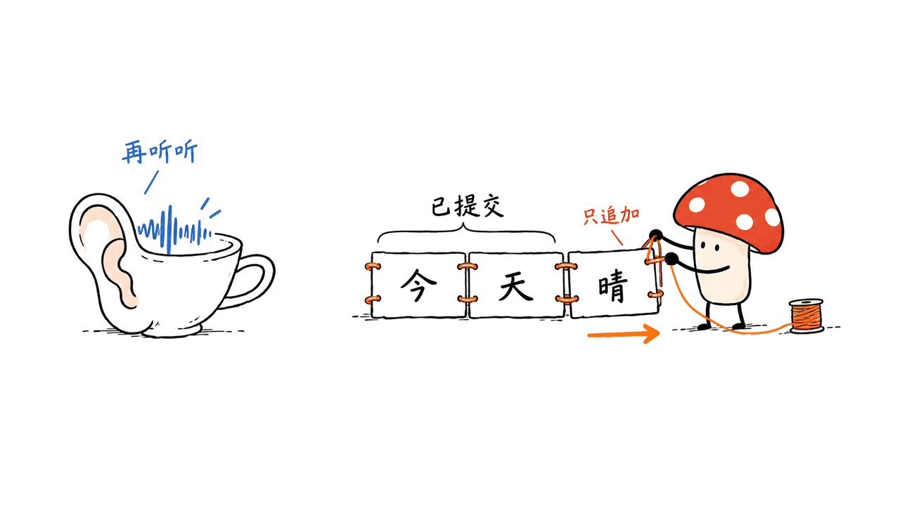
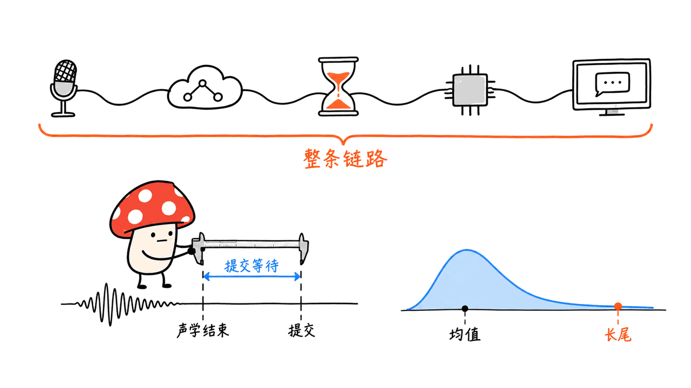
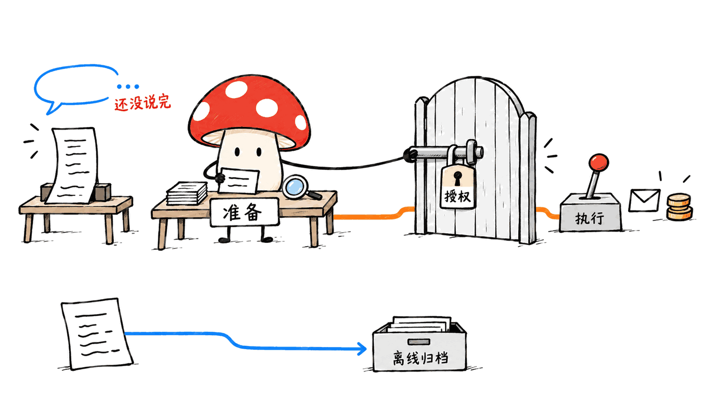

X2Streaming-ASR 是一个让识别文字只追加、不回改的流式语音模型：听不准就继续等，准备好才提交。它解决了实时字幕和语音 Agent 反复处理“上一版文字”的麻烦，但不保证每个提交都正确，也不保证一句话的意图已经完整。

项目由 X-Square-Robot 发布，基于 Voxtral Mini Realtime 4B，代码与模型卡声明 Apache 2.0。本文截至2026年10月15日核对官方仓库、Hugging Face 权重说明和论文第四版；所有准确率、延迟均为作者报告，我们没有运行模型推理或性能测试。

仓库：https://github.com/X-Square-Robot/X2Streaming-ASR

权重：https://huggingface.co/x-square-robot/X2Streaming-ASR-4B-1009

论文：https://arxiv.org/abs/2609.08672v4

## X2Streaming-ASR 改的是“何时交卷”

传统流式识别常见两条路线：多等一段上下文再出字，或者先给临时结果、后面修订。前者让所有字承担同一份等待预算，后者把版本管理交给字幕界面和下游 Agent。

X2Streaming-ASR 将“何时提交”和“提交什么”拆开。音频编码的节拍是每80毫秒一个单元，模型选择 LISTEN 或 DECODE；选择解码后输出一段文字，结束再回到监听。容易判断的片段尽早提交，歧义较大的位置等待更多上下文。

这个80毫秒是音频时间轴上的决策间隔，不是每步计算耗时，也不是每个字的最低延迟。论文测量相对字词结束点的剩余等待，因此平均值可以小于80毫秒。

底层使用因果音频编码与 KV cache 复用，避免每次从头识别。历史复用仍受配置的上下文和缓存限制，不能理解为无限记忆。



## 论文的三阶段训练，仓库只提供推理

第一阶段学习流式识别；第二阶段用自动探测得到的提交轨迹学习等待与输出；第三阶段用 GRPO 调整策略。奖励把正确性和延迟联系起来，并将字符或词的贡献归到对应提交片段，而不是只给整句话一个分数。

最后阶段冻结音频编码器及适配器，以 LoRA 更新语言模型。这里的“自适应”等待是训练结果，不是调用时简单调小一个 chunk 参数。

需要划清开源范围：当前仓库明确标注 inference-only，提供推理、批处理与 Demo。论文介绍了训练方法，不等于预处理、轨迹构造和 GRPO 训练流水线都已开放。

## 32毫秒不是从麦克风到屏幕的总延迟

论文把提交延迟定义为 `t_emit - t_end`，其中 `t_end` 来自强制对齐的声学结束点；中文按字符、英文按词统计。它回答的是“这个字词在音频里结束后，又等了多久才提交”，不能直接替代设备采集、传输、推理排队、计算和界面呈现合起来的端到端测量。

论文没有提供我们机器上的墙钟耗时、实时率或并发队列表现。因而本文不把这些数字写成“模型只需32毫秒算完”，也不把它们换算成推理速度提升。

以下摘录作者论文第四版的部分结果。CER 是中文字符错误率，WER 是英文词错误率，越低越好；延迟单位均为毫秒。

| 测试集 | CER / WER（%） | 平均提交延迟 | P95提交延迟 |
|---|---:|---:|---:|
| AISHELL-1 | 1.53 | 32 | 320 |
| AISHELL-3 | 2.08 | 57 | 400 |
| WenetSpeech Net | 7.88 | 109 | 400 |
| LibriSpeech test-clean | 2.20 | 29 | 240 |
| LibriSpeech test-other | 5.50 | 85 | 480 |
| GigaSpeech Clean | 10.01 | 43 | 320 |
| VoxPopuli | 7.07 | 12 | 320 |
| TEDLIUM | 3.42 | 15 | 240 |

AISHELL-1的平均32毫秒和P95的320毫秒同时成立。产品若只围绕均值做预算，用户仍可能在困难片段遇到明显等待。LibriSpeech test-other 上，它的P95为480毫秒，而论文中 R2T2 speed 为320毫秒；不能说所有延迟指标都全面领先。

准确率也有边界：作者在所列流式对照中报告六个测试集取得最佳 CER/WER，并不是十个集全部第一。不同表项的训练数据、模型规模和解码设置也需要一并考虑。Uni-ASR 在 WenetSpeech Net 的报告值更低，但采用1000毫秒 chunk、beam 3，论文明确标注它并非匹配协议的对比，也没有报告同口径的提交延迟。



### 两个容易被转述抹平的差异

一是数据集数量。论文按10个测试集统计，当前 README 列12行，是因为 AISHELL-2 拆成 android、ios、mic 三个子集；不是增加了两个独立的新任务。

二是“固定等待396毫秒”的例子。README 写396毫秒、1.58% CER；论文第四版表2写的是401毫秒、1.58%，对照自适应的32毫秒、1.53%。本文以第四版为准。

更关键的是，这组对照在同一检查点上借助参考强制对齐结束点，强制到 `t_end + 640ms` 再提交。它用于分析等待策略，不是一个不需要参考答案、可以照搬上线的通用固定 chunk 基线。不能据此宣称任何真实部署都快了十二倍。

## 怎样开始部署，怎样避免 Demo 改回文字

官方推荐 Linux、Python 3.11 和 NVIDIA CUDA。推理配置默认 `cuda:0`、BF16；依赖固定了 `torch==2.11.0+cu128` 和 `transformers==5.15.1` 等版本。这不是可以直接复制到 Mac 上的 MPS 安装说明，也没有在这些材料里证明某张消费卡的最低显存。

起步先使用隔离环境，按仓库 requirements 和对应 CUDA wheel 来源安装依赖。下面只列关键流程，不把依赖安装省略理解为已经验证整套部署：

```bash
git clone https://github.com/X-Square-Robot/X2Streaming-ASR.git
cd X2Streaming-ASR
export MODEL_PATH=/absolute/path/to/X2Streaming-ASR-4B-1009
```

用 Hugging Face 工具下载完整模型到该路径，建议固定模型版本 `4c8df16b8d7f8b50c95590c4d7907436ebe4aa08`。输入准备为16kHz、单声道音频，再按实际语种运行：

```bash
python infer.py --config configs/infer.yaml \
  --model_path "$MODEL_PATH" --language zh \
  --audio /absolute/path/to/audio.wav
```

`--language` 支持 `zh`、`en`、`cs`，最后一个用于中英混读。不指定时，脚本会根据路径猜部分已知英文语料，否则回退到中文；生产系统应显式设置，不要依赖文件名碰巧带着语料名称。

网页 Demo 的纯流式起步方式：

```bash
HOST=127.0.0.1 LANGUAGE=zh BACKEND=transformers MODE=adaptive \
  ENABLE_OFFLINE=0 REPO_ID="$MODEL_PATH" bash demo/run.sh
```

然后打开 `http://localhost:7860`。`ENABLE_OFFLINE=0` 有实际意义：代码默认开启整句离线复核；启用时会产生独立的 offline 事件，最终 `final_text` 可以来自离线识别，而非已经提交的 live 文本。

接入方应消费并累积实时提交事件，把离线归档文本放在另一条通道；否则应用自己用第二遍识别覆盖第一遍文字，就破坏了用户看到的“只追加”体验。

vLLM 后端也有支持，但要先用 `tools/convert_hf_to_mistral.py` 转换权重键名。转换默认向模型目录写入新文件，建议使用独立副本，并按仓库对应的启动参数部署；不应假定任意已有 OpenAI API 服务都能直接接收这套流式协议。

## 给语音 Agent 的价值：稳定前缀，仍需完整意图

不可回退的文字适合提早更新上下文、检索候选和准备回复。它能减少“拿旧文本做的工作又要作废”的成本，但错字一旦提交也会保留。

更微妙的问题是语义未完成。用户说“把灯打开……不，别打开”，前面的识别结果完全正确，最终意图仍在后半句才确定。文本不会撤回，不代表现实动作不需要撤回。

我们的工程建议是分开三个状态：声学提交、意图完成、动作授权。前两个可以推动预测性准备，涉及付款、删除、发送等副作用的工具仍要经过轮次判断、权限和执行策略。这是接入建议，不是模型内置的安全能力。



相关的本地语音路线可以参看本站 zixi-51M 的推理验证；TTS 和 ASR 的任务不同，不能把语音生成耗时与识别提交延迟混成一张榜：
https://blog.mushroom.cv/blog/zixi-51m-mac-local-tts/

## 本文核验范围与常见问题

我们在 M4、16GB Mac 上核对源码、模型配置、依赖、Demo 事件和论文表格，实际运行了 `infer.py --help`。没有下载4B权重、运行 ASR、测试麦克风链路或复现准确率与延迟。CLI 能显示帮助，只说明入口可解析，不证明模型能在这台机器上推理。

### 不回退是不是零错误？

不是。它是输出协议，错误率仍由 CER/WER 等识别指标衡量，错误提交也不会自动收回。

### 能直接替代任何现有流式 ASR 吗？

需要核对输入采样率、语种、事件语义、缓存与端到端尾延迟。尤其要区分 live 提交和 Demo 的 offline 复核结果。

### 开源了训练代码吗？

当前公开仓库标注 inference-only。可以研究论文训练方法，但不能把推理仓库当成完整训练复现包。

### 是否值得用于实时交互？

如果系统确实被识别结果反复修订拖累，这种提交策略值得评估。先在目标硬件和目标口音上测准确率、P95、实时率与整个交互链路，再决定是否接管正式流量。

版本留档：代码 `0aca80597bb1399c0be4002de5bc62c0a779c542`；权重版本见上文；论文第四版修订于2026年10月12日。封面采用官方仓库海狸吉祥物，正文插画用于解释机制，不代表模型测试结果。

---

> © 2026 Author: Mycelium Protocol. 本文采用 [CC BY 4.0](https://creativecommons.org/licenses/by/4.0/deed.zh) 授权——欢迎转载和引用，须注明作者姓名及原文链接，不得去除署名后以原创发布。

<!--EN-->

X2Streaming-ASR makes streaming speech recognition append-only: uncertain segments wait, and emitted text is never revised. This removes one source of churn for captions and voice agents. It does not guarantee correct recognition or a complete user intention.

X-Square-Robot publishes the code and model under declared Apache 2.0 licenses. The model builds on Voxtral Mini Realtime 4B. This review, dated October 15, 2026, checks the repository, model card and paper v4. All recognition and latency results below are author-reported; we did not run ASR inference or benchmarks.

Repository: https://github.com/X-Square-Robot/X2Streaming-ASR

Weights: https://huggingface.co/x-square-robot/X2Streaming-ASR-4B-1009

Paper: https://arxiv.org/abs/2609.08672v4

## X2Streaming-ASR learns when to commit

A conventional streaming recognizer may delay output using a fixed context budget, or publish provisional text and revise it later. X2Streaming-ASR separates when to commit from what to commit. At 80ms audio intervals, it chooses LISTEN or DECODE, emits a text segment when ready, then resumes listening.

The interval describes the audio timeline, not execution time. A mean delay measured from individual acoustic endpoints can therefore be shorter than 80ms. Incremental causal encoding and KV-cache reuse avoid repeatedly recognizing the entire recording, within configured context and cache limits.


The paper describes three training stages: streaming recognition, automatically probed commit trajectories, and GRPO optimization. Character- or word-level contributions are attributed to commit segments, balancing recognition correctness against delay. The final stage freezes the encoder and adapter and updates the language model with LoRA.

The public repository is explicitly inference-only. Its existence does not establish that trajectory generation or the full reinforcement-learning pipeline has been released.

## Read the latency definition before the headline

Commit latency is `t_emit - t_end`, relative to a forced-aligned acoustic endpoint. Chinese uses characters and English uses words. This measures remaining wait after an acoustic unit ends; it is not a demonstrated microphone-to-display budget including capture, transport, queueing, computation and rendering.

The sources do not supply wall-clock inference, real-time factor or concurrency results on our machine. We therefore do not turn these values into a runtime speedup claim.

| Dataset | CER / WER (%) | Mean commit latency, ms | P95, ms |
|---|---:|---:|---:|
| AISHELL-1 | 1.53 | 32 | 320 |
| AISHELL-3 | 2.08 | 57 | 400 |
| WenetSpeech Net | 7.88 | 109 | 400 |
| LibriSpeech test-clean | 2.20 | 29 | 240 |
| LibriSpeech test-other | 5.50 | 85 | 480 |
| GigaSpeech Clean | 10.01 | 43 | 320 |
| VoxPopuli | 7.07 | 12 | 320 |
| TEDLIUM | 3.42 | 15 | 240 |

A 32ms mean on AISHELL-1 coexists with a 320ms P95. On LibriSpeech test-other, the model's 480ms P95 is higher than the paper's 320ms for R2T2 speed. Mean improvements do not imply dominance on every tail metric. The authors report best streaming recognition scores on six evaluated datasets, not all ten. Uni-ASR reports a lower WenetSpeech Net CER using 1000ms chunks and beam 3; the paper flags it as an unmatched-protocol comparison without comparable leftover-wait latency.


Two reporting differences matter. The paper counts ten datasets, while the current README lists twelve rows by splitting AISHELL-2 into three recording-device subsets. These are not two additional independent tasks.

The README also reports 396ms and 1.58% CER for a forced-wait comparison; paper v4 Table 2 reports 401ms and 1.58%, versus adaptive 32ms and 1.53%. That experiment forces commits at reference-aligned `t_end + 640ms` on the same checkpoint. It analyzes the policy using reference boundaries; it is not a generally deployable fixed-chunk baseline or evidence of a twelvefold compute speedup.

## Deployment starts with CUDA and explicit language settings

The documented environment is Linux, Python 3.11 and NVIDIA CUDA, with BF16 and `cuda:0` defaults. Requirements pin `torch==2.11.0+cu128` and `transformers==5.15.1`. These instructions are not a verified Mac/MPS installation path, and the sources reviewed do not establish a minimum consumer-GPU memory requirement.

Clone the current official repository into an isolated environment, install its pinned dependencies using the appropriate CUDA wheel source, and download the complete checkpoint. Pin model revision `4c8df16b8d7f8b50c95590c4d7907436ebe4aa08`. Prepare 16kHz mono audio.

```bash
git clone https://github.com/X-Square-Robot/X2Streaming-ASR.git
cd X2Streaming-ASR
export MODEL_PATH=/absolute/path/to/X2Streaming-ASR-4B-1009
python infer.py --config configs/infer.yaml \
  --model_path "$MODEL_PATH" --language zh \
  --audio /absolute/path/to/audio.wav
```

Use `zh`, `en` or `cs` explicitly; `cs` denotes Chinese-English code-switching. Without a language argument, filename heuristics detect certain English corpora and otherwise default to Chinese.

For an adaptive, live-only Transformers demo:

```bash
HOST=127.0.0.1 LANGUAGE=zh BACKEND=transformers MODE=adaptive \
  ENABLE_OFFLINE=0 REPO_ID="$MODEL_PATH" bash demo/run.sh
```

Open `http://localhost:7860`. The offline flag matters: the default demo enables a whole-utterance recognition pass. When enabled, it produces separate offline events and may set `final_text` to that offline result. Consume live commits for append-only interaction and retain offline transcription separately for archival use.

The vLLM path requires `tools/convert_hf_to_mistral.py` to convert checkpoint keys. It writes into the model directory by default, so use a separate copy and follow the repository's matching server configuration. Support for this backend does not mean every existing OpenAI-compatible endpoint accepts the same streaming protocol.

## Stable text still needs intention and execution boundaries

Committed prefixes can update context, start retrieval and prepare candidate replies. Incorrect commitments remain possible. More fundamentally, a correctly recognized prefix can still be qualified by later speech: “turn on the light … no, don't.”

Our integration recommendation separates acoustic commitment, completed intention and action authorization. Speculative preparation can happen early; consequential tools such as payments, deletion and sending messages still require turn handling, permissions and execution policy. This is an engineering recommendation, not a built-in safety guarantee.


For a different local speech task, our zixi-51M article documents TTS inference checks. Audio-generation duration and ASR commit latency should not share a ranking:
https://blog.mushroom.cv/blog/zixi-51m-mac-local-tts/

## Verification scope and FAQ

On an M4 Mac with 16GB memory, we inspected source, model configuration, dependencies, demo events and paper tables, and successfully ran `infer.py --help`. We did not download the 4B weights, run recognition, measure a microphone pipeline or reproduce benchmark scores. Help output verifies argument parsing, not working model inference on this hardware.

### Does append-only mean error-free?

No. It specifies output behavior; CER/WER still measures recognition errors, including irreversible wrong commits.

### Can it replace an existing streaming recognizer directly?

Check sampling rate, language, event semantics, cache behavior and end-to-end tail latency. Keep live commits distinct from offline demo results.

### Is the training implementation available?

The current repository is inference-only. The paper describes training, but the public inference package is not a complete reproduction kit.

### When is it worth evaluating?

When revision churn is a real bottleneck. Evaluate target accents and hardware using accuracy, P95, real-time factor and complete interaction latency before routing production traffic.

Pinned source commit: `0aca80597bb1399c0be4002de5bc62c0a779c542`. Paper v4 was revised October 12, 2026. The cover uses the official repository's beaver mascot. Explanatory illustrations are not experimental evidence.

---

> © 2026 Author: Mycelium Protocol. Licensed under [CC BY 4.0](https://creativecommons.org/licenses/by/4.0/) — free to share and adapt with attribution. You must credit the author and link to the original; removing attribution and republishing as original is not permitted.
