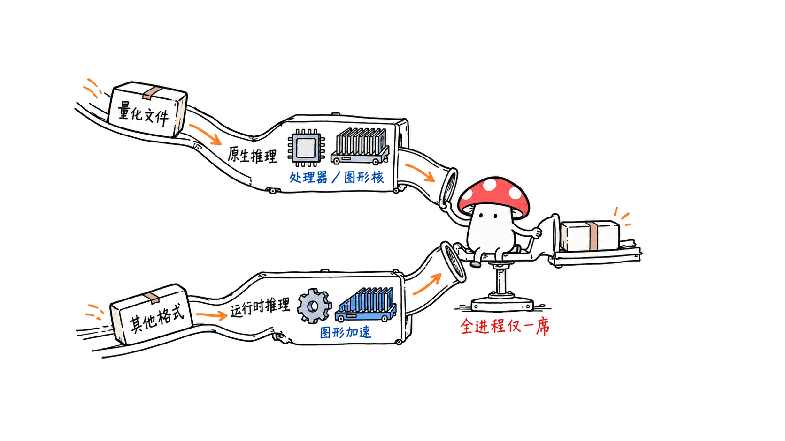
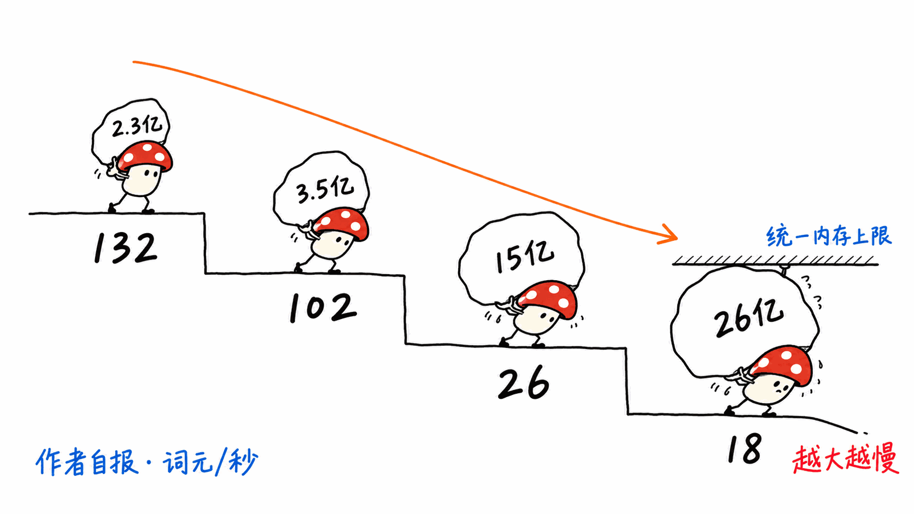

> 📌 开源仓库：gianlucamazza/xllama
> GitHub：https://github.com/gianlucamazza/xllama
> 协议：MIT（模型各有各的协议）｜ 语言：C++ ｜ Stars：73 ｜ 创建：2026-05-19 ｜ 最近提交：2026-10-26 ｜ 最新 Release：v1.6.0.0（2026-09-28）

---

**BLUF**：xllama 是一个真实在维护的独立项目，不是空壳：它把 llama.cpp（GGUF）和 ONNX Runtime GenAI（DirectML）塞进一个 UWP 应用，跑在**开发者模式**的 Xbox Series S 上，并提供一个**默认关闭、没有任何鉴权**的 OpenAI/Ollama 兼容局域网接口。README 自报的实测数字是：LFM2.5-350M 约 101.6 tok/s、LFM2.5-230M 约 132.4 tok/s（峰值内存 236 MB）、Qwen2.5-Coder-1.5B 约 26.1 tok/s、LFM2-2.6B 约 17.9 tok/s，全部是 llama.cpp CPU、6 线程。要点是：模型都很小，Series X 没测过，必须自己开通开发者账号、把主机切到开发者模式（此时不能玩零售游戏）。**对 Mac 用户的建议：不要为它买或改装主机；它是一个有意思的边缘设备实验和方法论样本，不是比你的 Mac 更好的推理机。** 本文没有在 Xbox 上实测（我们没有开发者模式主机），所有数字都是 README 与仓库内 bench 回执的自报值。

## xllama 到底是什么？

- 目标平台：Xbox Series S，开发者模式；作者明确写「Tested and measured on Series S. Not yet tested on Series X.」
- 两条推理后端按模型在运行时自动分派：`*.gguf` 走 llama.cpp（CPU，部分模型用作者自己写的 D3D12 内核），其余走 ORT GenAI + DirectML（CPU int4 解码 + DML fp16 预填充）。
- 附带：SD-Turbo 文生图（DirectML）、headless 基准（tok/s、内存带宽、磁盘带宽）、实验性的端上微调（只训练最后一个 block，仅有一次 SmolLM2-360M 的主机标记运行回执，应用内「Train on my feedback」流程**尚未端到端验证**）。
- 聊天界面是手柄操作的「演示壳」，作者在 positioning 文档里明说它不是产品主张；产品主张是「游戏里的 NPC 对话/Agent」和「主机端助手」，而局域网接口是当前的集成探针。
- 仓库自述的定位边界很诚实：不是 GDK 游戏 SDK，没有 ID@Xbox 集成，没有引擎插件。

## 跑得多快？这些数字该打几折？

| 模型 | 参数 | 自报解码速度（llama.cpp CPU，6 线程） | 角色 |
|---|---|---|---|
| LFM2.5-230M | 230M | 132.4 tok/s（3 次中位数） | 下限档，峰值 236 MB |
| LFM2.5-350M | 350M | 101.6 tok/s（3 次中位数） | 默认聊天，首次启动下载约 219 MB |
| Qwen2.5-Coder-1.5B | 1.5B | 26.1 tok/s（2 次中位数） | 编码 |
| LFM2-2.6B | 2.6B | 17.9 tok/s（3 次中位数） | 质量档，H9 评分 7/8 |

打折理由有三点。第一，样本量只有 2-3 次中位数，且是单台主机。第二，模型都在 3B 以下，这是由主机内存和每进程 GPU 预算（统一内存）硬性决定的，README 说 CPU 模型和 DML 模型同时驻留会 OOM，所以全进程只允许一个常驻会话。第三，作者在 README 里自己写了「视频不支持任何速度结论」，并把回执放在 `bench/results/`，这个习惯值得肯定——但我们没有复跑。

GPU 方面，作者的 D3D12 内核只对 LFM2.5-1.2B 默认开启；他的结论是 Series S 的 Zen2 CPU 在小模型解码上更快，RDNA2 GPU 赢在批量预填充。他还在 benchmarks 文档里拿 RX 6600、Steam Deck 等 RDNA2 设备的公开 llama.cpp 数字做了对照，结论是这台主机的 GPU 属于低端桌面 RDNA2 级别。

## 局域网接口：能直接当 Ollama 用吗？

接口在端口 11434（与 Ollama 默认端口一致），支持 `POST /v1/chat/completions`（`stream: true` 走 SSE，工具调用仍不流式）、`/v1/embeddings`、`/api/embed`、`/api/pull`、`/v1/models`、`/api/tags`、`/v1/images/generations` 以及自定义的 `/v1/preferences`、`/v1/training/status`。v1.6.0.0 的 Release 标题是「local embeddings and Ollama catalogue pulls」。

但有三个硬限制：

1. **默认关闭，且没有鉴权。** README 原话：开启后，局域网内任何设备、以及这些设备浏览器里打开的任何网页，都能向它发请求。只能在你信任的网络里开。
2. **单槽、前台。** 仓库近期提交（#354）让所有生成在 UI 与 LAN API 之间串行化，并发请求会被拒绝而不是排队。
3. 它是「集成探针」，不是服务契约，positioning 文档也这么说。

## 安装与合规要点：开发者模式不是免费午餐

- 需要自己的 Partner Center 开发者账号，并自行接受微软的 Xbox Developer Mode 激活条款。
- 开发者模式下**零售游戏和应用不能运行**，要玩游戏必须切回零售模式；微软提示强制更新可能导致功能下降，重置主机会删除未同步到云端的本地存档。
- 安装包用测试证书（`xllama-test.cer`）签名，只能从该仓库 Release 页下载并核对 SHA-256；不走 Microsoft Store；作者明确不对保修或微软如何看待开发者模式使用作任何声明。
- 浏览器 Device Portal 安装路径在 README 里标注为「steps not yet walked through on a console」，即尚未在主机上走通。
- 模型是第三方的，各有各的协议：README 提醒有的是非商业协议，LFM 模型会连同 LICENSE 一起下载；SD-Turbo 需要显示「Powered by Stability AI」；作者已因 Qwen2.5-Coder-3B 是非商业研究协议而把它移出模型列表。
- 项目很活跃但也很新：创建于 2026-05-19，截至 10-26 当天仍在修 P0 级缺陷（#372：升级到 1.6.0.1346 后疑似重复下载权重、后台下载时 GPU 路由、`std::terminate` 无 dump 退出），PR 里的「主机端验证」项由作者自己另行确认。

## 和同类相比，它的位置在哪？

- **直接在 Mac 上用 llama.cpp / Ollama / MLX**：速度和模型尺寸都远高于 3B 以下的小模型，也没有开发者模式的代价。xllama 在这个维度上没有可比性。
- **树莓派/Pi Zero 类边缘盒子、Steam Deck 跑 llama.cpp**：同属「把便宜硬件当推理端点」的思路。xllama 的差异在于它面对的是一个**带 UWP/AppContainer 限制**（无 mmap、无 dlopen、受限路径）的封闭平台，大量工程量花在这些约束上，这是它的研究价值所在。
- **云 API**：xllama 的卖点不是比云快，而是游戏/助手场景下零网络往返和数据不出局域网；但 350M 模型的能力上限就是上限。

### Mac 用户该怎么做？

1. 如果你只是想要本地 OpenAI 兼容端点，继续用 llama.cpp server、Ollama 或 MLX，不需要 Xbox。
2. 如果你对「受限平台上的推理工程」感兴趣，值得读的是 `docs/uwp-constraints.md`、`docs/benchmarks.md` 和 `bench/results/` 的回执，学方法比学结果更有用。
3. 仓库有 Linux 的 `cmake --preset linux-release` 路径，核心是「不含 WinRT 的头文件、可在主机上测试」，Mac 上能否直接构建**README 未说明，我们未验证**。
4. 想实际在 Xbox 上跑：先确认你愿意让主机进入开发者模式、接受以上风险，并且只在可信网络开启 API。

## FAQ

**Series X 能用吗？** 作者说没测过，别当成已支持。

**会被封号或影响保修吗？** 作者明确不做任何声明，请自己读微软的条款与所在国家的保修政策。

**能当生产服务用吗？** 不能：无鉴权、单槽、前台、测试证书签名、Dev Mode 限定。

**模型能商用吗？** 取决于各模型协议，xllama 的 MIT 只覆盖代码。

**训练功能可靠吗？** 属于实验性，应用内流程尚未端到端验证。

> 本文为开源项目拆解，仅供学习研究；使用任何开源项目前请自行核实协议与安全风险。

## 一手源

- https://github.com/gianlucamazza/xllama
- https://github.com/gianlucamazza/xllama/blob/main/docs/positioning.md
- https://github.com/gianlucamazza/xllama/blob/main/docs/benchmarks.md
- https://github.com/gianlucamazza/xllama/releases/tag/v1.6.0.0
- https://learn.microsoft.com/en-us/legal/windows/agreements/xbox-one-developer-mode-activation

---

> © 2026 Author: Mycelium Protocol. 本文采用 [CC BY 4.0](https://creativecommons.org/licenses/by/4.0/deed.zh) 授权——欢迎转载和引用，须注明作者姓名及原文链接，不得去除署名后以原创发布。

<!--EN-->

> 📌 Open-source repo: gianlucamazza/xllama
> GitHub: https://github.com/gianlucamazza/xllama
> License: MIT (models carry their own) | Language: C++ | Stars: 73 | Created: 2026-05-19 | Last commit: 2026-10-26 | Latest release: v1.6.0.0 (2026-09-28)

---

**BLUF**: xllama is a real, actively maintained independent project, not an empty shell. It packs llama.cpp (GGUF) and ONNX Runtime GenAI (DirectML) into a UWP app that runs on an Xbox Series S in **Developer Mode**, with an OpenAI/Ollama-compatible LAN endpoint that is **off by default and has no authentication**. The README's self-reported numbers: LFM2.5-350M about 101.6 tok/s, LFM2.5-230M about 132.4 tok/s (236 MB peak RAM), Qwen2.5-Coder-1.5B about 26.1 tok/s, LFM2-2.6B about 17.9 tok/s, all llama.cpp CPU with 6 threads. The catch: models are small, Series X is untested, and you need your own developer account and a console switched to Developer Mode (retail games will not run). **For Mac users: do not buy or convert a console for this. It is an interesting edge-device experiment and a methodology sample, not a better inference box than your Mac.** We did not run it on an Xbox (no Dev Mode console); every number here is self-reported from the README and the repo's bench receipts.

## What is xllama, exactly?

- Target: Xbox Series S in Developer Mode. The author writes "Tested and measured on Series S. Not yet tested on Series X."
- Two backends dispatched per model at runtime: `*.gguf` via llama.cpp (CPU, plus the author's own D3D12 kernels for some models); everything else via ORT GenAI + DirectML (CPU int4 decode, DML fp16 prefill).
- Extras: SD-Turbo image generation (DirectML), headless benchmarks (tok/s, memory and disk bandwidth), and experimental on-device fine-tuning (last block only; one console marker run on SmolLM2-360M; the in-app "Train on my feedback" flow is **not yet validated end to end**).
- The gamepad chat UI is a demo shell, not the product thesis. The stated targets are NPC dialogue/agents in games and on-console assistants, with the LAN endpoint as the current integration probe.
- The positioning doc is candid: not a GDK game SDK, no ID@Xbox integration, no engine plugin.

## How fast is it, and how much should we discount that?

| Model | Params | Self-reported decode (llama.cpp CPU, 6 threads) | Role |
|---|---|---|---|
| LFM2.5-230M | 230M | 132.4 tok/s (median of 3) | Floor, 236 MB peak |
| LFM2.5-350M | 350M | 101.6 tok/s (median of 3) | Default chat, ~219 MB first download |
| Qwen2.5-Coder-1.5B | 1.5B | 26.1 tok/s (median of 2) | Coding |
| LFM2-2.6B | 2.6B | 17.9 tok/s (median of 3) | Quality tier, H9 7/8 |

Three reasons to discount. First, medians of 2-3 runs on one console. Second, everything is under 3B because of the console's unified memory and per-process GPU budget; the README says a CPU model and a DML model together would OOM, so one resident session is enforced process-wide. Third, the author himself states the demo video supports no speed claim and keeps receipts in `bench/results/`. That habit is commendable, but we did not re-run them.

On the GPU side, the author's D3D12 kernels are the default only for LFM2.5-1.2B. His conclusion: the Series S Zen2 CPU wins small-model decode while RDNA2 wins batch prefill. His benchmarks doc compares against published llama.cpp numbers for RX 6600, Steam Deck and other RDNA2 parts and concludes the console GPU is low-end desktop RDNA2 class.

## The LAN endpoint: a drop-in Ollama?

It listens on port 11434 (Ollama's default) and supports `POST /v1/chat/completions` (SSE with `stream: true`; tool calls stay non-streaming), `/v1/embeddings`, `/api/embed`, `/api/pull`, `/v1/models`, `/api/tags`, `/v1/images/generations`, plus custom `/v1/preferences` and `/v1/training/status`. The v1.6.0.0 release is titled "local embeddings and Ollama catalogue pulls".

Three hard limits:

1. **Off by default, no authentication.** Per the README, once on, any device on your LAN and any web page open in a browser on it can send requests. Use only on a trusted network.
2. **Single slot, foreground only.** A recent commit (#354) serializes generations across the UI and LAN API; concurrent requests are rejected rather than queued.
3. It is an integration probe, not a service contract, as the positioning doc says.

## Install and compliance: Developer Mode is not free

- You need your own Partner Center developer account and must accept Microsoft's Xbox Developer Mode activation terms yourself.
- In Developer Mode, retail games and apps do not run; switch back to Retail Mode to play. Microsoft warns required updates may cause diminished or lost functionality, and a console reset deletes local saves not synced to the cloud.
- The package is signed with a test certificate (`xllama-test.cer`); download only from the repo's Releases and verify SHA-256. Not on the Microsoft Store. The author makes no statement on warranty or how Microsoft treats Dev Mode use.
- The browser Device Portal install path is marked in the README as "steps not yet walked through on a console".
- Models are third-party with their own licences: some are non-commercial, LFM models download their LICENSE alongside weights, SD-Turbo requires a "Powered by Stability AI" credit, and Qwen2.5-Coder-3B was removed from the list for its non-commercial research licence.
- The project is young: created 2026-05-19, and on 2026-10-26 it was still fixing P0 bugs (#372: suspected weight re-download after upgrading to 1.6.0.1346, GPU routing during background downloads, a `std::terminate` exit with no dump). Console validation of that fix is listed as the owner's separate to-do.

## How does it compare?

- **llama.cpp / Ollama / MLX directly on a Mac**: far larger models and speeds, no Developer Mode cost. xllama is not comparable here.
- **Raspberry Pi-class boxes or a Steam Deck running llama.cpp**: same "cheap hardware as an inference endpoint" idea. xllama's difference is a locked-down **UWP/AppContainer** platform (no mmap, no dlopen, restricted paths); most of the engineering goes into those constraints, which is its research value.
- **Cloud APIs**: the pitch is not beating the cloud on speed but zero round trip and data staying on the LAN for games and assistants; a 350M model's ceiling is still a ceiling.

### What should Mac users do?

1. For a local OpenAI-compatible endpoint, keep using llama.cpp server, Ollama or MLX.
2. For constrained-platform inference engineering, read `docs/uwp-constraints.md`, `docs/benchmarks.md` and the `bench/results/` receipts; the method is worth more than the numbers.
3. The repo has a Linux `cmake --preset linux-release` path with WinRT-free, host-testable headers. Whether it builds on macOS is **not stated in the README and we did not verify it**.
4. To actually run it on an Xbox, first accept the Dev Mode trade-offs and enable the API only on a trusted network.

## FAQ

**Does it work on Series X?** Untested per the author; do not assume support.

**Will it void my warranty or get me banned?** The author makes no claim; read Microsoft's terms and your country's warranty rules.

**Can it be a production service?** No: no auth, single slot, foreground only, test-certificate signed, Dev Mode only.

**Can I use the models commercially?** It depends on each model's licence; xllama's MIT covers only the code.

**Is the training feature reliable?** Experimental; the in-app flow is not validated end to end.

> This is an open-source teardown for study only. Verify each project's licence and security risks before use.

## Primary sources

- https://github.com/gianlucamazza/xllama
- https://github.com/gianlucamazza/xllama/blob/main/docs/positioning.md
- https://github.com/gianlucamazza/xllama/blob/main/docs/benchmarks.md
- https://github.com/gianlucamazza/xllama/releases/tag/v1.6.0.0
- https://learn.microsoft.com/en-us/legal/windows/agreements/xbox-one-developer-mode-activation

---

> © 2026 Author: Mycelium Protocol. Licensed under [CC BY 4.0](https://creativecommons.org/licenses/by/4.0/) — free to share and adapt with attribution. You must credit the author and link to the original; removing attribution and republishing as original is not permitted.
