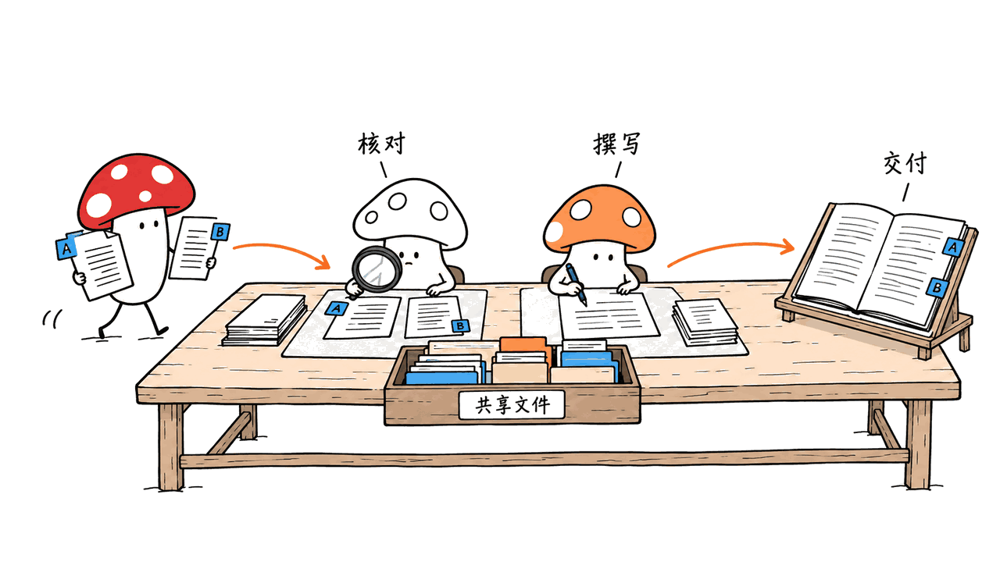
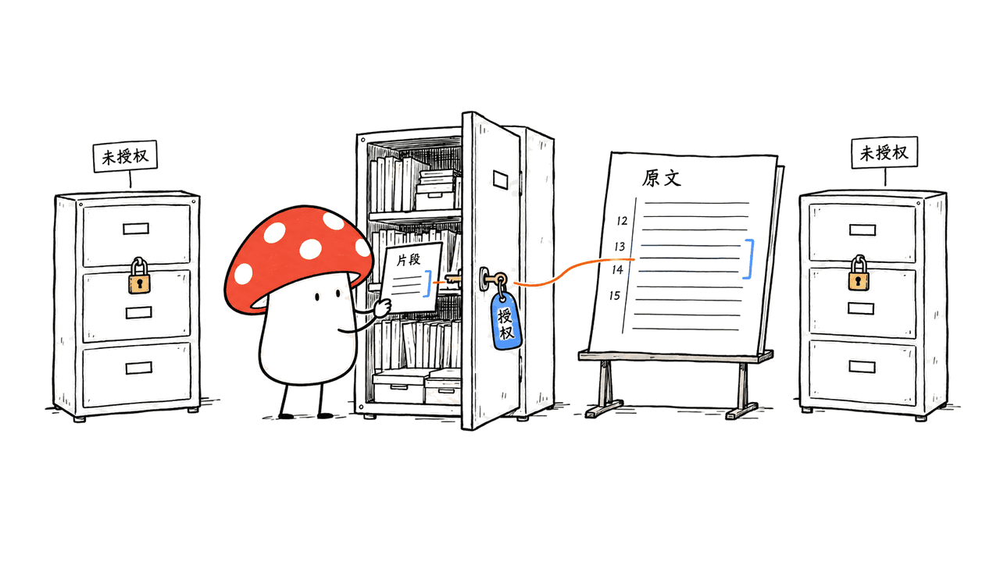
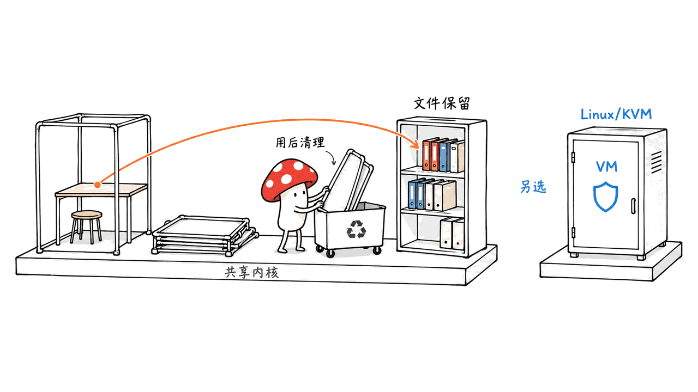

Yuxi 0.8 的重点，是把企业知识、分工执行、人工干预和文件交付接成一个可追溯的工作流程。它是 MIT 开源的自部署智能体平台，不是一款新训练的大模型。团队仍需配置模型服务、知识处理与执行环境。

先明确版本：截至 2026-10-29，GitHub 已发布的是 **`v0.8.0.beta5` 预发布版**，发布时间为 10 月 28 日。不能将“0.8 发布”直接写成正式版。本文固定核对标签提交 `ce90a04778fe370d56dd4dc623eb03565f59ae74`，沿用原有 Yuxi 文章链接，替换过时的 0.7.1 说明。

仓库：https://github.com/xerrors/Yuxi

官方预发布：https://github.com/xerrors/Yuxi/releases/tag/v0.8.0.beta5

固定版本更新说明：https://github.com/xerrors/Yuxi/blob/ce90a04778fe370d56dd4dc623eb03565f59ae74/docs/develop-guides/releases/0.8.0.md

## 它解决的是哪一类问题？

企业内部常见的断点，是资料在知识库里、任务在聊天窗口里、执行脚本在另一套环境里，最后交付文件和来源又散落在不同地方。Yuxi 把这些对象放到统一工作台，按用户和授权范围组织资源。

其核心仍是知识与执行两条链：文档经过解析、分块与检索提供依据；Agent 组合模型、工具、Skills、MCP 与执行环境推进任务。多成员协作、审批和任务状态则负责把长流程接起来。

例如，销售方案可以按这样的验收路径试用：读取产品资料和适用报价规则，分派资料核对与方案撰写，遇到缺失条件时向人提问，最后交付文档并列出来源。这是建议的试点流程，不是本文已经跑通的业务案例，更不意味着系统天然会替企业批准报价。



## 0.8 最值得关注的变化是什么？

| 方向 | beta5 文档与源码所描述的变化 | 应当怎样验收 |
|---|---|---|
| 多成员协作 | 独立上下文和会话，分派、消息、等待与项目文件共享 | 成员结果能否汇总，文件是否属于正确项目 |
| 人工参与 | 协作面板展示成员状态与待办，可进入成员会话处理问题 | 提问、审批和后续恢复是否衔接 |
| 运行中输入 | 普通输入排队，优先引导在安全边界生效 | 停止、引导、取消是否符合预期 |
| 知识溯源 | 向量、BM25 与混合检索，来源预览、文档定位与行号 | 引用能否打开并核对原文 |
| 外部接入 | Public Session API、源码版 npm CLI、内置知识 MCP | 身份、授权、附件与任务状态是否一致 |
| 执行环境 | 默认 Container，另可显式选择 Cube | 临时环境与持久文件的边界是否正确 |

这些不是“Agent 数量越多越好”的承诺。协作成员拥有独立上下文，但共享项目文件，不等于每位成员的工作完全不会冲突；并发名额与协作深度也受部署配置限制。

定时任务、Memory、基础子智能体和 API Key 等在旧版已经存在，不能全部当作 0.8 首次新增。对使用者更重要的是，任务等待、人工参与和恢复过程是否更连贯。

## 团队权限与工具账号怎样管理？

0.8 的治理增强包括 OIDC 登录与账号绑定、按 APP 隔离业务应用的会话和附件，以及远程 MCP 的个人 OAuth。企业身份登录、业务应用身份和外部工具授权各有边界，不能因为登录了平台，就推断第三方工具也已授权。

智能体还能绑定专属 Skill，在线维护包含脚本和模板的完整包，并管理版本与历史恢复。它的价值是把团队方法沉淀为可维护的交付物；Skill 或 MCP 服务实际能做什么，仍需按当前用户权限、服务配置与工具行为验证。

## 排队、引导和停止有何区别？

普通消息按顺序排队，适合追加任务。运行中的优先引导用于调整方向，但在安全执行边界生效；它不是立即抢占任意工具调用的开关。

停止整组协作也不意味着撤销已经完成的外部操作。若工具已经修改远端系统，后续停止不会自动把该操作倒回去。试点时应分别验证“未执行的输入被取消”“正在运行的任务停止”“已完成的操作如何补偿”。

文件交付也是同样的逻辑：应打开产物核对，而不是仅凭聊天窗口出现“已生成”就视为完成。

## 知识 MCP 能给外部 Agent 什么？

Yuxi 在现有 API 进程里提供 Streamable HTTP MCP，默认本地入口为 `http://127.0.0.1:5050/api/mcp`。它不是另外启动一个知识服务器，连接需要该实例签发的 `knowledge` API Key。

这个知识接口开放五个只读工具：`list_kbs`、`query_kb`、`search_file`、`open_kb_document`、`find_kb_document`。可见资料由 Key 所属用户的资源权限决定；接通 MCP 并不代表获得全平台知识访问权。

建议用一次可核验的检索验证连接：先列出授权知识库，再检索具体问题，拿返回的 `kb_id`、`file_id` 打开原文，核对片段与行号。MCP 显示 connected 只说明握手与能力发现完成，不能替代真实检索。

飞书只读连接也有范围：当前支持按配置身份在线搜索指定知识空间、读取支持类型的文档。不能推断它已覆盖所有飞书对象，或自动继承每个终端用户的全部个人权限。

知识 MCP 说明：https://github.com/xerrors/Yuxi/blob/ce90a04778fe370d56dd4dc623eb03565f59ae74/docs/advanced/knowledge-mcp.md



## Container 和 Cube 应该怎样选？

这是 0.8 试用门槛变化最明显的地方：默认 Container 方式不再要求额外准备 KVM 节点，但不能把“无需 KVM”理解为“隔离能力相同”。

| 项目 | Container | Cube |
|---|---|---|
| 官方定位 | 本地开发、单租户可信代码 | 需要 VM 隔离与持久用户环境 |
| 前提 | Docker；显式启用 container profile | 准备 Linux/KVM 执行节点 |
| 执行生命周期 | 每个 Run 临时容器，结束后清理 | 用户持久虚拟机可跨会话复用 |
| 环境与文件 | 容器内临时安装及登录态不跨执行段保留，工作目录持久化 | 按 Cube 运维与持久环境配置管理 |
| 隔离边界 | 共享 Docker 宿主内核，不是强多租户隔离 | 采用 VM 隔离路径，仍需正确运维 |

API 和 worker 不持有 Docker socket，只有独立 `sandbox-runner` 管理容器创建、资源限制、挂载和清理。这缩小了直接持有 Docker 控制能力的范围，但不等于整套系统已经通过独立安全认证。

Container 默认不允许沙盒联网。需要网络、第三方依赖或特定软件的任务，应预先核对环境；不要假设某一次 Run 安装的工具在下一次还存在。

Container 说明：https://github.com/xerrors/Yuxi/blob/ce90a04778fe370d56dd4dc623eb03565f59ae74/docs/advanced/container-sandbox.md



## Mac 可以试用吗？如何开始？

官方 README 给出的 Mac 路线是 Docker Desktop 的 Linux 容器模式，并允许项目目录共享。这里的“本地试用”是把平台组件运行在本机，不是 Mac 原生推理引擎，也不代表已经自带可离线运行的大模型。

若选择 Cube，需要另备可用的 Linux/KVM 执行节点，不能把 Mac 上安装 Docker Desktop 当作已经准备好 KVM。Windows 也可以选择 Container，Cube 则同样需要相应节点。

文档没有给出适用于所有知识库规模和并发量的统一 Mac 最低内存，本文不据此承诺“某档内存就能流畅部署”。默认知识平台涉及 PostgreSQL、Redis、MinIO、Milvus、Neo4j 等多个数据与执行组件，模型 API、嵌入、解析和重排的选择也影响资源与费用。

以下是官方 beta5 新环境试用步骤，本文没有实际执行整套启动：

```bash
git clone --branch v0.8.0.beta5 --depth 1 https://github.com/xerrors/Yuxi.git
cd Yuxi
./scripts/init.sh
# 按提示配置模型服务；选择 Container 并核对生成的环境配置。
docker compose --profile container config --quiet
docker compose --profile container up --build -d
docker compose --profile container ps
curl --fail http://localhost:5050/api/system/ready
```

Windows 使用 `scripts/init.ps1`。初始化会要求相应模型配置，并生成应用密钥、runner 认证密钥和实例标识；已有 `.env` 时应保留原密钥，而不是用模板覆盖。

返回 ready 后，再访问 `http://localhost:5173` 初始化管理员。随后上传一个无敏感信息的短文档，让 Agent 根据它生成 `hello.txt`，核对实际文件与来源。这一步才开始验证业务链路；健康接口或初始化脚本成功不能代替它。

固定版本快速开始：https://github.com/xerrors/Yuxi/blob/ce90a04778fe370d56dd4dc623eb03565f59ae74/docs/intro/quick-start.md

## 为什么旧版用户不应直接覆盖部署？

官方明确说明：0.8 面向全新部署，不提供从 0.7.x 原地升级的程序。旧数据库、向量索引和文件布局不能假定自动兼容，应使用独立数据目录保留旧环境，先验证新链路。

知识域的停机审计或离线转换工具，不等于整个旧实例的无缝升级。Session API、知识接口和 CLI 也有兼容变化，外部集成需要逐项核对；旧 Python CLI 配置不自动导入。

知识库思维导图、旧 SubAgent 专用入口等已退出当前使用路径，知识图谱及协作成员的人工待办仍保留。本次因此删除了旧文中过时的“一键部署”“知识导图”等泛化表述。

## CLI 已经能直接 npm 安装了吗？

源码里的客户端包名为 `@xerrors/yuxi`，版本 `0.1.0`，要求 Node.js 22+；客户端版本与平台 0.8 独立。

2026-10-29 查询官方 npm registry 时，`npm view @xerrors/yuxi version engines dist-tags --json` 返回 **E404**。这只能说明本次查询未找到可公开读取的包，不能写成 npm 安装已验证可用。仓库文档也提醒源码版本不等于已发布到 npm。

隔离源码中的安装、构建与测试已通过，未改本机全局 CLI 配置：

```bash
cd packages/yuxi-cli
npm ci --ignore-scripts --no-audit --no-fund
npm test
node dist/cli.js --help
```

15 项既有测试全部通过，覆盖配置、Public API 客户端、Session 资源、附件、SSE 解析、断流及提交回执恢复。相关网络行为由测试服务与夹具覆盖；没有据此宣称真实模型调用、在线 MCP、完整审批恢复或服务器部署已经通过。

CLI 源码：https://github.com/xerrors/Yuxi/tree/ce90a04778fe370d56dd4dc623eb03565f59ae74/packages/yuxi-cli

## 小团队怎样判断是否值得试？

适合的起点是一个边界清楚的流程：少量资料、一个授权范围、一个可打开的交付物，再逐步加入协作成员与外部工具。建议分别记录三类结果：引用是否正确、任务是否可恢复、交付物是否符合要求。

暂时不需要知识功能的部署，可按官方无知识组件的 Compose 覆盖配置精简服务；只修改一个环境开关不等于相关存储容器已经停止。部署调整仍需按文档重建服务并检查状态。

需要把现有编程助手接入知识或模型服务时，也可参考 [HiRoute 的模型路由边界](https://blog.mushroom.cv/blog/hiroute-local-model-routing/)：平台、路由器与模型各自负责不同层次，不能用某一层的成功替代整条任务链验证。

## 常见问题

### 这是新的开源模型吗？

不是。Yuxi 是知识与智能体平台，需要配置适用的模型服务；自部署平台不等于模型调用免费或完全离线。

### 0.8 是正式版了吗？

截至核对日，官方 Release 为 v0.8.0.beta5 预发布版。应按实际标签和 Release 状态判断，不依据主分支版本号推断。

### 多租户平台可以直接运行不可信代码吗？

不能仅据多租户界面作此推断。默认 Container 共享 Docker 宿主内核，官方将其定位为可信代码等场景；强隔离需求需选择并核验相应执行方案。

> © 2026 Author: Mycelium Protocol. 本文采用 [CC BY 4.0](https://creativecommons.org/licenses/by/4.0/deed.zh) 授权——欢迎转载和引用，须注明作者姓名及原文链接，不得去除署名后以原创发布。

<!--EN-->

Yuxi 0.8 connects enterprise knowledge, delegated work, human intervention and file delivery in one self-hosted agent platform. It is MIT-licensed application software, not a newly trained language model; model services and infrastructure remain deployment choices.

As of October 29, 2026, the published candidate is **v0.8.0.beta5**, released October 28 and marked prerelease. This update reuses the original article URL and replaces the outdated 0.7.1 overview. Its pinned source is `ce90a04778fe370d56dd4dc623eb03565f59ae74`.

Repository: https://github.com/xerrors/Yuxi

Candidate release: https://github.com/xerrors/Yuxi/releases/tag/v0.8.0.beta5

Pinned notes: https://github.com/xerrors/Yuxi/blob/ce90a04778fe370d56dd4dc623eb03565f59ae74/docs/develop-guides/releases/0.8.0.md

## What changes for a team?

Yuxi combines document processing and retrieval with agent tools, Skills, MCP, project files and execution environments. Version 0.8 emphasizes connecting those stages rather than simply adding more agents.

A possible pilot is a sales proposal: retrieve product and pricing references, delegate verification and drafting, ask a person for missing conditions, and deliver a document with inspectable sources. This is a proposed acceptance scenario, not a workflow independently demonstrated here.


Collaboration members have separate contexts and sessions, can exchange messages and wait for results, and share project files. Their independence does not remove shared-file conflicts or deployment concurrency limits. The collaboration panel exposes member states and human actions.

Ordinary messages queue; priority guidance takes effect at safe execution boundaries. Stopping collaboration does not undo completed external actions. Acceptance checks should distinguish canceled inputs, stopped execution and compensation for earlier side effects.

Scheduled tasks, Memory, basic subagents and API keys predate this candidate. Their presence should not all be counted as new 0.8 features.

## How are identities and reusable skills managed?

The candidate improves OIDC login/account binding, APP-scoped application sessions and attachments, and personal OAuth for remote MCP services. Enterprise login, application identity and third-party tool authorization remain distinct. An agent can bind a dedicated Skill package with scripts, templates, online edits and version recovery; its effective access still depends on user permissions and service configuration.

## How does knowledge reach external agents?

The built-in Streamable HTTP knowledge MCP runs within the API process, normally at `http://127.0.0.1:5050/api/mcp`. It requires an instance-issued `knowledge` API key and enforces the resource permissions of that key's user.

Its five read-only tools are `list_kbs`, `query_kb`, `search_file`, `open_kb_document` and `find_kb_document`. Verify retrieval by selecting an authorized knowledge base, retrieving a passage, and opening its source using the returned knowledge-base and file IDs. A successful MCP handshake does not establish correct retrieval.

Hybrid/vector/BM25 retrieval, source previews and document line references improve inspectability. The Feishu connector is read-only within its configured identity and supported document scope; it should not be assumed to cover every object or automatically inherit every end user's personal permissions.


MCP documentation: https://github.com/xerrors/Yuxi/blob/ce90a04778fe370d56dd4dc623eb03565f59ae74/docs/advanced/knowledge-mcp.md

## Which execution backend fits?

| Property | Container | Cube |
|---|---|---|
| Documented use | Local development and single-tenant trusted code | VM isolation and persistent user environments |
| Requirement | Docker with the container profile | Prepared Linux/KVM execution node |
| Lifetime | Temporary container per Run | Persistent per-user VM across sessions |
| Persistence | Project workdir persists; temporary installs and logins do not | Managed through Cube's persistent environment |
| Isolation | Shares the Docker host kernel; not strong multi-tenant isolation | VM-based path requiring appropriate operations |

Only the separate sandbox-runner holds the Docker socket; API and worker processes call it through the internal authenticated interface. Container networking is disabled by default. These design choices are not an independent security certification.


Backend documentation: https://github.com/xerrors/Yuxi/blob/ce90a04778fe370d56dd4dc623eb03565f59ae74/docs/advanced/container-sandbox.md

## Can a Mac run the platform locally?

The documented Mac route uses Docker Desktop's Linux-container mode with project-directory sharing. This is local platform hosting, not a native Mac inference engine or a bundled offline language model. Cube needs an appropriate Linux/KVM node; installing Docker Desktop on Mac or Windows does not establish that prerequisite.

The documentation does not provide one universal minimum Mac memory specification for every knowledge corpus and concurrency level. Model APIs, embedding, parsing, reranking and storage choices affect both resource requirements and operating cost.

For a fresh trial environment, the tagged README documents the following sequence. The complete startup was **not executed for this review**:

```bash
git clone --branch v0.8.0.beta5 --depth 1 https://github.com/xerrors/Yuxi.git
cd Yuxi
./scripts/init.sh
docker compose --profile container config --quiet
docker compose --profile container up --build -d
docker compose --profile container ps
curl --fail http://localhost:5050/api/system/ready
```

Configure the required model services and select Container during setup; Windows uses `scripts/init.ps1`. Preserve existing secrets rather than overwriting an environment file. Once readiness succeeds, initialize the administrator at `http://localhost:5173`, upload a harmless short document, request an output such as `hello.txt`, and inspect the actual content and references.

Quick start: https://github.com/xerrors/Yuxi/blob/ce90a04778fe370d56dd4dc623eb03565f59ae74/docs/intro/quick-start.md

## Can an existing 0.7 installation upgrade in place?

No automatic 0.7-to-0.8 upgrade is provided. Use independent data directories and preserve the old environment. An offline knowledge-domain conversion utility is not a migration of the complete application, indexes and file layout.

Public integrations now use the Session protocol, knowledge interfaces have changed, and old Python CLI configuration is not automatically imported. Removed paths include knowledge-base mind maps and the old dedicated SubAgent entry; knowledge graphs and member human-action tasks remain.

## Is the npm CLI publicly installable yet?

The tagged source package is `@xerrors/yuxi` version **0.1.0**, requiring Node.js 22+. That version is independent of the platform's 0.8 version.

An October 29 query of the official npm registry using `npm view @xerrors/yuxi version engines dist-tags --json` returned **E404**. This establishes that the query did not find a publicly readable package; it does not establish a verified registry installation. The project's notes explicitly distinguish source availability from npm publication.

In an isolated checkout, `npm ci --ignore-scripts --no-audit --no-fund`, `npm test` and the built CLI's `--help` succeeded. All **15 existing tests passed**, covering configuration, the Public API client, Session resources, attachments, SSE and interrupted-response receipt recovery. HTTP behavior uses test servers and fixtures, not a deployed production instance.

No complete Docker stack, live model request, online MCP retrieval, approval recovery or security/performance benchmark was tested. CLI source success must not stand in for those paths.

Source client: https://github.com/xerrors/Yuxi/tree/ce90a04778fe370d56dd4dc623eb03565f59ae74/packages/yuxi-cli

## What should a small team measure first?

Start with a bounded corpus, a single permission scope and an inspectable output. Measure citation correctness, recoverability and deliverable quality separately before increasing collaboration complexity.

A documented no-knowledge Compose override can reduce dependencies when retrieval is unnecessary. An environment flag alone does not stop storage containers; deployment changes require the appropriate configuration and service recreation.

## FAQ

### Is this a new open-source model?

No. It is a platform that needs suitable model services. Self-hosting does not inherently remove API costs or make every component offline.

### Is 0.8 a stable release?

The verified Release is v0.8.0.beta5 and is marked prerelease. Use the actual tag and release status rather than a main-branch version string.

### Does a multi-tenant UI mean untrusted code is isolated?

No. The default Container backend shares the Docker host kernel and is documented for trusted-code scenarios. Choose and verify execution isolation separately.

> © 2026 Author: Mycelium Protocol. Licensed under [CC BY 4.0](https://creativecommons.org/licenses/by/4.0/) — free to share and adapt with attribution. You must credit the author and link to the original; removing attribution and republishing as original is not permitted.
