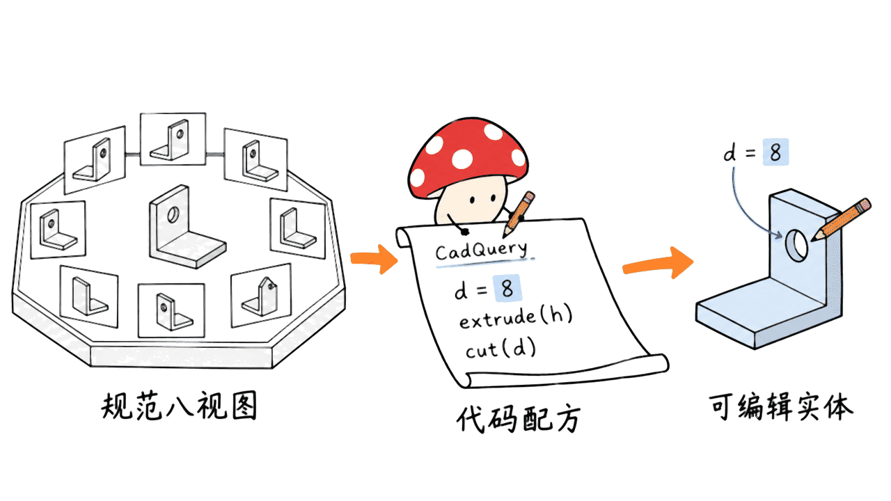
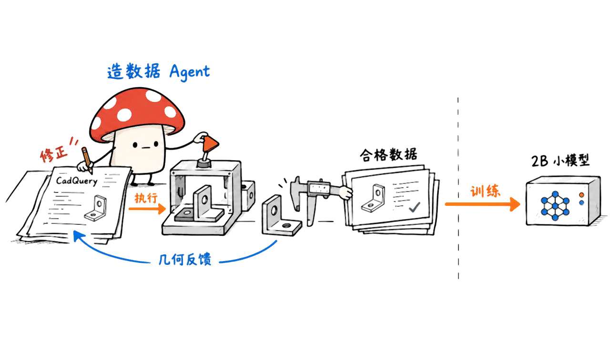
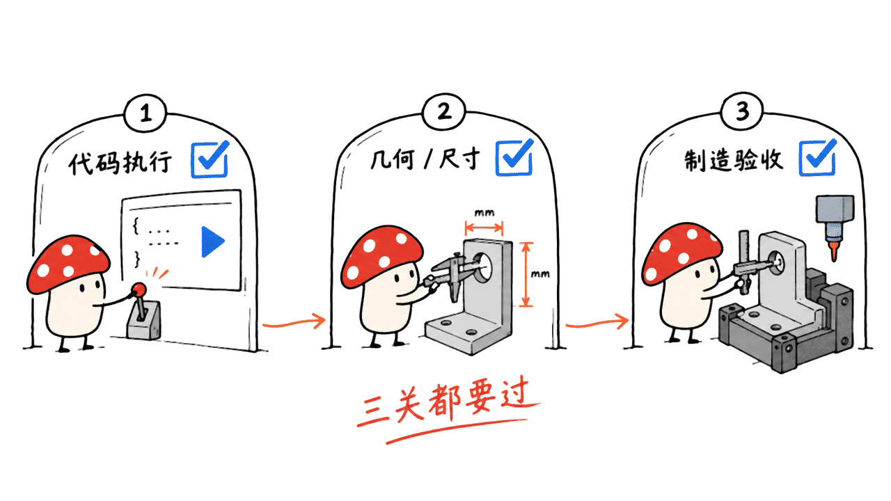

Autodesk Research 的 Zero-to-CAD-Qwen3-VL-2B，能把八张规范渲染图转换为 CadQuery Python 建模代码，再通过几何引擎生成可编辑模型。它在作者的自合成测试集上优于 GPT-5.2 High；在外部 ABC 数据上，几何重合度更高，但可执行率更低。这个成果值得研究，适用边界也需要一起读。

这是一项 2026 年 4 月 27 日公开论文对应的研究，本文在 10 月 18 日核查资料，并非刚刚发布的新模型。素材里的“PT-5.2”应为 **GPT-5.2**。官方入口是 Hugging Face 的 ADSKAILab 模型、数据和论文；本次未确认官方完整推理／训练 GitHub 仓库，不能将第三方桌面封装当作 Autodesk 官方发布。

模型：https://huggingface.co/ADSKAILab/Zero-To-CAD-Qwen3-VL-2B

论文：https://arxiv.org/abs/2604.24479

## 它到底接收什么，生成什么？

官方配置为八张 256×256 的干净渲染图：四张前侧、四张后侧。模型基于 Qwen3-VL-2B-Instruct 全参数微调，输出描述草图、拉伸、切除、圆角等步骤的 CadQuery Python 程序。程序执行后产生实体，再导出 STEP 或 STL。

这里的“可编辑”，首先指参数和建模步骤在代码中可读、可改。例如更改孔径变量后重新执行，得到另一版几何。它不表示自动恢复原设计师的操作历史，也不保证直接得到 AutoCAD 的原生 DWG、Fusion 的原生特征树或完整装配约束。

| 产物 | 可以保留什么 | 仍需注意什么 |
|---|---|---|
| CadQuery 源码 | 参数、运算顺序、重建逻辑 | 是否易改、约束是否合理仍需审查 |
| STEP | 用于下游 CAD 交换的几何 | 不自动携带原生软件的完整建模历史 |
| STL | 三角网格，适合进入切片流程 | 参数历史、尺寸单位和制造约束不能由文件扩展名保证 |

“拿来八张零件照片就能反求”比当前证据多走了一步。模型卡明确说明：只训练于合成数据，照片、噪声输入可能困难，其他视图配置未验证。真实物体的遮挡、反光、隐藏腔体以及绝对尺寸，也不是一组外观图必然能解出的信息。



## 为什么只有2B，却能在自家测试集领先？

论文重点不只是一个小模型，更是如何获得足够多可执行、可解释的 CAD 程序。团队先用本地服务的 gpt-oss-120b 生成零件描述，再通过 CadQuery 执行、校验和文档检索工具反复修正程序，构建约一百万条合成序列。这个造数据 Agent 与最终发布的 2B 图像重建模型，是两个阶段。

数据总量为 999,633 条，其中训练 979,633、验证 10,000、测试 10,000；另有按几何多样性筛选的 100K 子集。覆盖的操作不局限于画草图后拉伸，还包括布尔运算、圆角、倒角、壳体、放样、扫掠和阵列。

作者报告，合成阶段只有 22.3% 的设计第一次就校验通过，成功前平均需要 3.30 次尝试。这说明执行反馈在造数据时发挥了作用，不能把这些数字当作发布的 2B 模型在线自修复成功率。

专用监督把“外观到建模操作”的映射集中教给小模型，而通用基线主要依靠提示词现场完成。这支持“高质量任务数据能显著改变专门能力”的判断，不能外推成 2B 的通用推理水平超过大模型。

数据集：https://huggingface.co/datasets/ADSKAILab/Zero-To-CAD-1m



## “跑赢GPT-5.2”需要带上哪几条脚注？

以下均为作者公开评测，本文没有重跑模型。成功率指生成有效、可执行代码的比例；Mean IoU 指生成实体与参考实体的体素交并比。

| 模型 | 自合成测试：成功率 | 自合成：Mean IoU | ABC：成功率 | ABC：Mean IoU |
|---|---:|---:|---:|---:|
| Zero-to-CAD 微调2B | 82.1% | 0.747 | 61.0% | 0.377 |
| GPT-5.2 High | 72.2% | 0.485 | 66.2% | 0.344 |
| GPT-5.2 Medium | 71.1% | 0.495 | 62.6% | 0.346 |
| Qwen3-VL-2B 原始底座 | 6.6% | 0.184 | 5.4% | 0.131 |

第一，比较样本数不同：Qwen 系列评完整 10,000 条自合成测试样本，GPT-5.2 因 API 成本只评随机抽取的 1,000 条。ABC 则选了 1,000 个、B-Rep 面数在 7 至 100 之间的形状。公开数字不是全部模型逐题配对、在所有零件类型上的工业验收。

第二，论文表注明确说，IoU 与 Chamfer distance 在成功样本上计算。因此 0.747 不是“把所有失败都计入后”的全样本平均几何质量。最好同时看成功率、成功后的形状质量和失败类别，而不是只挑一列。

第三，IoU 采用归一化后的 64³ 体素，并在 45° 旋转增量中选择最佳对齐结果。这个尺度适合研究几何相似性，不是毫米级尺寸、公差、壁厚或孔位验收；最佳旋转对齐还会弱化模型方向错误的影响。

第四，分布变化非常明显：微调模型从自合成数据的 82.1%／0.747，降到 ABC 的 61.0%／0.377。后者成功率低于 GPT-5.2 High 的 66.2%，但成功样本的平均 IoU 更高。结论应是“专用模型在特定任务上有竞争力”，而非全面替代通用模型或 CAD 工程师。

## 从研究模型到反求工具，应该怎么接？

Mycelium Protocol 建议将工作流拆成可验收的阶段。先从已知 CAD／网格的标准渲染图起步，确认视角顺序、分辨率、背景、朝向与预处理符合模型配置；之后再单独验证扫描或照片输入的域差距。

接着生成源码并保存原始响应、模型 revision、八张输入和采样设置。不要直接把模型输出当作可信脚本在工作目录 `exec`：需要先提取真正的 Python 代码，审查依赖及文件访问，在无凭证、限制网络与资源的独立执行环境中运行。普通子进程或普通虚拟环境本身不构成安全沙箱。

第三阶段分开验收“程序能运行”和“几何符合要求”：检查实体数量、几何有效性、包围盒、体积、单位和关键尺寸，再从同一视角重新渲染对照。隐藏结构和真实尺寸应来自额外测量或工程约束，不能让视觉猜测代替。

最后保留源码作为编辑入口，按下游需要导出 STEP/STL，再检查壁厚、间隙、网格闭合、支撑和工艺参数。能导出 STL，只证明完成一次格式转换，不能独立证明能按预期制造或装配。



## 怎么下载，机器门槛是多少？

本次核查的官方模型 revision 为 `8cf9260904aa6eb29f0826e3585f25b7df61ff89`，权重文件约 4.26GB，配置为 BF16；模型卡使用 Transformers 的 `Qwen3VLForConditionalGeneration`。2B 和文件大小都不能直接换算为最低显存，八张图的视觉编码、生成长度及运行时也要占内存。本文没有给出本机模型推理速度或“某张显卡一定能跑”的承诺。

下面仅为固定版本下载方式，本文没有下载完整权重或执行模型推理：

```bash
hf download ADSKAILab/Zero-To-CAD-Qwen3-VL-2B \
  --revision 8cf9260904aa6eb29f0826e3585f25b7df61ff89 \
  --local-dir models/zero-to-cad-2b
```

输入组织和生成方式可从模型卡的完整例子开始：八张图加入消息，调用处理器构造多模态输入，生成代码后再进入上述独立执行与验证阶段。不要使用页面自动推荐的过时通用 pipeline 示例替代官方自定义类示例。

模型卡记录的训练长度为 4,096 tokens、三轮训练，使用 16 张 H100 80GB；这是训练配置，不是推理硬件要求。底层配置中的更大位置长度也不等于长装配程序已经通过训练或测试。

模型与数据集卡均标注 Apache-2.0。此次确认的是权重、数据和使用示例的公开状态，没有证据就不声称完整 Agent 合成系统、渲染流程和训练工程仓库都已公开。

## 本文做了什么验证？

我们核对官方模型卡、数据字段、版本及论文中的样本数和计分说明；另在独立 Python 环境中重放一个官方测试集的真值 CadQuery 程序，得到有效的单实体、14 个面，导出 STEP/STL，并重新导入 STEP 检查体积一致性。这个小检查验证的是一条公开样例的执行与导出链路，没有调用 2B 模型、没有生成新预测，也没有复现 82.1% 或 GPT-5.2 对比。

本地复核报告随文章研究记录保存。选型时，先区分三件事：外观重建是否像、参数是否易改、关键尺寸是否满足制造要求。Zero-to-CAD 对前两件事提供了一个开放研究入口，第三件事仍需专门的测量与验收流程。

## 常见问题

### 八张手机照片能直接得到停产零件吗？

当前官方证据针对八张规范渲染图。实物照片、遮挡与绝对尺寸恢复需要额外验证，不能把研究输入替换成拍摄输入而沿用同一组成绩。

### 模型成功率82.1%，是不是八成零件能直接生产？

不是。这里衡量有效、可执行代码，且来自作者自合成测试集；生产还需要尺寸、公差、材料、工艺和装配等验收。

### 它是AutoCAD自动画图插件吗？

官方模型输出 CadQuery Python，不是 AutoCAD 操作插件。后续可以导出几何交换文件，集成到具体 CAD 产品仍需要工程适配。

## 一手资料

模型卡：https://huggingface.co/ADSKAILab/Zero-To-CAD-Qwen3-VL-2B

论文：https://arxiv.org/abs/2604.24479

完整数据：https://huggingface.co/datasets/ADSKAILab/Zero-To-CAD-1m

精选100K：https://huggingface.co/datasets/ADSKAILab/Zero-To-CAD-100k

官方合集：https://huggingface.co/collections/ADSKAILab/zero-to-cad

CadQuery：https://github.com/CadQuery/cadquery

相关三维内容工作流：https://blog.mushroom.cv/blog/scenario-blender-generation-mcp/

封面采用官方公开数据样例图，正文小M图为概念示意。

---

> © 2026 Author: Mycelium Protocol. 本文采用 [CC BY 4.0](https://creativecommons.org/licenses/by/4.0/deed.zh) 授权——欢迎转载和引用，须注明作者姓名及原文链接，不得去除署名后以原创发布。

<!--EN-->

Autodesk Research's Zero-to-CAD-Qwen3-VL-2B reconstructs CadQuery Python programs from eight standardized rendered views. It exceeds GPT-5.2 High on the authors' synthetic test set. On out-of-distribution ABC shapes, it has higher geometric overlap but a lower executable-code success rate. Both results matter.

The paper appeared on April 27, 2026; this article reviews the release on October 18. The primary release consists of Hugging Face weights, datasets and usage examples. We did not confirm an official GitHub repository containing the complete synthesis, training and inference stack. Third-party desktop wrappers should be identified separately.

## What are the inputs and outputs?

The documented input is eight clean 256×256 rendered views, four front-side and four rear-side views. A fully fine-tuned Qwen3-VL-2B-Instruct generates CadQuery Python that constructs the solid. A geometry engine executes the program and exports STEP or STL.

Editable means that parameters and operations are available in code. It does not establish recovery of the original designer's history, native AutoCAD DWG files, a Fusion feature tree or complete assembly constraints. STEP exchanges geometry; STL exchanges a mesh. Neither extension guarantees dimensions or manufacturability.

The model card warns about photographs and noisy inputs, and other view configurations are untested. Reflective surfaces, occlusion, hidden cavities and absolute scale remain separate reverse-engineering problems.


## Why can a specialized 2B model perform well?

The training resource is central. A locally served gpt-oss-120b agent proposed parts, executed CadQuery, inspected validation feedback and consulted documentation to repair programs. That synthesis agent is distinct from the final 2B image-to-program model.

The dataset contains 999,633 sequences: 979,633 training, 10,000 validation and 10,000 test samples. A diverse 100K subset is also available. Operations include booleans, fillets, chamfers, shells, lofts, sweeps and patterns rather than only sketch-and-extrude.

Only 22.3% of synthesis designs validated on the first attempt, with an average of 3.30 attempts before success. These are data-generation statistics, not the 2B model's online repair rate. Specialized supervision can teach this mapping without establishing superiority in general reasoning.


## How should the GPT-5.2 comparison be read?

All figures below are author-reported; we did not rerun model evaluation.

| Model | Synthetic success | Synthetic mean IoU | ABC success | ABC mean IoU |
|---|---:|---:|---:|---:|
| Fine-tuned Zero-to-CAD 2B | 82.1% | 0.747 | 61.0% | 0.377 |
| GPT-5.2 High | 72.2% | 0.485 | 66.2% | 0.344 |
| GPT-5.2 Medium | 71.1% | 0.495 | 62.6% | 0.346 |
| Base Qwen3-VL-2B | 6.6% | 0.184 | 5.4% | 0.131 |

Qwen models were evaluated on all 10,000 synthetic test examples, whereas GPT-5.2 used a random 1,000-example subset because of API costs. The ABC evaluation selects 1,000 shapes with 7–100 B-Rep faces. This is not a fully paired industrial acceptance test across all part types.

Success measures valid executable code, not geometric fidelity. The paper's table specifies that IoU and Chamfer distance are computed over successful samples. Mean IoU 0.747 therefore does not average all failed generations into the denominator.

Geometries are normalized and voxelized at 64³, with the best overlap over 45-degree rotation increments. This measures approximate volumetric agreement, rather than millimeter tolerances, wall thickness or hole placement. Best-rotation alignment also reduces sensitivity to orientation mistakes.

The domain shift is substantial: the fine-tuned model falls from 82.1% success and 0.747 mean IoU to 61.0% and 0.377 on ABC. Its ABC success is below GPT-5.2 High's 66.2%, although its successful outputs have higher average overlap. The evidence supports a competitive specialized model, not universal replacement of general models or CAD engineers.

## How could an engineering workflow use it?

Mycelium Protocol recommends starting with standardized renders from known geometry. Match view order, resolution, orientation and preprocessing before separately evaluating scans or photographs.

Preserve all eight inputs, the model revision, generation settings and raw output. Extract and review Python before running it in a separate environment with no credentials and restricted network, filesystem and resource access. A normal virtual environment or subprocess alone is not a security sandbox.

Validate execution and geometry independently: solid count, validity, bounding box, volume, units and critical dimensions. Render the output again from matching views. Supply measured scale and hidden-feature constraints rather than asking appearance alone to determine them.

Keep source code as the editable artifact. Export STEP or STL for downstream tools, then inspect clearances, wall thickness, mesh closure, supports and process requirements. A successful STL export is not manufacturing acceptance.


## How can developers download it?

We checked model revision `8cf9260904aa6eb29f0826e3585f25b7df61ff89`. The BF16 weight file is about 4.26GB. File size is not minimum runtime memory: vision encoding, generation and runtime allocations add overhead. We did not measure model latency or establish a supported GPU-memory floor.

This pinned download command is provided for readers; full model weights were not downloaded or executed here:

```bash
hf download ADSKAILab/Zero-To-CAD-Qwen3-VL-2B \
  --revision 8cf9260904aa6eb29f0826e3585f25b7df61ff89 \
  --local-dir models/zero-to-cad-2b
```

Use the official model card's `Qwen3VLForConditionalGeneration` and processor example to assemble eight images into a multimodal request. Its generated code should enter the reviewed execution workflow above, rather than unconditional `exec` in the working directory.

The recorded training used a 4,096-token sequence length, three epochs and 16 H100 80GB GPUs. That is a training setup, not an inference requirement. A larger position limit in the underlying configuration does not establish training or validation on long assembly programs.

Both model and dataset cards state Apache-2.0. We verified public weights, data and usage examples; we did not verify release of the full agentic synthesis or training engineering repository.

## What did we check locally?

We reviewed primary cards, model configuration and the paper's evaluation denominators. In an isolated Python environment, we replayed one official test-set ground-truth CadQuery program, confirmed one valid solid with 14 faces, exported STEP/STL, and checked volume consistency after reimporting STEP. This is a sample execution/export check, not model inference or a reproduction of 82.1% success or the GPT-5.2 comparison.

The local evidence is preserved with the research record. Shape similarity, editable parameters and manufacturing dimensions deserve separate acceptance criteria.

## FAQ

### Can eight phone photographs reconstruct a discontinued part?

The published evidence uses standardized renders. Photographs, occlusion and recovery of absolute dimensions need additional validation.

### Does 82.1% success mean production-ready parts?

No. It means valid executable code on the authors' synthetic test set. Production requires geometric, dimensional, material and process checks.

### Is this an AutoCAD automation plugin?

The official model emits CadQuery Python. Integration with AutoCAD or another CAD product requires separate engineering.

## Primary sources

Model: https://huggingface.co/ADSKAILab/Zero-To-CAD-Qwen3-VL-2B

Paper: https://arxiv.org/abs/2604.24479

Full dataset: https://huggingface.co/datasets/ADSKAILab/Zero-To-CAD-1m

100K subset: https://huggingface.co/datasets/ADSKAILab/Zero-To-CAD-100k

Official collection: https://huggingface.co/collections/ADSKAILab/zero-to-cad

CadQuery: https://github.com/CadQuery/cadquery

Related 3D workflow: https://blog.mushroom.cv/blog/scenario-blender-generation-mcp/

The cover uses the official dataset sample gallery. XiaoM body figures are conceptual illustrations.

---

> © 2026 Author: Mycelium Protocol. Licensed under [CC BY 4.0](https://creativecommons.org/licenses/by/4.0/) — free to share and adapt with attribution. You must credit the author and link to the original; removing attribution and republishing as original is not permitted.
