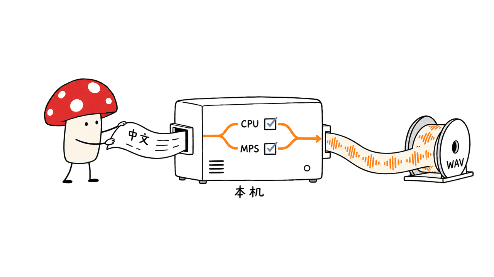

zixi-51M 在这台 M4、16GB 内存的 Mac 上跑通了：CPU 与 MPS 两条路径，各生成了两段中文音频。输出是44.1kHz、单声道PCM16，没有无效数值，也不是静音文件。下面给出样本和复现方法；我们没有据此评判音质优劣或训练能力。

项目地址：https://github.com/lizixi-0x2F/zixi-51M

官方权重：https://huggingface.co/NoesisLab/zixi-51m

仓库作者为 Zixi Li，代码采用 MIT，模型卡也标记 MIT。本文固定代码提交 `2cfebd74b6b84db2f83a40604e3a11fcbb750cee`，权重 revision 为 `3f66b777ff7d498310215939f98dd29598945d28`，核验日期为2026年10月15日。



## 先看结果：在什么环境里跑通？

| 项目 | 本次实际情况 |
| --- | --- |
| 硬件 | Apple M4，16GB统一内存 |
| 软件 | macOS、Python3.12.15、PyTorch2.14.1；临时隔离环境 |
| 权重 | `pytorch_model.bin`，206099369字节，约206.1MB |
| 生成器参数 | 实际计数51433265，约51.43M |
| MPS | 两段文本成功；音频分别约1.42秒、6.10秒 |
| CPU | 同样两段文本成功；音频分别约1.42秒、6.13秒 |
| 文件检查 | 四份均为44100Hz、单声道、PCM16，非静音且样本值有限 |
| 文本前端测试 | 上游原有9项测试全部通过 |

这里的“秒”是生成音频的长度，不是生成耗时。我们没有做实时率、冷启动、持续吞吐或跨设备速度排名。MPS 和 CPU 结果也不应被要求逐样本完全相同：推理中有随机采样，两条数值计算路径可能产生差异。

这是 MPS 生成的第二段测试音频。它是明确标识的 AI 合成演示，不是真人录音，也不表示作者本人说过这段话。

<audio controls preload="none" src="/audio/zixi-51m-mps-smoke.wav"></audio>

音频地址：https://blog.mushroom.cv/audio/zixi-51m-mps-smoke.wav

测试文本：“这是一段本地语音合成测试。今天我们检查模型能否正常生成声音。”

文件能解码、非静音，只证明生成链路成立。我们没有进行盲听、MOS评分或ASR转写评估，因此不会把它写成“零字错”“媲美真人”或“最佳中文音质”。


## 它为什么适合先做本地试用？

zixi-51M 沿用 VITS2/MeloTTS 路线，专注中文单说话人。作者移除了 BERT 与多语言嵌入，文本编码使用音素、声调等信息；模型卡列出77个符号、6个声调槽位。它不是一个需要另配大语言模型来回答问题的语音助手。

发布的主要推理文件是配置和生成器权重，判别器及训练数据不随这份权重公开。小模型、直接的文本到波形路径，让“先在自己的机器上生成一段中文”成为一个容易核验的目标。

单说话人也意味着默认输出是预训练的 `zixi` 声音。API不接收参考音频，不能把“可微调自己的声音”理解为零样本音色克隆。中文前端测试包含混合ASCII输入，但“不崩溃”也不等于支持高质量英文朗读。

## 怎样复现 CPU 或 MPS 推理？

README推荐Python3.11；本次实际使用3.12.15。项目声明支持Python3.10至3.13，3.14暂不在范围内。下面用明确的环境路径，避免把包装到另一套Python里：

```bash
git clone https://github.com/lizixi-0x2F/zixi-51M.git
cd zixi-51M
git checkout 2cfebd74b6b84db2f83a40604e3a11fcbb750cee
uv venv .venv --python 3.11
uv pip install --python .venv/bin/python -e . huggingface-hub
```

`huggingface-hub` 是示例下载代码需要的包，当前项目依赖列表没有单独声明它。本次没有改动源码，也没有修改共享ML环境：在临时环境中复用已有包，并将额外依赖装入临时环境。

保存为 `infer_local.py`：

```python
from huggingface_hub import snapshot_download
from zixi.api import TTS

folder = snapshot_download(
    "NoesisLab/zixi-51m",
    revision="3f66b777ff7d498310215939f98dd29598945d28",
    allow_patterns=["config.json", "pytorch_model.bin"],
)
model = TTS(
    language="ZH",
    device="cpu",  # 本次也验证了 device="mps"
    config_path=f"{folder}/config.json",
    ckpt_path=f"{folder}/pytorch_model.bin",
)
model.tts_to_file(
    "你好，世界。",
    model.hps.data.spk2id["zixi"],
    "hello.wav",
)
```

运行：`.venv/bin/python infer_local.py`。默认 `device="auto"` 会检查CUDA/MPS，但排查时建议明确选择设备，日志和结果更容易对应。限制下载文件可以避免顺便拉取海报与官方演示音频。

本次看到PyTorch的JIT、weight norm弃用提示，以及MPS高维padding使用View Ops实现的提示；它们没有阻止这四次生成。出现警告不应自动当作失败，成功也不能消除后续兼容性风险，复现时请保存依赖版本。

## 想训练自己的声音，需要准备什么？

仓库包含 `zixi/preprocess_text.py` 与 `zixi/train.py`，预期清单是一行一条：

```text
/absolute/path/0001.wav|myvoice|ZH|这是一句和录音严格对应的文本。
```

音频要求44.1kHz、单声道WAV。语言字段在这个中文专用版本中使用 `ZH`。路径要可读取，说话人名称要与后续配置映射一致，文本与实际录音对应；不是把任何格式改个扩展名就能训练。

需要转换时，可用下面的命令生成一份新文件：

```bash
ffmpeg -i input.wav -ar 44100 -ac 1 -c:a pcm_s16le output.wav
```

预处理会做文本归一化、音素与声调转换、训练/验证集划分，并输出配置中的说话人映射及数据路径。默认每个说话人取4条验证样本、总验证数最多8条，极少量录音可能几乎都被分进验证集，训练前必须检查实际行数。

从仓库根目录查看入口：

```bash
.venv/bin/python zixi/preprocess_text.py --help
.venv/bin/python zixi/train.py --help
```

我们实际验证了这两个帮助入口，但训练入口首次因缺少 `loguru` 失败；补装后能显示帮助。`loguru` 当前也没有写进项目依赖列表。准备训练环境时，需要补充：

```bash
uv pip install --python .venv/bin/python loguru
```

这只是训练环境的入口核查。`train.py` 使用 `torchrun` 环境变量与gloo分布式初始化，并有CPU/MPS/CUDA设备选择；“源码里有MPS分支”不等于我们已经在Mac上完成了训练。

若要从发布的生成器微调，还要设置训练器的 `--pretrain_G` 或对应本地预训练路径，核对新说话人映射、采样率、数据列表和输出目录。README中的推理 `config_path` 不会自动替你配置训练器。我们没有用户自有录音，没有运行训练步，也没有验证音色迁移是否成功。

官方只发布权重，作者的原始录音与文本语料不在发行内容里。这不会阻止你准备自己的数据，但不能据此声称已复现原训练过程。


## 本次验证能帮助你做什么决定？

如果目标是“在M4 Mac上把中文文字生成WAV”，已经有可复核的成功样本，值得按相同版本试用。如果目标是实时语音助手、多语种朗读、零样本克隆或生产并发服务，还需要分别验证对应链路；本次结果不覆盖这些目标。

对训练来说，这个仓库提供了可阅读的起点，但安装声明存在小缺口，配置也需要自己对齐。合理顺序是先跑通推理，再验数据和预处理，再尝试小规模训练，最后用未参与训练的文本评估发音与音色。

### 是否必须联网合成？

首次获取代码、依赖与权重需要网络。配置和权重下载到本地后，推理使用本地文件；我们没有做拔网或网络隔离测试，因此不把本次结果描述为已验证的严格离线运行。

### 能否直接生成我自己的声音？

默认权重输出 `zixi` 单一声音。自己的声音需要自备录音并微调；当前推理API没有参考音频参数。

### 这证明51M模型胜过更大的TTS吗？

没有。这里只验证本机生成与文件完整性，没有统一听测、ASR质量评估或性能对照。不同TTS选型方法可参考：https://blog.mushroom.cv/blog/drama3-breeze2-fish-s2-comparison/

固定源码：https://github.com/lizixi-0x2F/zixi-51M/tree/2cfebd74b6b84db2f83a40604e3a11fcbb750cee

固定模型卡：https://huggingface.co/NoesisLab/zixi-51m/blob/3f66b777ff7d498310215939f98dd29598945d28/README.md

---

> © 2026 Author: Mycelium Protocol. 本文采用 [CC BY 4.0](https://creativecommons.org/licenses/by/4.0/deed.zh) 授权——欢迎转载和引用，须注明作者姓名及原文链接，不得去除署名后以原创发布。

<!--EN-->

zixi-51M generated Chinese speech successfully on this M4 Mac with 16GB memory. Both CPU and MPS completed two texts, producing 44.1kHz mono PCM16 WAV files with finite, non-silent samples. This verifies the generation path, without establishing superior quality, speed or training support.

Repository: https://github.com/lizixi-0x2F/zixi-51M

Weights: https://huggingface.co/NoesisLab/zixi-51m

The code is MIT-licensed, and the official model card also declares MIT. We pinned code `2cfebd74b6b84db2f83a40604e3a11fcbb750cee` and model revision `3f66b777ff7d498310215939f98dd29598945d28` on October 15, 2026.


## What actually ran?

| Item | Observed result |
| --- | --- |
| Hardware | Apple M4, 16GB unified memory |
| Environment | macOS, Python 3.12.15, PyTorch 2.14.1; temporary isolated environment |
| Checkpoint |206099369 bytes, approximately 206.1MB |
| Generator |51433265 parameters, approximately 51.43M |
| MPS | Two successful outputs, approximately 1.42s and 6.10s of audio |
| CPU | Two successful outputs, approximately 1.42s and 6.13s of audio |
| Files | All four are 44100Hz mono PCM16, finite and non-silent |
| Existing frontend tests | All 9 passed |

Durations describe output audio, not generation latency. We did not benchmark real-time factor, cold start or sustained throughput. Stochastic synthesis and different numerical paths also mean CPU and MPS waveforms need not match exactly.

The following is the second MPS output, explicitly labeled as AI-generated test speech rather than a real recording or a statement by the voice's author.

<audio controls preload="none" src="/audio/zixi-51m-mps-smoke.wav"></audio>

Audio: https://blog.mushroom.cv/audio/zixi-51m-mps-smoke.wav

Text: “这是一段本地语音合成测试。今天我们检查模型能否正常生成声音。”

A valid non-silent file does not establish intelligibility or naturalness. We performed no blind listening, MOS or ASR evaluation, and make no zero-error or human-parity claim.


## Why is it approachable for local evaluation?

This Chinese-only, single-speaker model follows VITS2/MeloTTS. It removes BERT and multilingual embeddings, using phoneme/tone information; the card lists 77 symbols and 6 tone slots. It is a text-to-waveform model rather than a conversational assistant requiring a separate language model.

The release supplies configuration and generator weights. Discriminators and the author's training corpus are not included. Its compact, direct synthesis path makes a small local smoke test a practical first step.

The default speaker is `zixi`. There is no reference-audio argument in the inference API, so fine-tuning a personal voice should not be confused with zero-shot voice cloning. Mixed-ASCII regression tests establish robustness, not high-quality English speech.

## How can you reproduce CPU or MPS inference?

The README recommends Python 3.11; we used 3.12.15. Package metadata accepts Python 3.10 through 3.13, excluding 3.14. Use an explicit environment path:

```bash
git clone https://github.com/lizixi-0x2F/zixi-51M.git
cd zixi-51M
git checkout 2cfebd74b6b84db2f83a40604e3a11fcbb750cee
uv venv .venv --python 3.11
uv pip install --python .venv/bin/python -e . huggingface-hub
```

The download example needs `huggingface-hub`, which is not explicitly declared in the project's dependency list. Our temporary environment reused available ML packages and installed additional dependencies locally; the shared ML environment was not modified.

Save as `infer_local.py`:

```python
from huggingface_hub import snapshot_download
from zixi.api import TTS

folder = snapshot_download(
    "NoesisLab/zixi-51m",
    revision="3f66b777ff7d498310215939f98dd29598945d28",
    allow_patterns=["config.json", "pytorch_model.bin"],
)
model = TTS(
    language="ZH", device="cpu",  # device="mps" also verified
    config_path=f"{folder}/config.json",
    ckpt_path=f"{folder}/pytorch_model.bin",
)
model.tts_to_file(
    "你好，世界。", model.hps.data.spk2id["zixi"], "hello.wav"
)
```

Run `.venv/bin/python infer_local.py`. The automatic device path detects CUDA/MPS, but selecting a device explicitly makes debugging clearer. Restricted download patterns avoid fetching the poster and official audio unnecessarily.

PyTorch emitted JIT/weight-norm deprecation warnings and an MPS multidimensional-padding View Ops warning. They did not prevent these four outputs. Save package versions for reproduction rather than treating either warnings or success as a universal compatibility guarantee.

## What is required to train your own voice?

The repository includes `zixi/preprocess_text.py` and `zixi/train.py`. Metadata has one utterance per line:

```text
/absolute/path/0001.wav|myvoice|ZH|这是一句和录音严格对应的文本。
```

Use 44.1kHz mono WAV, readable paths, consistent speaker names and accurate transcriptions. This Chinese-only version expects `ZH`. Renaming a file extension does not convert its audio format.

```bash
ffmpeg -i input.wav -ar 44100 -ac 1 -c:a pcm_s16le output.wav
```

Preprocessing normalizes text, generates phonemes/tones, splits training/validation lists and writes mappings/configuration. Defaults reserve 4 validation utterances per speaker, capped at 8 overall. Tiny datasets can leave little training data; inspect the actual lists.

We checked both CLI help entry points:

```bash
.venv/bin/python zixi/preprocess_text.py --help
.venv/bin/python zixi/train.py --help
```

The training entry initially failed because `loguru` was missing. Installing it allowed help to load. It is also absent from the declared project dependencies:

```bash
uv pip install --python .venv/bin/python loguru
```

This was an entry-point check, not a training run. The trainer expects `torchrun` environment variables and initializes gloo. Its CPU/MPS/CUDA selection code does not prove that we trained successfully on a Mac.

Fine-tuning from the released generator also requires setting `--pretrain_G` or the expected local pretrain path, checking speaker mappings, sample rate, data lists and output paths. Inference `config_path` does not configure training automatically. We had no personal voice dataset, ran no training steps and did not validate timbre transfer.

The original recordings and text corpus remain private. The available weights therefore do not make the author's full training process reproducible.


## What decision does this support?

For local Chinese text-to-WAV generation on an M4 Mac, there are working outputs and pinned versions to try. Real-time assistants, multilingual reading, zero-shot cloning and concurrent production serving require separate validation.

For personal-voice training, the repository is an inspectable starting point with dependency and configuration work still required. Run inference first, validate data and preprocessing next, then attempt a small training run and evaluate held-out text.

### Does synthesis require the network?

The initial code, dependencies and weights require downloading. Inference accepts local configuration/checkpoint files. We did not test network isolation, so this is not a verified strict-offline result.

### Can it immediately speak in my voice?

The released checkpoint has the single `zixi` voice. Personal timbre requires your own dataset and fine-tuning; there is no reference-audio input in this API.

### Does this establish superiority over larger TTS models?

No. It establishes local generation and file integrity, without comparable listening, ASR or performance measurements. Related evaluation context: https://blog.mushroom.cv/blog/drama3-breeze2-fish-s2-comparison/

Pinned code: https://github.com/lizixi-0x2F/zixi-51M/tree/2cfebd74b6b84db2f83a40604e3a11fcbb750cee

Pinned model card: https://huggingface.co/NoesisLab/zixi-51m/blob/3f66b777ff7d498310215939f98dd29598945d28/README.md

---

> © 2026 Author: Mycelium Protocol. Licensed under [CC BY 4.0](https://creativecommons.org/licenses/by/4.0/) — free to share and adapt with attribution. You must credit the author and link to the original; removing attribution and republishing as original is not permitted.
